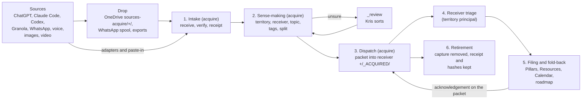

# [Knowledge Islands model](/Users/krisbrown/workspaces/knowledge-islands/ki-principal/Streams/Initiatives/knowledge-islands-model/knowledge-islands-model.md) › [Knowledge acquisition](/Users/krisbrown/workspaces/knowledge-islands/ki-principal/Streams/Projects/knowledge-acquisition.md) › acquisition-model

**Run report at 01:20 BST · last mark 15:59 BST (15 Oct)**

---

## Done

- Design only, under Kris's words of 18 October 00:00 BST in the [decisions log](/Users/krisbrown/workspaces/knowledge-islands/ki-principal/+/_THREADS/knowledge-acquisition/decisions.md). No canonical file was changed in any repository; only this report was written.
- Read: the [Acquisition Process](</Users/krisbrown/workspaces/knowledge-islands/ki-principal/Pillars/Philosophy/Model/Processes/Acquisition Process/Acquisition Process.md>), [ADR-KI-PRINCIPAL-001](/Users/krisbrown/workspaces/knowledge-islands/ki-principal/Admin/Governance/Decisions/ADR-KI-PRINCIPAL-001-provider-neutral-knowledge-acquisition.md), [KI-PRINCIPAL-MOD-009](/Users/krisbrown/workspaces/knowledge-islands/ki-principal/Streams/Roadmap/KI-PRINCIPAL-MOD-009-amend-adr-001-staging-wording.md), acquire's [AGENTS.md](/Users/krisbrown/workspaces/personal/acquire/AGENTS.md), [README.md](/Users/krisbrown/workspaces/personal/acquire/README.md), [CAPTURE-CHATGPT.md](/Users/krisbrown/workspaces/personal/acquire/CAPTURE-CHATGPT.md), [intake contract](/Users/krisbrown/workspaces/personal/acquire/intake/README.md), [KB-ACQUIRE-003](/Users/krisbrown/workspaces/personal/acquire/docs/roadmap/KB-ACQUIRE-003-investigate-binary-bridge.md), [KB-ACQUIRE-005](/Users/krisbrown/workspaces/personal/acquire/docs/roadmap/KB-ACQUIRE-005-seed-and-return-loop.md) and [KB-ACQUIRE-006](/Users/krisbrown/workspaces/personal/acquire/docs/roadmap/KB-ACQUIRE-006-image-video-holding-area.md), the [stock-take](/Users/krisbrown/workspaces/knowledge-islands/ki-principal/+/_THREADS/knowledge-acquisition/stock-take.report.md), the `ki-repo` working-area rules and the `ki-trades` skill.
- Found the existing dispatch: it is a standing area in Personal, the [acquire-dispatch checkpoint](/Users/krisbrown/workspaces/personal/personal-principal/+/_CHECKPOINTS/knowledge-acquisition.acquire-dispatch.md) and its [MS3 pilot assessment](</Users/krisbrown/workspaces/personal/personal-principal/+/Acquire dispatch - initial stocktake and Phase II MS3 pilot.md>). It works by pull, not push: Personal's master Decision 7 keeps acquire as a temporary spool and says "receivers select relevance and pull into their own homes"; dispatch nominates a topic, Kris carries a ready-to-copy prompt to the receiving thread, the receiver copies what it wants and returns a handling receipt. It has run once (the HNR Phase II MS3 pilot, 13 October, cleanup `none`).
- Found the other dispatch discussion: ways-of-working's [activity-levels report](/Users/krisbrown/workspaces/knowledge-islands/ki-principal/+/_THREADS/ways-of-working/activity-levels.report.md) proposes retiring the acquire-dispatch thread and making it an Activity, `Acquire dispatch`, with no standing thread, and the [work-model-shape report](/Users/krisbrown/workspaces/knowledge-islands/ki-principal/+/_THREADS/ways-of-working/work-model-shape.report.md) (WORK-REGULAR, open) makes such regular work territory-level and dispatched by state of play. Kris's own words there: acquire dispatch "in reality it's regular activity. It's not something I would think I should have keep thread alive for." The model below assumes that shape.
- The model follows. Commit: this report only, by explicit path in ki-principal, local, not pushed.

### The model in one paragraph

Everything Kris wants kept goes first to acquire, which receives it faithfully and gives it a receipt, deciding nothing. Acquire then reads what it has, works out roughly what it is and who should have it, and sends a small dispatch packet into the `+` inbound area of that territory's principal repository. The principal, which knows its own world far better, decides what matters, files it properly and writes back on the same packet where each part went. When every part of a capture is accounted for, acquire can retire its copy, keeping only the receipt and the fingerprints. Acquire never files knowledge and the receiver never re-acquires.



### Units of comprehension

| Unit | What it is | Boundary: may | Boundary: must not | Hands to | Owner |
| --- | --- | --- | --- | --- | --- |
| Source | Where material is born: a ChatGPT chat, a Granola meeting, a phone photo | - | Be changed by acquisition, except Granola's approved "Acquired" marking | Drop or Intake | The provider; Kris |
| Drop | A place bytes wait before receipt: `sources-acquire/+/<source>/`, the WhatsApp spool, an export ZIP | Hold anything, untouched | Count as acquired | Intake | Kris drops; Rig runs the WhatsApp refresh |
| 1. Intake | Receive, verify (size and SHA-256, read back from Git), write a receipt in `intake/` and a capture in `captures/<territory>/<source>/` | Capture the whole supplied scope; route an obvious territory; retire a drop wholly in Git and pushed | Screen for relevance, summarise away detail, write to any other repository | Sense-making | acquire's conversational `intake` role, adapters in tools-ki (`ki acquire import`), MCPs |
| 2. Sense-making | Read captures and decide who should have them | Decide territory, receiving principal, Project tag, topic and title; split a mixed capture into portions; flag duplicates and links; add acquire's own short reading, labelled as such; send unsure items to `_review` | Decide what is durable, where it files, whether it changes a decision, or drop anything as irrelevant | Dispatch | Acquire dispatch (regular activity, Personal Capital) |
| 3. Dispatch | Write one packet per receiver per topic into the receiver's `+/_ACQUIRED/` and record it in acquire | Write only inside `+/_ACQUIRED/`, commit that path alone | Touch the receiver's canonical zones, roadmap or other `+` content | Receiver triage | Acquire dispatch |
| 4. Receiver triage | Read the packet, decide each portion: file, turn into work, park, decline | Everything about meaning and value | Rewrite the capture or the packet's sent part | Filing | Receiving principal |
| 5. Filing and fold-back | Put kept knowledge in its home under the receiver's own rules; fold-back is filing into a named seed note (KB-ACQUIRE-005) | Use its own Enactment Process, `ki-next` for work | File by reaching into acquire | Acknowledgement back to Dispatch | Receiving principal |
| 6. Retirement | Remove a capture once every portion is accounted for; later, provider-side clean-up | Keep the receipt, ledger entry, hashes and last commit as a pointer | Delete anything not wholly accounted for, or a provider source, without Kris's word | - | Acquire dispatch proposes; Kris approves |
| Coordination | Design the process and run its records across acquire, tools-ki and the harness | Shape and sequence records | Do intake, dispatch or filing | All units, as records | This knowledge-acquisition thread |

### The dispatch packet

- **Where:** `+/_ACQUIRED/<YYYY-MM-DD>--<topic>--DSP-<id>/` in the territory's principal repository, never in a product repository. A Project is a note inside its principal, so "the relevant project" is a tag on the packet, not a separate address; the principal passes work on inside its territory.
- **What:** a `dispatch.md` whose front matter carries `id`, `sent_at`, the acquire commit, territory, receiver, Project tag and the list of capture IDs with their acquire paths and SHA-256; a body with acquire's reading ("what this seems to be about", confidence, what acquire did not decide); and a copy of the text Markdown so the receiver can read it in place. Binaries are not copied: they are named by path and hash in acquire or the OneDrive holding area.
- **Receipt:** acquire records the dispatch against each capture, next to the receipt (`dispatched`, packet ID, receiver), as Granola's ledger already records `disposition`.
- **Acknowledgement:** the receiver adds to its own copy, under an `## Acknowledgement` section, one line per portion: `filed <path> <commit>`, `work <record ID>`, `parked` or `declined <reason>`, then sets `state: acknowledged`. Acquire dispatch reads it on its next run (read-only), records `acknowledged` in acquire, and the receiver may then delete the packet; Git holds it.

### Sources: how each fits today

| Source | Intake today | Fits the model? | Gap |
| --- | --- | --- | --- |
| ChatGPT export | `ki acquire import --adapter chatgpt`, 334 packages staged | Yes, to step 2 | No dispatch or acknowledgement field |
| ChatGPT chat | Paste-in under CAPTURE-CHATGPT.md, binaries by ZIP | Yes, to step 1 | Binaries depend on the ZIP; bridge parked (BINARY-NEXT) |
| Claude Code | Read-only discover and read in `mcp-housekeeping-claude` | Not yet | Nothing reaches intake; no adapter in tools-ki |
| Codex | A few folders captured by hand | Partly | No adapter; provenance of those folders not recorded |
| Granola | `ki acquire import --adapter granola`, 304 staged | Yes, to step 2; the MS3 pilot ran a hand-carried step 3 | Retirement safeguard in [KI-TOOL-KI-CLI-128](/Users/krisbrown/workspaces/knowledge-islands/tools-ki/docs/roadmap/KI-TOOL-KI-CLI-128-granola-retention-safeguards.md) still draft |
| WhatsApp | `mcp-acquire-whatsapp` spool outside Git | Only as a Drop | No hand-off from spool to intake |
| Voice notes | The voicenotes-sync plugin writes straight into an island's `+/_Voice Notes/` | No: it skips acquire and lands at the receiver | No receipt; decide whether it stays direct (already "dispatched") or goes through intake |
| Images | KB-ACQUIRE-006 holding area, `sources-acquire/+/<source>/` | Yes, to step 1, once 006 is built | 006 still triage |
| Video | Holding area only, never Git | Yes, to step 1 | As images; packets point at it by hash |

### What already fits and what is missing

Already fits: intake's receive-before-route rule and receipts; territory keys and `_review`; the Granola ledger's `disposition`; KB-ACQUIRE-005's `folded` disposition, which is an acknowledgement for one case; the MS3 pilot's handling receipt, which is the acknowledgement in long form; and the retirement rule for a drop wholly in Git.

Missing:

1. A written packet shape and a landing folder in receivers; today dispatch is a prompt carried by Kris.
2. A push permission: Personal's Decision 7 says receivers pull, and acquire has no authority to write into another repository (DISPATCH-PUSH).
3. A carrier: `ki-trades` already has send, receipt, decision and release, but trades are on hold until 21 October and work only between repositories under the same Capital, while acquire (Capital: Personal) dispatches to every territory (DISPATCH-CARRIER).
4. An acknowledgement field in acquire for ChatGPT, intake and image captures.
5. A retirement rule for captures, so acquire (512 MB in Git) stops growing for ever (CAPTURE-RETIRE).
6. Claude Code, Codex and WhatsApp do not reach intake; voice notes bypass it.
7. Two homes named knowledge acquisition: this Project in KI Principal (the process) and Personal's Initiative holding acquire-dispatch (the running of it). The model keeps both: this thread designs, Personal runs dispatch as a regular activity once WORK-REGULAR settles.
8. The ADR's wording. Today it says staging happens in the receiver's `+`; [KI-PRINCIPAL-MOD-009](/Users/krisbrown/workspaces/knowledge-islands/ki-principal/Streams/Roadmap/KI-PRINCIPAL-MOD-009-amend-adr-001-staging-wording.md) was to correct that to acquire. With dispatch, the right wording is "staged in acquire, dispatched to the receiver's `+`", so MOD-009 should carry dispatch too.

### Records that would follow (proposed, not captured)

- acquire, next free number (ledger at 006): **Dispatch packet and acknowledgement** - packet shape, the `dispatched` and `acknowledged` fields, the dispatch run's steps.
- acquire, the number after: **Retire acknowledged captures** - the CAPTURE-RETIRE rule, per source, with provider-side retirement left to a later decision.
- ki-agentic-harness, next free GOV number: **`+/_ACQUIRED/` inbound area** - a scaffold README and receiver triage guidance in `ki-repo-kb`, so every principal recognises a packet.
- KI Principal: widen [KI-PRINCIPAL-MOD-009](/Users/krisbrown/workspaces/knowledge-islands/ki-principal/Streams/Roadmap/KI-PRINCIPAL-MOD-009-amend-adr-001-staging-wording.md) to cover dispatch in the ADR and the Acquisition Process note, rather than opening a second record.
- Personal: the `Acquire dispatch` Activity note replacing the checkpoint thread, already proposed by ways-of-working; no separate record from here.

## In Progress

Nothing is running.

Outstanding - no action requested now:

- WORK-REGULAR and ACTIVITY-LEVELS with ways-of-working decide how acquire dispatch runs without a thread; the model assumes their recommended answer.
- The `ki-trades` hold review on 21 October bears on DISPATCH-CARRIER.
- KB-ACQUIRE-006 (holding area) and KB-ACQUIRE-005 (seed-and-return) stay as they are; both fit the model unchanged.

## Queries

### DISPATCH-PUSH - Let acquire push packets into receivers' inbound areas

**Context:** Today receivers pull from acquire when Kris carries a prompt to them (Personal master Decision 7). Kris's 18 October idea is the reverse: acquire pushes into the receiver's `+`. Pushing needs a narrow write permission into every principal repository. The safest narrow form is one folder, `+/_ACQUIRED/`, holding a packet that points at acquire's bytes and copies only the text, committed by explicit path and pushed fast-forward only as acquire dispatch's own commit.

**Query:** Should acquire dispatch be allowed to write and commit packets into each principal's `+/_ACQUIRED/`, replacing the pull model?

**Options:**

a) (recommended, confidence high - it is Kris's own idea and the one-folder limit keeps receivers' authority whole) Yes: acquire dispatch may write, commit and push its own packet commits in `+/_ACQUIRED/` of each territory principal, and nowhere else; Personal's Decision 7 is amended to push, with receivers still deciding everything.

b) Keep the pull: acquire prepares the packet in its own `-` and Kris carries it, as in the MS3 pilot.

### DISPATCH-CARRIER - Build a light packet now or wait for trades

**Context:** `ki-trades` already models send, receipt, receiver decision and release, but it is on hold until 21 October and only works between repositories under one Capital. Acquire's Capital is Personal and it dispatches to every territory, so trades would need widening first. A light acquire-owned packet can start now and be shaped so it maps onto a knowledge trade later.

**Query:** Should dispatch use its own light packet now, or wait for the trades review?

**Options:**

a) (recommended, confidence medium - it unblocks dispatch now, but two similar mechanisms may later need merging) Use acquire's own light packet now, keeping its fields close to a `ki-trades` knowledge trade, and revisit at the 21 October trades review.

b) Wait for the trades review and ask the harness to extend trades across territories first.

### CAPTURE-RETIRE - When acquire may retire a capture

**Context:** Acquire keeps every capture for ever today, and its Git store is 512 MB. Under the model, the receiver's acknowledgement names a home or a decline for every portion. At that point acquire's copy adds nothing except provenance, which the receipt, ledger entry, hashes and last commit keep. Provider-side sources (ChatGPT chats, Granola meetings) are a separate, later decision.

**Query:** May acquire remove a capture's content once every portion is acknowledged and pushed in the receiver, keeping its receipt, hashes and last commit?

**Options:**

a) (recommended, confidence medium - it is a deletion and the acknowledgement shape is not yet proven) Yes, as a standing rule once the dispatch record is delivered and piloted on one territory; anything not wholly accounted for, video, and every provider-side source still need Kris's word.

b) Keep every capture in acquire until a per-source retirement decision is made later.

```text
DISPATCH-PUSH

Yes: acquire dispatch may write, commit and push its own packet commits in +/_ACQUIRED/ of each territory principal, and nowhere else; amend Personal's Decision 7 from pull to push, with receivers still deciding everything. Capture the proposed acquire record "Dispatch packet and acknowledgement" and the harness record for the +/_ACQUIRED/ inbound area, and widen KI-PRINCIPAL-MOD-009 to cover dispatch.

---

DISPATCH-CARRIER

Use acquire's own light dispatch packet now, keeping its fields close to a ki-trades knowledge trade, and revisit at the 21 October trades review.

---

CAPTURE-RETIRE

Yes: once the dispatch record is delivered and piloted on one territory, acquire may remove a capture's content when every portion is acknowledged and pushed in the receiver, keeping its receipt, ledger entry, hashes and last commit; anything not wholly accounted for, video and every provider-side source still need my word. Capture the proposed acquire record "Retire acknowledged captures".
```

```text
╭─ run report · 2026-10-18T00:20:00Z ──────────────╮
│                                                  │
│  █▀▀▄ █▀▀▀ █▀▀▀ ▀▀█▀   · thread at rest          │
│  █▀▀▄ █▀▀  ▀▀▀█   █    · nothing running         │
│  █  █ █▄▄▄ ▄▄▄█   █    · nothing queued          │
│                                                  │
╰──────────────────────────────────────────────────╯
```

- [at rest] nothing running or queued
- [waiting] DISPATCH-PUSH
- [waiting] DISPATCH-CARRIER
- [waiting] CAPTURE-RETIRE
- [unpushed] this report, committed locally

```text
Resume Knowledge Islands Model: knowledge-acquisition under current ki-pmo and ki-delegation since 2026-10-15T14:59:00Z: re-bootstrap, mark, fresh summary with carried-forward open points, take stock, restart authorised work, then banner.
```
