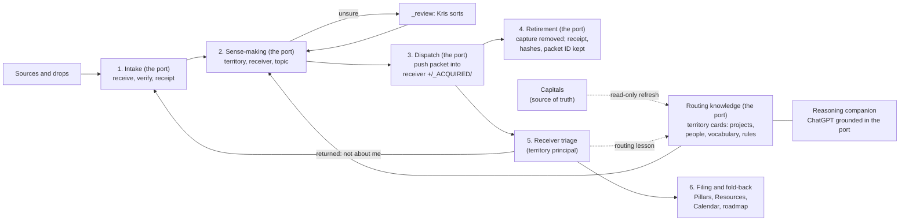

# [Knowledge Islands model](/Users/krisbrown/workspaces/knowledge-islands/ki-principal/Streams/Initiatives/knowledge-islands-model/knowledge-islands-model.md) › [Knowledge acquisition](/Users/krisbrown/workspaces/knowledge-islands/ki-principal/Streams/Projects/knowledge-acquisition.md) › dispatch-options

**Run report at 01:35 BST · last mark 15:59 BST (15 Oct)**

---

## Done

- Design only, under Kris's words of 18 October 01:20 BST in the [decisions log](/Users/krisbrown/workspaces/knowledge-islands/ki-principal/+/_THREADS/knowledge-acquisition/decisions.md), building on the [acquisition-model report](/Users/krisbrown/workspaces/knowledge-islands/ki-principal/+/_THREADS/knowledge-acquisition/acquisition-model.report.md). No canonical file changed anywhere; this report is the only file written.
- Read acquire's [AGENTS.md](/Users/krisbrown/workspaces/personal/acquire/AGENTS.md) and its [ChatGPT capture context](/Users/krisbrown/workspaces/personal/acquire/context/chatgpt/README.md): eight dated territory summaries already exist. They are the start of the routing knowledge, but they are written for ChatGPT only and are refreshed only after a receiver reconciles knowledge.
- Found one conflict with point 3: acquire's AGENTS.md calls it "a temporary capture inbox, not a durable knowledge base". With Kris's point 3 the port holds two kinds of content: captures, which pass through and are retired, and routing knowledge, which is durable. That wording needs amending (proposed record 2 below).
- Treated these as settled by Kris's 01:20 words, so they are not asked again: the six-step flow becomes durable knowledge in the Acquisition Process note; dispatch uses its own light packet until the trades talk (DISPATCH-CARRIER); and the port retires a capture on dispatch, not on the island's acceptance (this replaces CAPTURE-RETIRE).
- Compared six ways to dispatch, revised the flow and units table to add the return route and routing knowledge, and said what routing knowledge the port needs. All are below.
- Checks: none run. Design only.

### The six ways of dispatching

**A. The port pushes into each principal's `+/_ACQUIRED/`.**

- How it works: the port's dispatch run writes one packet per receiver per topic into that principal's `+/_ACQUIRED/` folder. It commits only that folder and pushes only its own commit. The island's own session finds the packet the next time it opens and triages it.
- Write access: the port can write into one folder in each principal repository, and nowhere else. Islands write nothing outside their own repository.
- What Kris does: nothing per packet. He answers the port's `_review` questions and approves anything the rules hold back.
- What can go wrong: the push collides with the island's own unpushed work, because two sessions share one checkout. The fix is a fresh read, commit only the packet path, and fast-forward only. The port is also one actor with write access to every territory, so a bug spreads widely. Keeping it to one folder and its own commits limits the damage.
- Retire on dispatch: fits best. The port knows dispatch is complete the moment its own push succeeds and it has read the packet back from the receiver, so it can retire the capture in the same run.
- Return route: fits. The island marks the packet `returned`, and the port's next run reads that and takes it back in (see RETURN-ROUTE).
- Routing knowledge: the port already reads each principal to write into it, so refreshing its routing cards in the same run costs little.

**B. Islands pull from an outbox in the port.**

- How it works: the port writes packets into `-/outbox/<territory>/` in its own repository. Each island's session looks there when it opens, copies in what is addressed to it, and marks it collected.
- Write access: islands can read the port. To mark a packet collected, they must also write into the port, so every island gets write access to the port, the opposite of A.
- What Kris does: nothing, as long as island sessions open regularly. A territory whose island rarely opens leaves its packets sitting in the outbox.
- What can go wrong: eight islands writing to one repository collide with each other. A packet nobody collects stays in the port indefinitely, which is the "second copy of everything" Kris wants to avoid.
- Retire on dispatch: poor fit. Dispatch is not complete until the island collects, so the port either keeps the copy until then or deletes it from the outbox before anyone has it.
- Return route and routing knowledge: returns are easy, because the island writes back into the outbox. Routing knowledge gains nothing.

**C. Kris carries packets.**

- How it works: the port prepares a packet and a paste line. Kris pastes it into the island's session, which pulls the packet in. This is the MS3 pilot, as it runs today under Personal's Decision 7.
- Write access: none across repositories. Each repository writes only to itself.
- What Kris does: one paste per receiver per run, plus confirming it arrived.
- What can go wrong: it depends on Kris's time and memory. Packets go stale, a missed paste goes unseen, and with eight territories it does not scale.
- Retire on dispatch: weak fit. The port can only retire once Kris confirms the paste.
- Return route: works, but it is a second paste.
- Routing knowledge: gains nothing.

**D. A queue or ledger read by each island's own session.**

- How it works: the port keeps a dispatch ledger, a list of packet, receiver, state and hash. Each island's session reads its lines when it opens, fetches its packets, and writes `received` or `returned` back on the ledger.
- Write access: islands can read the port's packets. They also write their state into the ledger, either in the port or in a shared local state file outside Git.
- What Kris does: nothing per packet.
- What can go wrong: this is B with better bookkeeping. Islands still need write access to the ledger. A ledger kept outside Git is not "safe in Git on a remote", and it exists on one machine only.
- Retire on dispatch: possible once the ledger shows `received`, but that is acceptance-shaped, which Kris has just ruled out.
- Return route and routing knowledge: returns are clean, because the ledger state is the return. Routing knowledge gains nothing.
- Worth keeping in any option: the port's own ledger of `dispatched` entries. Option A needs it anyway, and it is what the Observatory would display.

**E. Through the Observatory.**

- How it works: the Observatory shows, for each territory, what is waiting, dispatched, returned or stale, and lets Kris press send or approve. It is a view and a set of controls, not a transport. Underneath, one of A to D still moves the packets.
- Write access: whatever the underlying transport needs. The Observatory itself should only read and trigger.
- What Kris does: looks and decides in one place instead of in several threads. This is what Kris asked for on 17 October.
- What can go wrong: the Observatory is not running yet (state-of-play is prioritising it). Waiting for it would hold dispatch up.
- Fit: good with all three points, as long as the transport underneath fits them. It also suits the reasoning-companion role, as a window onto the port.

**F. Through ki-trades, later.**

- How it works: each dispatch becomes a knowledge trade with send, receipt, receiver decision and release, the machinery ki-trades already defines.
- Write access: as ki-trades sets it. Today that covers only repositories under one Capital. The port sits in Personal and dispatches to every territory, so ki-trades would need widening.
- What Kris does: decides on the widening at the 21 October trades review.
- What can go wrong: it is on hold until 21 October, and its release step is acceptance-shaped, which conflicts with retire on dispatch unless release is redefined as "sent".
- Fit: a good long-term envelope. Option A's packet can keep its fields close to a knowledge trade so it can be wrapped as a trade later.

| Approach | Cross-repository write | Kris per packet | Retire on dispatch | Return route | Ready now |
| --- | --- | --- | --- | --- | --- |
| A. Push into `+/_ACQUIRED/` | The port writes one folder in each principal | Nothing | Best: retires at its own push | The port reads the mark and takes it back | Yes |
| B. Outbox pull | Islands write into the port | Nothing | Poor | Easy | Yes |
| C. Kris carries | None | A paste each | Weak | A second paste | Yes, today |
| D. Ledger | Islands write the ledger | Nothing | Acceptance-shaped | Clean | Yes |
| E. Observatory | As its transport | Looks and decides | As its transport | As its transport | No |
| F. ki-trades | As trades, widened | Decides on widening | Needs release redefined | As trades | No, after 21 October |

### Retire on dispatch: what it changes

- **Taken whole:** a packet must carry everything the port will delete. Text goes in full. Images already in Git (up to about 2 MB under [KB-ACQUIRE-006](/Users/krisbrown/workspaces/personal/acquire/docs/roadmap/KB-ACQUIRE-006-image-video-holding-area.md)) are copied into the packet. Video and large files stay in the OneDrive holding area, the packet points to them by path and hash, and their ownership passes to the receiver. The holding-area copy is not deleted at dispatch.
- **What the port keeps:** the receipt, the hashes, the packet ID, the receiver and the commit that removed the capture. Git history in the port still holds the content, so a lost packet can be recovered. The working tree stays small, but the repository's size does not shrink unless history is rewritten, which would be a separate decision for Kris.
- **The trigger:** "dispatched" means the packet is committed and pushed in the receiver and the port has read it back. The island's triage is not part of the trigger.

### Routing knowledge: what the port needs

- **What:** for each territory: its key, its Capital and that Capital's repository; its live Initiatives and Projects, with short descriptions and aliases; its people and organisations; and its vocabulary (product names, code names, and speech-to-text garbles such as "big" for Rig). Plus the standing routing rules: Granola folder IDs in `.ki.toml`, Kris's routing decisions (The Tower Game to Personal, Spirituality to Sacred Inquiry) and lessons learned from returns.
- **Where it comes from:** each Capital stays the source of truth through its Charter, Known Lands, Projects and Initiatives indexes, people notes and Routing Rules. The port only reads them. Kris's decisions and the returns add to it.
- **How it stays current:** each dispatch run refreshes the affected territory card from its Capital, read-only, and stamps a reviewed date. A card past its date is flagged at the mark. Every "not about me" return becomes a dated routing lesson on the card.
- **Where it lives:** one card per territory under `context/<territory>/`, widened from today's ChatGPT-only `context/chatgpt/<territory>/`. The same cards ground the ChatGPT instance Kris reasons with across all territories, which is why the port sits in Personal.

### Revised flow

Six steps, with two loops added: the return route, and routing knowledge feeding sense-making. Retirement moves up to step 4, straight after dispatch.



| Unit | What it is | Boundary: may | Boundary: must not | Hands to | Owner |
| --- | --- | --- | --- | --- | --- |
| Source | Where material is born | - | Be changed by acquisition, except Granola's approved "Acquired" marking | Drop or Intake | provider; Kris |
| Drop | Where files wait before receipt: `sources-acquire/+/<source>/`, the WhatsApp spool, export ZIPs | Hold anything untouched | Count as acquired | Intake | Kris; Rig for WhatsApp |
| 1. Intake | Receive, verify, write the receipt and the capture | Take in the whole supplied scope, including returns (source `return`) | Screen for relevance or write to another repository | Sense-making | the port's `intake` role, tools-ki adapters |
| 2. Sense-making | Decide who should have each capture, using routing knowledge | Choose territory, receiver, Project tag and topic; split mixed material; send unsure items to `_review` | Decide what is durable or drop anything as irrelevant | Dispatch | the port's dispatch run |
| 3. Dispatch | Push one whole packet per receiver per topic | Write, commit and push in the receiver's `+/_ACQUIRED/` only; record `dispatched` | Touch any other path in the receiver | Retirement; Receiver triage | the port's dispatch run |
| 4. Retirement | Remove a capture once its packet is pushed and read back | Keep the receipt, hashes, packet ID and removing commit | Delete the provider source, holding-area video or anything not in a pushed packet without Kris's word | - | the port's dispatch run |
| 5. Receiver triage | Decide each portion: file, turn into work, park or return | Everything about meaning and value; mark a packet `returned <reason>` | Write into the port | Filing, or Return | receiving principal |
| 6. Filing and fold-back | File under the receiver's own rules | Use its own Enactment Process and `ki-next` | Reach into the port | - | receiving principal |
| Return | Take back what a receiver says is not about it | The port reads `returned` packets, takes them in as new acquisitions and removes the packet folder it wrote | Treat a return as a failure, or lose the reason | Intake; Routing knowledge | the port's dispatch run |
| Routing knowledge | Territory cards: projects, people, vocabulary, rules, return lessons | Read Capitals read-only; date and refresh its cards | Become the source of truth for a territory | Sense-making; Reasoning companion | the port (Personal) |
| Reasoning companion | ChatGPT, or another assistant, grounded in the port across all territories | Read the cards and the captures in flight | File knowledge or dispatch by itself | Intake, when a conversation is captured | Kris |
| Coordination | Design the process and run its records | Shape and sequence the records | Do intake, dispatch or filing | All units, as records | this knowledge-acquisition thread |

### Records that would follow (proposed, not captured)

1. **acquire, next free number:** "Dispatch packet, push and return". Covers the whole-packet shape, the push into `+/_ACQUIRED/`, the `dispatched` ledger entry, retire on dispatch with its read-back check, and taking back `returned` packets as source `return`. Fields are kept close to a ki-trades knowledge trade.
2. **acquire, the number after:** "Routing knowledge cards". Widens `context/chatgpt/` to `context/<territory>/` with projects, people, vocabulary, rules and return lessons; adds read-only refresh from Capitals with reviewed dates; and amends AGENTS.md so the port is a capture port plus durable routing knowledge, not only a temporary inbox.
3. **ki-agentic-harness, next free GOV number:** "`+/_ACQUIRED/` inbound area". Adds the scaffold README and receiver triage guidance in `ki-repo-kb`, including how to mark a packet `returned <reason>`.
4. **KI Principal:** widen [KI-PRINCIPAL-MOD-009](/Users/krisbrown/workspaces/knowledge-islands/ki-principal/Streams/Roadmap/KI-PRINCIPAL-MOD-009-amend-adr-001-staging-wording.md) to say "staged in the port, dispatched to the receiver's `+`". Add one Enactment record to bring the six-step flow, the return route and routing knowledge into the [Acquisition Process](</Users/krisbrown/workspaces/knowledge-islands/ki-principal/Pillars/Philosophy/Model/Processes/Acquisition Process/Acquisition Process.md>) note, using "the port" as PORT-NAME set.
5. **Personal:** a decision rather than a record. Amend Personal's Decision 7 from pull to push for the `+/_ACQUIRED/` folder only.

## In Progress

Nothing is running.

Outstanding - no action requested now:

- Seed-and-return ([KB-ACQUIRE-005](/Users/krisbrown/workspaces/personal/acquire/docs/roadmap/KB-ACQUIRE-005-seed-and-return-loop.md)) and the holding area ([KB-ACQUIRE-006](/Users/krisbrown/workspaces/personal/acquire/docs/roadmap/KB-ACQUIRE-006-image-video-holding-area.md)) stay as they are. Record 1 would reuse KB-ACQUIRE-005's `folded` disposition as one kind of receiver outcome.
- The Observatory (option E) and ki-trades (option F) are later layers over option A. Neither blocks this.

## Queries

### DISPATCH-PUSH - How packets leave the port

**Context:** Of the six ways, only A, the port pushing into each principal's `+/_ACQUIRED/`, lets the port retire a capture the moment it dispatches it, which is what Kris asked for. It also keeps islands from writing into the port and needs nothing from Kris per packet. B and D give every island write access to the port, and leave copies waiting until islands collect them. C is the MS3 pilot and does not scale to eight territories. E (Observatory) and F (ki-trades) are not ready, and both can sit on top of A later.

**Query:** Should the port dispatch by pushing whole packets into each principal's `+/_ACQUIRED/`?

**Options:**

a) (recommended, confidence high - it is the only option that fits retire on dispatch and keeps a single writer across repositories) Yes: the port may write, commit and push its own packet commits in `+/_ACQUIRED/` of each territory principal and nowhere else. Personal's Decision 7 is amended from pull to push, the Observatory becomes its view later, and ki-trades its envelope after 21 October.

b) Islands pull from an outbox in the port (B), with a ledger (D), and each island gets write access to the port.

c) Keep Kris carrying packets (C) until the Observatory runs.

### RETURN-ROUTE - How an island hands back "not about me"

**Context:** Under A the port is the only actor writing across repositories. A return can keep it that way: the island marks the packet `returned <reason>` in its own `+/_ACQUIRED/`, and the port's next run reads the packet, takes it in as a new acquisition with source `return` and the reason attached, removes the packet folder it wrote, and adds the reason to that territory's routing card. The other way is for the island to write the return into the port's own `+/`, which gives every island write access to the port.

**Query:** Should a return be a mark the port reads and takes back, rather than something the island writes into the port?

**Options:**

a) (recommended, confidence medium - it keeps one writer, but the port will be removing a folder in another repository, which needs a careful read-back check) Yes: the island marks `returned <reason>`; the port takes it back as source `return`, removes its own packet folder and records a routing lesson.

b) The island writes the returned packet into the port's `+/_RETURNED/`, and the port takes it in from there.

### ROUTING-SOURCE - Where the port's routing knowledge comes from

**Context:** The port needs a card for each territory: its Capital, its projects, people, vocabulary and rules, and lessons from returns. Today only ChatGPT-shaped summaries exist under `context/chatgpt/`, refreshed after a receiver reconciles knowledge. The Capitals hold the truth. Either the port reads them read-only at each dispatch run and keeps dated cards, or each Capital writes its own card into the port.

**Query:** Should the port build and refresh its own routing cards by reading each Capital read-only?

**Options:**

a) (recommended, confidence medium - it needs no new write access and fits the reasoning-companion role, though cards can lag a Capital by up to one run) Yes: cards live at `context/<territory>/` with reviewed dates. Each dispatch run refreshes the affected card from its Capital, returns add lessons, and stale cards are flagged at the mark. Capture proposed records 1 and 2 in acquire, record 3 in the harness, widen KI-PRINCIPAL-MOD-009 and add the Acquisition Process Enactment record.

b) Each Capital owns a routing card and pushes it into the port when it changes.

```text
DISPATCH-PUSH

Yes: the port may write, commit and push its own packet commits in +/_ACQUIRED/ of each territory principal and nowhere else; amend Personal's Decision 7 from pull to push; the Observatory becomes its view later and ki-trades its envelope after 21 October.

---

RETURN-ROUTE

Yes: an island marks a packet "returned <reason>" in its own +/_ACQUIRED/; the port's next run takes it back as a new acquisition with source "return", removes the packet folder it wrote after reading it back, and adds the reason to that territory's routing card.

---

ROUTING-SOURCE

Yes: the port keeps one routing card per territory at context/<territory>/ (projects, people, vocabulary, rules, return lessons) with reviewed dates, refreshed read-only from each Capital at each dispatch run and flagged at the mark when stale; capture "Dispatch packet, push and return" and "Routing knowledge cards" in acquire, the "+/_ACQUIRED/ inbound area" record in ki-agentic-harness, widen KI-PRINCIPAL-MOD-009 to cover dispatch, and add an Enactment record to bring the six-step flow, return route and routing knowledge into the Acquisition Process note.
```

```text
╭─ run report · 2026-10-18T00:35:00Z ──────────────╮
│                                                  │
│  █▀▀▄ █▀▀▀ █▀▀▀ ▀▀█▀   · thread at rest          │
│  █▀▀▄ █▀▀  ▀▀▀█   █    · nothing running         │
│  █  █ █▄▄▄ ▄▄▄█   █    · nothing queued          │
│                                                  │
╰──────────────────────────────────────────────────╯
```

- [at rest] nothing running or queued
- [waiting] DISPATCH-PUSH
- [waiting] RETURN-ROUTE
- [waiting] ROUTING-SOURCE
- [unpushed] this report, committed locally

```text
Resume Knowledge Islands Model: knowledge-acquisition under current ki-pmo and ki-delegation since 2026-10-15T14:59:00Z: re-bootstrap, mark, fresh summary with carried-forward open points, take stock, restart authorised work, then banner.
```
