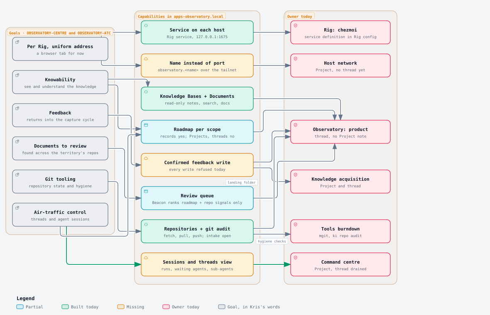

# [Knowledge Islands](/Users/krisbrown/workspaces/knowledge-islands/ki-principal/Admin/Governance/Charter.md) › State of play › observatory-goals

**Run report at 22:41 BST · last mark 16:14 BST**

---

## Done

Read-only framing of the Observatory as an operations centre, from Kris's OBSERVATORY-CENTRE words of 17 October 22:35 BST, with OBSERVATORY-ATC (13:35 BST) and KB-READER (from GO-AHEAD, 14:22 BST), all in the [state-of-play decisions log](/Users/krisbrown/workspaces/knowledge-islands/ki-principal/+/_THREADS/state-of-play/decisions.md). Nothing was written outside this report and its diagram folder.

### 1 · Goals and non-goals

Each line quotes the source.

1. **An operations centre for one or more territories.** "this is becoming this operational centre for one or more territories ... I need to get that up and running pretty quickly."
2. **Deployed per Rig, at a uniform address, a browser tab for now.** "something which is deployed on a given rig. It's got a uniform address that it's available at ... for now ... I'm happy for it to be a tab in a browser"; a richer app only "in the future if we need to be able to access things on a machine that we can't do through that".
3. **Knowability.** "lots of knowledge capture, but knowability ... I need a way to actually see and understand that knowledge." KB-READER adds the reader stance: "look at and understand all these in a reader-only fashion", with a private side the website does not publish.
4. **Feedback that returns into the capture cycle.** "be able to feedback directly in it, which can go back into a capture cycle ... I want to acquire feedback or more knowledge in that area that I want to speak about."
5. **Documents to review, found across the territory's repositories.** "anytime there's some document to review ... It'd be nice if that document to review was able to be found ... It might not even be in the knowledge base, it might be in the specific repo which is associated to that territory."
6. **Git tooling.** "I've also mentioned about some of the git tooling."
7. **Air-traffic control over threads and agent sessions.** OBSERVATORY-ATC: "see which threads are running, which sessions, agentic sessions, are associated to those ... so I can see when agents are waiting, whether they've got sub-agents that they've subbed out to ... a little bit like air traffic control."

Non-goals, in the same words: "It's not meant to be an agentic editor; it's meant to be something which doesn't need anything to do with agents really, it's interacting with the knowledge that it can find", and "I don't want to see the updates from those sessions. I want those to still stay ... in ... my main Agentic environment". So: no prompt box, no launching, stopping or steering of sessions, and no session transcripts; Zed keeps those. The Observatory's own [PDR-KI-OBSERVA-001](/Users/krisbrown/workspaces/knowledge-islands/apps-observatory.local/docs/decisions/PDR-KI-OBSERVA-001-observatory-beacon-and-bridge.md) already draws this line: Instruments observe, the Beacon ranks attention, and only a confirmed Bridge operation with a receipt may act.

### 2 · Where it stands

The app in `apps-observatory.local` is further on than the Projects suggest: twelve Instruments, a Beacon, governed Git operations, read-only Knowledge Base and Documents reading, and a Rig-managed login service. Its roadmap holds one triage record, [KI-OBSERVA-VIS-021](/Users/krisbrown/workspaces/knowledge-islands/apps-observatory.local/docs/roadmap/KI-OBSERVA-VIS-021-explain-tool-storage.md), plus the 16 October Personal repository-manager intake under its `+/` folder.

| Goal | State | What exists today | Owner today |
| --- | --- | --- | --- |
| Per Rig, uniform address | Partial | The service runs on each host under launchd from Rig's `[service.observatory]` definition (verified running on sol, port 1675, tab icon on `origin/main`). No name: still `127.0.0.1:1675`. | Rig: chezmoi for the service; [Host network](/Users/krisbrown/workspaces/knowledge-islands/ki-principal/Streams/Projects/host-network.md) for LOCAL-DNS, no thread yet |
| Knowability | Built, partial for the model | Knowledge Bases Instrument (tracked notes by zone, search, sources store) and Documents Instrument (README, guides, specs, decisions, diagrams per project), read-only, with the private side local by design. The Roadmap Instrument shows work records per scope, but nothing shows Initiatives, Projects or threads. | Observatory: product, [knowledge-islands-model.observatory.md](/Users/krisbrown/workspaces/knowledge-islands/ki-principal/+/_CHECKPOINTS/knowledge-islands-model.observatory.md), resting with no Project note |
| Feedback into the capture cycle | Missing | Every write is refused today (artifacts spec, Gaps: "every write is refused"); the Bridge contract for a confirmed write with a receipt exists in `docs/specs/authority.md` but no write operation lands knowledge anywhere. The capture cycle's Stage lands in the acquire repository, with a direct-intake route already used nine times. | Observatory: product for the operation; [Knowledge acquisition](/Users/krisbrown/workspaces/knowledge-islands/ki-principal/Streams/Projects/knowledge-acquisition.md) for the landing folder, which asked on 17 October (OBSERVATORY-FIRST) that acquisition "be managed through" the Observatory |
| Documents to review across the territory | Partial | The Beacon ranks signals from Repositories, Roadmap, Decisions, Rig, MCP and Automation, so stale or waiting records surface. It does not know thread reports with open queries, acquire captures awaiting Harvest, or intake folders in other repositories. | Observatory: product; the "unread agent reports" idea sits in [Command centre](/Users/krisbrown/workspaces/knowledge-islands/ki-principal/Streams/Projects/command-centre.md) Notes |
| Git tooling | Built, increment open | Repositories Instrument with governed fetch, pull and push and a git-audit evidence source. The 16 October intake asks for the smallest useful increment of Personal's Git audit; tools burndown's REPO-GIT-HYGIENE adds the hygiene checks to `ki repo audit` and mgit that the Observatory would then show. | Observatory: product for the view; [Tools burndown](/Users/krisbrown/workspaces/knowledge-islands/ki-principal/Streams/Projects/tools-burndown.md) for the checks |
| Air-traffic control | Missing | Nothing reads checkpoints, `ki agent` runs or session state. `ki agent status` has no machine form, but the launcher writes one status file per agent under `~/.local/state/ki/agents/<run>/`, which the backend can read directly. | Command centre, [knowledge-islands-model.command-centre.md](/Users/krisbrown/workspaces/knowledge-islands/ki-principal/+/_CHECKPOINTS/knowledge-islands-model.command-centre.md), drained and waiting on ways of working; its Outcome is "a read-only Sessions view as the pane of glass" |

**Overlap.** Two threads own one outcome. Observatory: product owns the app but has no Project note and is set to burn its roadmap down and rest. Command centre's Outcome of 14 October is "the Observatory on each host" with the Sessions view, but its thread is drained until ways of working lands and it has no records. The [consolidate report](/Users/krisbrown/workspaces/knowledge-islands/ki-principal/+/_THREADS/state-of-play/consolidate.report.md) already named the collision. Recommendation: one Observatory Project under the Knowledge Islands model, owning the app and everything shown in it, with one thread; Command centre's cross-territory vocabulary already went to ways of working on 13 October, so nothing of substance is lost by folding it in. That is OBS-OWNER below.

### 3 · First slice

Four units, smallest first, each an ordinary record in the owning repository. The first three touch only `apps-observatory.local` and chain, one writer; the fourth runs in parallel elsewhere.

1. **Sessions and threads Instrument** (apps-observatory.local). For the selected territory: Initiatives and Projects from `Streams/`, threads from `+/_CHECKPOINTS/` (label, state, mark, what is running), and `ki agent` runs from the state folder (each agent's last status line, age, pid alive or finished), each linked to its Project. Beacon signal when an agent's status is stale or says it is waiting. Read-only, this machine, no transcripts. This is the air-traffic-control view and the missing half of knowability.
2. **Review queue** (apps-observatory.local, after unit 1). One Beacon source listing what awaits a human across every repository in scope: roadmap records at awaiting-review, thread reports whose Queries section is not empty, acquire captures at Stage, and `+/` intake folders. Each row opens in the Documents or Knowledge Bases Instrument.
3. **Capture feedback** (apps-observatory.local, after unit 2; knowledge acquisition decides the landing folder in parallel). The first confirmed Bridge write: from any note or document, a short Markdown note with provenance (repository, path, revision, time) written into the territory's capture landing so it enters Stage and Harvest like any other capture. Receipt retained, every other write still refused.
4. **A name instead of a port** (Host network; tools-rig and chezmoi). `observatory.<name>` on each host over the tailnet, connection-critical with a tested restore path, as LOCAL-DNS already asks. Independent of units 1 to 3 and gated by HOST-NETWORK-THREAD, fifth in the restart order.

Git tooling needs no new unit to be useful: the Repositories Instrument exists, and the 16 October intake and REPO-GIT-HYGIENE feed it when they land. Each Observatory delivery needs the service restarted on the host in an interactive session, as its AGENTS.md requires.

### 4 · Diagram



Source: [goals-map.architecture.json](/Users/krisbrown/workspaces/knowledge-islands/ki-principal/+/_THREADS/state-of-play/observatory-goals/goals-map.architecture.json). Exported as a static light SVG by the same flatten step the diagram-fix run used, checked through the strict non-CSS renderer.

Commit: this report and the `observatory-goals/` diagram folder landed in `05d9552` on local `main`, by explicit path, gate passed for the staged paths. Two faults to own. First, the index already held the ways-of-working session's staged `+/_THREADS/ways-of-working/note1a-quiet.report.md`, so `05d9552` carried that file as well; that session then committed `6874818` and `d59d1da` on top, so I could not amend my commit without rewriting theirs, and I left it. Nothing is lost, but that file's first commit is wrongly mine. Second, not pushed: `05d9552` sits on five unpushed commits by other sessions (`fecd757`, `424d95a`, `7d3adc5`, `0060254`, `0658112`) and under the two above, so a fast-forward push would carry theirs; a worktree cherry-pick onto `origin/main` would leave local `main` to a conflicting rebase. The push is yours. The report correction itself is a second small commit, named in the status file.

## In Progress

Nothing is running.

Outstanding - no action requested now:

- Rendering through `ki-diagrams` still produces the dual-theme SVG that previews black; DIAGRAMS-RENDER with ways of working covers it.
- The knowledge-acquisition stock-take's Part 1 overview is the acquisition requirement the Observatory should read once unit 3 is planned.

## Queries

### OBS-OWNER - One Project for the Observatory

**Context:** Observatory: product (thread, no Project note, resting on a burn-down remit) and Command centre (Project whose Outcome is "the Observatory on each host" with a Sessions view, thread drained) both own the operations centre. Command centre's vocabulary work already moved to ways of working on 13 October. Two threads with one outcome will collide the moment the Sessions view starts.

**Query:** Which single Project owns the Observatory as the operations centre?

**Options:** a) (recommended) Fold Command centre into one Observatory Project under the Knowledge Islands model: rename the [Command centre note](/Users/krisbrown/workspaces/knowledge-islands/ki-principal/Streams/Projects/command-centre.md) to Observatory with the Outcome "the operations centre for one or more territories" and the seven goals above, make Observatory: product its one thread, close the command-centre checkpoint into it, and keep cross-territory vocabulary with ways of working. b) Keep both: Command centre owns the views and Observatory: product owns the app, with every Sessions-view record raised as a handoff between them.

### OBS-SLICE - Agree the first slice

**Context:** The app already reads knowledge bases, documents, roadmaps and repositories. What is missing for an operations centre is the view of threads and agents, a review queue across repositories, a single feedback write and a name instead of a port. Units 1 to 3 are one chained lane in `apps-observatory.local`; unit 4 is a parallel Host network lane.

**Query:** Is the four-unit first slice, in that order, the slice to build?

**Options:** a) (recommended) Build the four units in that order: Sessions and threads Instrument, Review queue, Capture feedback, then the tailnet name, with the first three as chained records in `apps-observatory.local` and the fourth with Host network when its thread opens. b) Build only the Sessions and threads Instrument first and decide the rest after seeing it.

### OBS-NOW - Start ahead of the restart order

**Context:** The restart order puts Command centre seventh and Observatory: product eighth, after ways of working reports ready. Kris said on 17 October the centre must be "up and running pretty quickly", and the knowledge-acquisition thread asked the same day (OBSERVATORY-FIRST) to prioritise getting it running.

**Query:** May the Observatory thread restart now, ahead of the ways-of-working gate?

**Options:** a) (recommended) Restart the Observatory thread now under the single Project, with unit 1 as its first record, and apply ways of working's standards when they land. b) Keep its place in the restart order.

```text
OBS-OWNER

Fold Command centre into one Observatory Project under the Knowledge Islands model: rename the Command centre note (/Users/krisbrown/workspaces/knowledge-islands/ki-principal/Streams/Projects/command-centre.md) to Observatory with the Outcome "the operations centre for one or more territories" and the seven goals from the observatory-goals report, make Observatory: product its one thread, close the command-centre checkpoint into it, and keep cross-territory vocabulary with ways of working.

---

OBS-SLICE

Build the four units in that order: Sessions and threads Instrument, Review queue, Capture feedback, then the tailnet name, with the first three as chained records in apps-observatory.local and the fourth with Host network when its thread opens.

---

OBS-NOW

Restart the Observatory thread now under the single Project, with unit 1 as its first record, and apply ways of working's standards when they land.
```

```text
╭─ run report · 2026-10-17T21:41:03Z ──────────────╮
│                                                  │
│  █▀▀▄ █▀▀▀ █▀▀▀ ▀▀█▀   · thread at rest          │
│  █▀▀▄ █▀▀  ▀▀▀█   █    · nothing running         │
│  █  █ █▄▄▄ ▄▄▄█   █    · nothing queued          │
│                                                  │
╰──────────────────────────────────────────────────╯
```

- [at rest] nothing running or queued
- [waiting] OBS-OWNER
- [waiting] OBS-SLICE
- [waiting] OBS-NOW
- [unpushed] report and diagram committed on local main beneath other sessions' commits; the push is Kris's

```text
Resume Master: state-of-play under current ki-pmo and ki-delegation since 16:14 BST: re-bootstrap, mark, fresh summary with carried-forward open points, take stock, restart authorised work, then banner.
```
