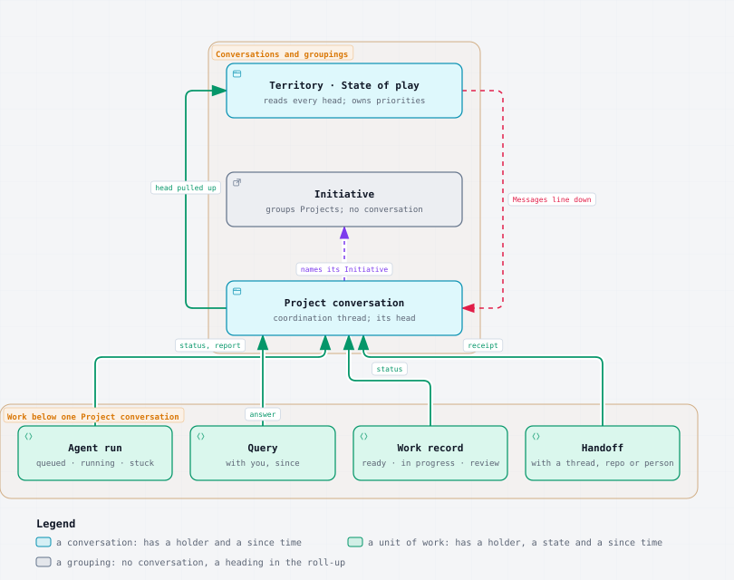
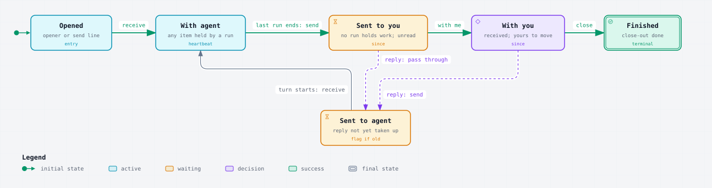

# [Knowledge Islands model](/Users/krisbrown/workspaces/knowledge-islands/ki-principal/Streams/Initiatives/knowledge-islands-model/knowledge-islands-model.md) › [Ways of working](/Users/krisbrown/workspaces/knowledge-islands/ki-principal/Streams/Projects/ways-of-working/ways-of-working.md) › work-cascade

**Run report at 23:31 BST · last mark 22:34 BST**

---

## Done

- Read the ideation entries of 17 October in the [decisions log](/Users/krisbrown/workspaces/knowledge-islands/ki-principal/+/_THREADS/ways-of-working/decisions.md): THREAD-STATES to WORK-CASCADE, plus the three added to this brief, LOGBOOK, CONVERSATION-LEVELS and LEVEL-NAMES. Also read the [thread-states report](/Users/krisbrown/workspaces/knowledge-islands/ki-principal/+/_THREADS/ways-of-working/thread-states.report.md) as `thread-states-rev` left it, and ki-pmo, ki-delegation, ki-work and the roadmap model.
- Read Paperclip's model of work from the local [Paperclip coordination standard](/Users/krisbrown/workspaces/knowledge-islands/ki-agentic-harness/skills/agentic-systems/ki-agent-coordination-paperclip/references/standards-agent-coordination-paperclip.md) and [Paperclip Operating Lessons](</Users/krisbrown/workspaces/knowledge-islands/ki-principal/Pillars/Engineering Practice/Operating Model/Paperclip Operating Lessons.md>), then its public skill and documentation. Read Linear's Initiatives and sub-issues briefly. Section 1 gives the sources.
- Drew two Archify diagrams through the `ki-diagrams` exporter, flattened to static light SVG as `diagram-fix` did, and checked each by eye through `rsvg-convert`. Both read cleanly. Each has a text fallback underneath. Sources and SVGs sit beside this report.
- This is counsel for discussion. No standard, skill, hook, style, record or checkpoint was changed. Only this report, its two SVGs and their two Archify sources are committed.

### 1. What Paperclip and the others do

**Paperclip** ([skill](https://github.com/paperclipai/paperclip/blob/master/skills/paperclip/SKILL.md), [goals](https://docs.paperclip.ing/guides/projects-workflow/goals/), [projects](https://docs.paperclip.ing/guides/projects-workflow/projects/), [dashboard](https://docs.paperclip.ing/guides/day-to-day/dashboard/), [blocked inbox](https://docs.paperclip.ing/guides/day-to-day/blocked-inbox/)):

- **Hierarchy.** "Goal → Project → Issue → Execution workspace → Agent run". Goals nest through sub-goals, with "two or three levels usually enough", and carry a level label such as `company` or `team`. An issue belongs to a project, and sub-issues hang from a `parentId`.
- **Statuses.** `backlog`, `todo`, `in_progress`, `in_review`, `blocked`, `done` and `cancelled`.
  - `in_progress` is "execution-backed": it is valid only while a run, a queued continuation or a monitor is live.
  - `in_review` is "a healthy waiting path": the work is waiting on a named reviewer, the board or a person, and must have a real review path.
  - `blocked` "cannot proceed until something specific changes". It needs recorded blockers (`blockedByIssueIds`), a pending approval or an `unblockDescriptor` naming who must act.
- **Assignees.** An issue is assigned to an agent or a user. Handing work back to a person means assigning it to them, usually as `in_review`.
- **Heartbeats.** An agent wakes in short windows, checks its inbox, works and exits. Agents show as Active, Running, Error ("the last heartbeat failed") or Paused.
- **Roll-up: none for status.** "Paperclip does not auto-compute a parent goal's status from its children." A project has no percentage either, because "progress is the shape of the Tasks tab". When all of an issue's children end, its assignee is woken with `issue_children_completed`, and when its blockers end it is woken with `issue_blockers_resolved`. Neither changes the parent's status.
- **What does roll up is attention.** The Blocked inbox gathers stalled issues with a reason chip: Needs decision, Blocked chain stalled, Needs attention, Recovery required, External wait or Owner paused. Each row shows its age (`stopped 2h`) and can be sorted "most urgent" (severity, then time stopped) or "longest stopped".
- **Local lessons, from our own use.** "Agents sat in error unnoticed" and "thirty-three issues sat in review without landing". Both are attention items that were never surfaced.

**Linear** ([Initiatives](https://linear.app/docs/initiatives), [sub-issues](https://linear.app/docs/parent-and-sub-issues)):

- Initiatives "group projects around company objectives" and can have sub-initiatives. An Initiative's own status (Proposed, Planned, Active, Completed, Canceled) and its health are set by hand from its latest update.
- Project health, by contrast, rolls up from the projects as a coloured column: on track, at risk, off track, or no update.
- A parent issue is auto-closed when its sub-issues are done only if a team turns that on.

**GTD's "Waiting For" list** (David Allen, _Getting Things Done_): each delegated item is written down with who has it and the date it was handed over, then reviewed weekly. The point is that the delegator holds the list, not the delegate, and that age is read at review rather than chased.

What this says for us:

- No mature tool computes a parent's status from its children. They roll up **attention**: what needs a person, what is blocked and what is stuck, each with its age.
- "In progress" is only honest while something is actually executing.
- Waiting on a named party (`in_review`, Waiting For) is kept apart from being blocked on a thing (`blocked`).
- `ki-work` already agrees: a Project's completion "is never inferred from its records' status".

### 2. The levels and the cascade



The same diagram as a list, for terminals:

- **Territory**, the state-of-play conversation. It reads every conversation's head and owns priorities.
  - **Initiative**, a grouping with no conversation, which appears as a heading in the roll-up.
    - **Project conversation**, a coordination thread. Its head carries its state and its work list.
      - **Agent run**: queued, running or stuck. The run holds it.
      - **Query** (a Needs tag): with you, since it was raised.
      - **Work record**: ready, in progress or awaiting review. The owning repository or the reviewer holds it.
      - **Handoff**: with another thread, a repository or a person.
- **Up:** status, reports, answers and receipts go into the Project conversation's head, and the territory reads that head.
- **Down:** the territory writes a Messages line, and a Project conversation writes a brief.

**The unit of work at each level:**

| Level | Unit | Its states as a work item | Who holds it | Where it is recorded today |
| --- | --- | --- | --- | --- |
| Agent run | one agent in a run | queued, running (`step n of m`), stuck, finished, stopped | the run | `<name>.status`, `DONE` (ki-delegation) |
| Query | one Needs tag | with you, then gone when answered | Kris | the report's Queries and reply block (ki-pmo) |
| Work record | one roadmap record | ready is queued, `in-progress` is running, `awaiting-review` is with the reviewer, `blocked_by` or a hold `waiting-for` is blocked, a hold `parked` is held | the owning repository, or the reviewer while awaiting review | the record (ki-work-roadmap) |
| Handoff | a Messages line, a trade or another repository's roadmap item | sent to a target until received, then with it | the target | Messages block, `ki-trades` |
| Project conversation | the conversation | With agent, Sent to you, With you, Sent to agent, Finished | derived from its items (section 3) | the pick-up block today; the logbook head under LOGBOOK |
| Initiative | a grouping | `active`, `paused` or `retired` as a lifecycle only, never a work state | its lead | the registry note (ki-work) |
| Territory | the state-of-play conversation | as a conversation | derived | `_state-of-play.md` |

**Roll-up and cascade rules, as I would put them:**

1. **Every item carries a holder, a state and a since time.** The holder uses the target grammar from section 5 of the thread-states report: `run/<name>`, `owner`, `thread/<label>`, `person/<handle>`, and `repo/<name>` for work another repository must deliver.
2. **State is pulled up; directions are pushed down.** A level reads the heads of the level below it, and nothing below writes into a level above except its own report or receipt. This mirrors the roadmap model's "links point upwards only" in [GDR-KI-PRINCIPAL-005](/Users/krisbrown/workspaces/knowledge-islands/ki-principal/Admin/Governance/Decisions/GDR-KI-PRINCIPAL-005-the-roadmap-model.md): a record names its Project and `ki` builds the views by reading. Directions go down by the channels that exist today: a Messages line from the territory to a conversation, and a brief from a conversation to a run. A direction never skips a level.
3. **Roll up attention, not status.** What crosses a level is the list of items needing someone (with you, stuck, blocked), each with its age, plus counts of the rest. No level's lifecycle or status is computed from below. Paperclip, Linear and ki-work all hold to this, and it removes the question of what a Project "is" when it has one run going and one query waiting.
4. **"Most urgent wins" orders rows; it does not replace the list.** The ranking is: stuck, then with you, then blocked, then with agent, then held, then nothing. It picks the one glyph a conversation's row shows at the level above, and the order rows appear in. Every attention item is still listed. A single winning state on its own would hide a query behind a running agent, which is exactly the case Kris raised.
5. **"Stuck" is derived, never set.** Something is stuck when:
   - a run's status step has not changed for more than 10 minutes (the HEARTBEAT-PACE threshold);
   - a process exited without `DONE`;
   - something has been Sent to an agent for more than a few minutes;
   - a Messages line has gone unread for more than a day.

   This is Paperclip's "execution-backed" rule applied to us: running means a live process with a fresh step.

**Is there an Initiative-level conversation?** My counsel is not by default.

- An Initiative is a direction that never finishes. A conversation exists to move work, and work lives in Projects or, for recurring work, in Activities that ACT-THREAD already runs without a standing thread, dispatched from the state-of-play conversation.
- Cross-Project sequencing inside one Initiative is a priority question, which the state-of-play conversation already owns.
- Finite work across an Initiative's Projects is itself a Project. ACT-THREAD says the same of improving an activity.
- The Initiative still shows in the roll-up without a hop. Every conversation label already carries it (`KI > Model > ways of working`), so the territory view groups rows under Initiative headings by reading labels.
- Where it would earn its place: an Initiative with more than about three live Projects needing sequencing, at a point where the state-of-play conversation's context is crowded. Even then, I would open it as a coordination conversation counted against the cap of three or four, receiving its Projects' heads and passing one head upward, rather than adding a standing level.
- The strongest objection: Knowledge Islands model already has several Projects moving at once. My answer is that the state-of-play conversation already copes with that through the cap and the queue.

**What the middle level is called.** Kris: "a theme area of which there's multiple projects under".

- **History.** Until the roadmap model of 2026-10-07, `theme` was a classification each repository invented on its own records. The model replaced it with a registry the territory owns: Initiative notes with a direction and a lifecycle, in [Streams/Initiatives](/Users/krisbrown/workspaces/knowledge-islands/ki-principal/Streams/Initiatives/Initiatives.md), and `ki-work` adapters map Initiatives to the tracker's own grouping. The design papers record no reason for the word itself. My reading is that it matches Linear's level of the same name, which also groups Projects under a long-lived objective.
- **Collisions:**
  - **Theme** names the retired record field, which the roadmap checker now fails as a retired shape. It is also the name of the state-of-play intake [themes](/Users/krisbrown/workspaces/knowledge-islands/ki-principal/+/_THREADS/state-of-play/themes.md) and of light and dark UI themes.
  - **Area** is an existing record field (`area`, the issuing area), and also Personal's areas and AREAS-DISPATCH.
  - **Stream** collides with the `Streams/` zone.
  - **Topic** is the `topic/` tag namespace, and Kris floated it for conversations.
  - **Programme** is the most natural PMO word. It collides only with the [Techne Programme Hold](</Users/krisbrown/workspaces/knowledge-islands/ki-principal/Admin/Governance/Policies/Techne Programme Hold.md>). But in project-management practice a programme is usually finite, while an Initiative never finishes.
- **Cost of renaming:**
  - the registry folder and `note_type: streams/initiative`;
  - the `initiative` record field across every repository's roadmap and the checker's resolution;
  - checkpoint names `<initiative>.<project>.md`;
  - ki-work, ki-pmo and ki-pmo-design wording;
  - `ki` views;
  - every Initiative and Project note.
- **Counsel: keep Initiative.** Kris rarely sees the word, because the report heading and labels show the Initiative's title alone ("Knowledge Islands model", "Model"). ACT-NAMES already shortens those titles. The cost of a rename lands on machinery, not on what Kris reads.

### 3. Two dimensions or one

Kris's correction (WORK-CASCADE) is right: "with agent" should mean the work lies with agents, not that the coordinating session has its turn. Tested against real cases, my view is **two dimensions in the data and one in the headline**.

| Case | One state alone says | What is actually true |
| --- | --- | --- |
| Two runs going, one blocking query raised | With agent | The agents hold two items and Kris holds one |
| Last run done, waiting only on tools burndown's release | Sent to you | Kris has nothing to decide; one item is blocked on another thread |
| Kris has received, and one record is awaiting Kris's review | With you | True, and the review is a with-you item with its own age |
| A run's process died while the thread was quiet | With agent | The work is stuck, which no conversation state can say |

So:

- **Where the work lies is the primary data.** It is the per-item holder, state and since of section 2. The bracketed footer list is already this list. It lacks only the holder and the since.
- **Whose move it is is mostly derived.** The conversation is With agent while any item is held by a run, or the coordinator is mid-turn. Otherwise it is Sent to you.
- **One bit cannot be derived: Kris's receive.** That bit is the Cmd-K question, "have I seen it", and only Kris can set it. It turns Sent to you into With you.



Text fallback:

```text
            receive               send
 opener ──▶ WITH AGENT ─────────▶ SENT TO YOU
              ▲                     │       │
              │ receive     with me │       │ reply
              │                     ▼       │ (pass
         SENT TO AGENT ◀── reply ── WITH YOU │ through)
              ▲                     │       │
              └─────────────────────┼───────┘
                              close ▼
                                 FINISHED
```

**The banner at a glance** (form A from the thread-states report, extended). The headline is the conversation state. Its facts count items by holder, with the glyphs 🤖 run, 🧑 you, 👤 person, ⛔ blocked and ⚠️ stuck. The list gives each item its holder and since time. The examples below are illustrative, drawn at `###` as the thread-states report drew them.

### 🤖 With agent · since 23:41 BST · 🤖 2 running · 🧑 1 with you · ⛔ 1 blocked

- [running] harness-records · step 3 of 5 · since 23:44 BST
- [queued] states-write · after harness-records
- [with you] STATE-NAMES · since 23:40 BST
- [blocked] release · on KI > Foundations > tools burndown · since Tue 18:10
- [held] PAPERCLIP-REQ · until Wave F

### 🤖 → 🧑 Sent to you · since 23:52 BST · nothing to decide · ⛔ 1 blocked

- [blocked] release · on KI > Foundations > tools burndown · since Tue 18:10

The changes from today:

- `[waiting] <TAG>` becomes `[with you] <TAG> · since <time>`, because "waiting" no longer says on whom.
- `[blocked]` names what it is on.
- `[stuck]` is new and is set only by derivation.
- The facts leave out any zero.

**What the state-of-play conversation shows across conversations.** It reads every conversation's head and gives four lists, each item named by its conversation label, which also carries the Initiative. This is Paperclip's Blocked inbox and GTD's Waiting For in one. Illustrative:

### 🧑 With you · 4 items, oldest since Tue 18:10 · ⚠️ 1 stuck · ⛔ 2 blocked · 🤖 3 moving

**With you, oldest first**

- Tue 18:10 · KI > Foundations > tools burndown · awaiting your review: [KI-TOOL-KI-CLI-127](/Users/krisbrown/workspaces/knowledge-islands/tools-ki/docs/roadmap/KI-TOOL-KI-CLI-127-agent-status-live-threads.md)
- 22:50 BST · Rig > chezmoi · Sent to you, unread · 2 queries
- 23:40 BST · KI > Model > ways of working · with you · 5 queries

**Stuck**

- KI > Model > ways of working · run quiet-style · step 3 of 5 unchanged since 23:12 BST
- Acquire > intake · run sweep · exited without DONE at 21:05 BST

**Blocked, oldest first**

- Mon 09:10 · KI > Model > ways of working · release, on tools burndown

**Moving**

- 🤖 KI > Foundations > tools burndown · 2 running · since 22:50 BST

The order is fixed: what Kris must act on first, then what only Kris can rescue, then what is blocked, then what is fine. A human holder's age is shown, never chased, as THREAD-STATES-IDEATION asked. The same heads feed `ki agent status` and the Observatory's "air traffic control" view in OBSERVATORY-ATC on the [Command centre](/Users/krisbrown/workspaces/knowledge-islands/ki-principal/Streams/Projects/command-centre.md) Project note.

### 4. Where this lands

Nothing is applied. Each line says what would change if Kris settles the model.

**In the thread-states proposal:**

- "With agent" is redefined as "an item is held by a run, or the coordinator is mid-turn".
- The headline is derived from the items, plus Kris's receive bit.
- Per-item holder and since come in now, at the level of the conversation's list. This reverses that report's "per-item state ... would not do that now" in section 5, but it touches only the list, not records.
- `[waiting]` becomes `[with you]`, and the facts count items by holder.
- The waiting-on-another-thread case becomes Sent to you with "nothing to decide".
- HANDOFF-SHAPE, STATE-NAMES, RECEIVE-WORDS, BANNER-FORM and HEARTBEAT-PACE all stand as asked.

**In the skills and tools:**

- **ki-pmo:** footer list items gain holder and since; the four-list state-of-play view; "state pulled up, directions pushed down" stated beside Messages; no standing Initiative conversation.
- **ki-delegation:** status lines carry `step n of m`; the monitor derives stuck (no step change for 10 minutes, or exited without `DONE`) and reports it as an attention item rather than in a log.
- **ki-work:** one mapping table from record status and horizon to item states (`awaiting-review` is with the reviewer, a hold `waiting-for` is blocked, `parked` is held). The existing rule that no status is inferred upwards is restated as the roll-up rule.
- **tools-ki:** `ki agent status` reads conversation heads and prints the four lists, inside [KI-TOOL-KI-CLI-127](/Users/krisbrown/workspaces/knowledge-islands/tools-ki/docs/roadmap/KI-TOOL-KI-CLI-127-agent-status-live-threads.md), and the Observatory reads the same heads.

### 4a. The logbook

Today a conversation's knowledge is split in two:

- its checkpoint in `+/_CHECKPOINTS/<initiative>.<project>.md`: the pick-up block, the Messages block and current state;
- its thread folder in `+/_THREADS/<run>/`: the decisions log, reports and diagrams.

Kris called both "the knowledge around this whole conversation" (THREAD-STATES-IDEATION). The logbook joins them:

- **Layout:** one folder per conversation, holding:
  - `logbook.md`, made of:
    - its **head**: state, since, the receive time, the mark and the work list with holders and since times, which is the roll-up source;
    - then the Messages block;
    - then today's checkpoint body: objective, current state and next steps;
  - `decisions.md`, unchanged;
  - the reports and diagrams, tidied at each mark as now.
- **Roll-up:** the state-of-play conversation reads only the head of each `logbook.md`, a fixed small block a tool can parse. Globbing `+/_THREADS/*/logbook.md` replaces listing `+/_CHECKPOINTS/`.
- **What stays where:**
  - The run state folder in `~/.local/state/ki/agents/<run>/` stays runtime-only: status lines, process ids, logs and queue. It is per machine and losable. The logbook is tracked and travels by Git.
  - `ki-checkpoint` becomes the logbook skill, keeping RESUME and AUDIT.
  - The decisions log does not move.
- **Migration cost:**
  - the ki-checkpoint standard and its validation;
  - the naming rule;
  - every ki-pmo reference to "checkpoint", "pick-up block" and "top of its checkpoint";
  - the rubric;
  - the hook line and output style;
  - tools-ki readers;
  - each Capital's live checkpoints, moved and renamed.

  SHAPE-AGREE already plans one migration of folders, decisions logs and thread ids, so the logbook could ride in that pass at little extra cost.
- **My view:** yes, in principle, because it gives the roll-up a single, well-defined place to read.
- **The strongest objection:** the checkpoint is deliberately small, "current state only" ([GDR-KI-PRINCIPAL-005](/Users/krisbrown/workspaces/knowledge-islands/ki-principal/Admin/Governance/Decisions/GDR-KI-PRINCIPAL-005-the-roadmap-model.md) calls it "ephemeral thread reconstruction"), and it sits in one folder that is cheap to scan. A logbook beside an accumulating folder could drift into a journal. The guard is to keep the head fixed and short, keep history in `decisions.md` and Git, and never append to the logbook, only rewrite it.

## In Progress

- Nothing of this run is running, and no agent is queued in run `ways-of-working`.

### Outstanding - no action requested now

- The five thread-states queries (HANDOFF-SHAPE, STATE-NAMES, RECEIVE-WORDS, BANNER-FORM, HEARTBEAT-PACE) stay open in the [thread-states report](/Users/krisbrown/workspaces/knowledge-islands/ki-principal/+/_THREADS/ways-of-working/thread-states.report.md). Nothing here changes their recommended options. Section 4 says how they would be read under this model.
- The second tool named in WORK-CASCADE ("Public Ass City") is still unidentified, so this report draws on Paperclip, Linear and GTD only.
- Stuck thresholds for a record awaiting review would align with the 30-day stale threshold in [KI-HARNESS-GOV-203](/Users/krisbrown/workspaces/knowledge-islands/ki-agentic-harness/docs/roadmap/KI-HARNESS-GOV-203-git-clean-down-criteria.md), which goes to Kris at the HARNESS-ACCEPT sitting.
- The diagrams used the one-off flatten script `diagram-fix` left outside the repositories. [KI-HARNESS-GOV-205](/Users/krisbrown/workspaces/knowledge-islands/ki-agentic-harness/docs/roadmap/KI-HARNESS-GOV-205-static-light-diagram-export.md) would make that a supported export.
- Another session has `+/_THREADS/chezmoi/decisions.md` dirty in ki-principal. I left it untouched.

## Queries

### CASCADE-SHAPE - two dimensions, attention rolled up

**Context:** Sections 2 and 3 propose the following:

- Every unit of work carries a holder, a state and a since time.
- A conversation's headline (With agent, Sent to you, With you) is derived from where its items lie, plus Kris's receive, which only Kris can set.
- What rolls up a level is attention, not status: with you oldest first, then stuck, then blocked, then moving. "Most urgent wins" only orders rows and picks a row's glyph.
- State is pulled up by reading heads, and directions are pushed down by Messages lines and briefs.

This matches Paperclip, Linear and ki-work, none of which computes a parent's status from its children.

**Query:** Should the model carry forward two dimensions, with attention rolled up and directions cascading down, as sections 2 and 3 set out?

**Options:**

a) (recommended) Agree in principle: per-item holder, state and since; the headline derived from the items plus Kris's receive; attention rolled up in the four-list view; state pulled up and directions pushed down; nothing written into standards yet.

b) One dimension: the conversation state alone, with the most urgent item's state winning the headline and no per-item holders.

c) Two dimensions kept fully separate: the conversation state set only by moves, as the thread-states report has it, and the work list shown beside it without deriving one from the other.

### INITIATIVE-THREAD - whether an Initiative-level conversation exists

**Context:** Section 2 argues there are two kinds of conversation, territory and Project, with the Initiative as a grouping that the roll-up shows as a heading read from conversation labels. Its reasons:

- recurring work runs without a standing thread under ACT-THREAD;
- cross-Project priorities already belong to the state-of-play conversation;
- finite Initiative-wide work is a Project.

An Initiative conversation would earn its place only when an Initiative has more than about three live Projects needing sequencing.

**Query:** Should an Initiative have its own conversation?

**Options:**

a) (recommended) Not by default: the Initiative is a heading in the roll-up; open an Initiative conversation only on demand, when one Initiative has more than about three live Projects needing sequencing, counted against the cap of three or four, receiving its Projects' heads and passing one head upward.

b) Never: Initiative-wide work is always a Project or the state-of-play conversation's.

c) A standing conversation for each active Initiative, between the territory and its Projects.

### LEVEL-NAME - what the middle level is called

**Context:** Kris called the level "a theme area of which there's multiple projects under". Every alternative collides with something:

- **Theme**: the retired record field the checker now fails, the intake themes and UI themes.
- **Area**: the `area` record field and Personal's areas.
- **Stream**: the `Streams/` zone.
- **Topic**: the `topic/` tag namespace.
- **Programme**: the Techne Programme Hold, and it usually means something finite.

Linear uses Initiative for the same level. A rename would touch the registry, every roadmap's `initiative` field, checkpoint names, three skills and `ki` views, while Kris already sees only the Initiative's title in headings and labels.

**Query:** Should the level between territory and Project keep the name Initiative?

**Options:**

a) (recommended) Keep Initiative, and lean on ACT-NAMES' short titles so the word itself rarely appears in what Kris reads.

b) Rename to Programme in SHAPE-AGREE's single migration.

c) Return to Theme in SHAPE-AGREE's single migration, accepting the clash with the retired field.

### LOGBOOK - one folder per conversation

**Context:** Section 4a proposes the logbook:

- one folder per conversation, holding `logbook.md`, `decisions.md` and the reports;
- `logbook.md` is a fixed, short, rewritten-never-appended head (state, since, receive time, mark and the work list with holders and since times), then the Messages block and today's checkpoint body;
- `+/_CHECKPOINTS/` retires, `ki-checkpoint` becomes the logbook skill, and the run state folder stays runtime-only.

The state-of-play conversation reads only the heads. The strongest objection is drift from a small current-state file into a journal. SHAPE-AGREE's planned migration is the natural pass for it.

**Query:** Should the conversation's checkpoint and thread folder merge into a logbook?

**Options:**

a) (recommended) Agree in principle and fold it into SHAPE-AGREE's single migration: one folder per conversation with `logbook.md` (fixed head, then Messages, objective, current state and next steps), `decisions.md` and reports; `+/_CHECKPOINTS/` retires; nothing written until the model is settled.

b) Keep the checkpoint file and folder apart, and add only the head with the work list to the pick-up block.

c) Defer until the thread-states and cascade models are settled.

```text
CASCADE-SHAPE

Agree in principle the model in sections 2 and 3 of /Users/krisbrown/workspaces/knowledge-islands/ki-principal/+/_THREADS/ways-of-working/work-cascade.report.md: every unit of work carries a holder, a state and a since time; a conversation's headline is derived from where its items lie plus my receive; attention rolls up as with you oldest first, stuck, blocked and moving, with most-urgent-wins only ordering rows; state is pulled up by reading heads and directions pushed down by Messages lines and briefs; nothing written into standards yet.

---

INITIATIVE-THREAD

No Initiative conversation by default: the Initiative is a heading in the roll-up, read from conversation labels; open one only on demand, when an Initiative has more than about three live Projects needing sequencing, counted against the cap of three or four, receiving its Projects' heads and passing one head upward.

---

LEVEL-NAME

Keep Initiative as the name of the level between territory and Project, and lean on ACT-NAMES' short titles so the word itself rarely appears in what I read.

---

LOGBOOK

Agree the logbook in principle (section 4a of work-cascade.report.md) and fold it into SHAPE-AGREE's single migration: one folder per conversation with logbook.md (a fixed, short, rewritten head of state, since, receive time, mark and work list, then Messages, objective, current state and next steps), decisions.md and reports; +/_CHECKPOINTS/ retires and ki-checkpoint becomes the logbook skill; nothing written until the model is settled.
```

```text
╭─ run report · 2026-10-17T22:31:31Z ──────────────╮
│                                                  │
│  █▀▀▄ █▀▀▀ █▀▀▀ ▀▀█▀   · thread at rest          │
│  █▀▀▄ █▀▀  ▀▀▀█   █    · nothing running         │
│  █  █ █▄▄▄ ▄▄▄█   █    · nothing queued          │
│                                                  │
╰──────────────────────────────────────────────────╯

- [at rest] nothing running or queued
- [waiting] CASCADE-SHAPE
- [waiting] INITIATIVE-THREAD
- [waiting] LEVEL-NAME
- [waiting] LOGBOOK
- [waiting] HANDOFF-SHAPE, STATE-NAMES, RECEIVE-WORDS, BANNER-FORM, HEARTBEAT-PACE in thread-states
- [committed] work-cascade report and diagrams
```

```text
Resume KI > Model > ways of working under current ki-pmo and ki-delegation since 22:34 BST: re-bootstrap, mark, fresh summary with carried-forward open points, take stock, restart authorised work, then banner.
```
