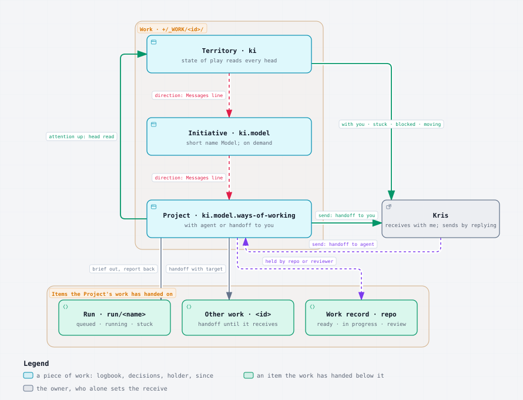

# [Knowledge Islands model](/Users/krisbrown/workspaces/knowledge-islands/ki-principal/Streams/Initiatives/knowledge-islands-model/knowledge-islands-model.md) › [Ways of working](/Users/krisbrown/workspaces/knowledge-islands/ki-principal/Streams/Projects/ways-of-working/ways-of-working.md) › work-model

**Run report at 23:45 BST · last mark 22:34 BST**

---

## Done

- Brought the [thread-states report](/Users/krisbrown/workspaces/knowledge-islands/ki-principal/+/_THREADS/ways-of-working/thread-states.report.md), the [work-cascade report](/Users/krisbrown/workspaces/knowledge-islands/ki-principal/+/_THREADS/ways-of-working/work-cascade.report.md) and Kris's CONVERSATIONS-FOLDER and WORK-UNIT words of 17 October into one model, set out in sections 1 to 6 below. Where I choose between them, the section says so and why. The strongest objection to my choices follows section 6.
- Read the whole [decisions log](/Users/krisbrown/workspaces/knowledge-islands/ki-principal/+/_THREADS/ways-of-working/decisions.md) and sorted every entry for the worked example in section 4. I sorted them from the log and the report trail and did not check each one line by line against its durable home.
- Drew one Archify diagram, exported it through the `ki-diagrams` exporter, flattened it to static light SVG as `diagram-fix` did, and checked it by eye through `rsvg-convert`. It reads cleanly. A nested-list fallback sits under it, and its source is beside this report.
- This is counsel for discussion. No standard, skill, hook, style, record or checkpoint was changed. Only this report, its SVG and its Archify source are committed.

### 1. The model on one page

**Work** is the unit, as Kris said on 17 October: "the unit is work, not a conversation". A piece of work is a territory, an Initiative or a Project, the thing itself, with its id. It carries four things:

- what is being worked on;
- a **logbook**: a short head that is rewritten each time, then the Messages block, then the moves since the last mark;
- its own **decisions**;
- where it lies: **with** a holder, or in **handoff** to a named target.

A chat session is only the channel through which the coordinating agent works on it. The work outlives any session, and it is persisted in full at every move between holders.

**Holders.** A holder is a party:

- `owner`, the work's lead, who is Kris;
- `agent`, the work's coordinating agent, whichever session is acting as it;
- `run/<name>`, a background run;
- `work/<id>`, another piece of work;
- `person/<handle>`, another person;
- `repo/<name>`, a repository or its reviewer.

**Moves.** There are two verbs, and only the holder may make either:

- to **send** is to put the work, or one of its items, into handoff to a target;
- to **receive** is to take it out of handoff and make it with you.

The rules the thread-states report settled carry over unchanged:

- a message sent mid-run is a steer and does not move anything;
- a reply moves through With you on its way;
- hold drains the work, then sends and receives;
- finishing is a move to Finished.

What changes is the word: Kris's "handoff" replaces "Sent" as the state's name.

**Whose move.** The work's headline is derived from where its items lie. The one exception is Kris's receive, which only Kris can set.

| The work's items | Headline | Whose move |
|---|---|---|
| any item with a run, or the agent mid-turn | With agent | agent |
| nothing with an agent, nothing received | Handoff to you | Kris |
| Kris has said `with me`, `ack`, `got it`, `seen` or `hold` | With you | Kris |
| Kris has replied | Handoff to agent | agent, until a session receives it |
| closed | Finished | nobody |

**The cascade.** Attention goes up and directions come down:

- Each level reads the heads of the work beneath it and rolls up attention, not status. The view shows four lists: with you, oldest first; stuck; blocked; moving.
- Each level sends directions down as a Messages line or a brief.
- Stuck is derived from how long an item has gone without moving. Nobody sets it.
- A heartbeat runs only while an item lies with an agent: an update when something changes, at least every 5 minutes, and always by 10.

**Levels.** There are three, as Kris named them:

- **Territory:** `ki`, read through the "state of play" view.
- **Initiative:** `ki.model`, shown as "Model". Its folder exists only when something is sent to it or it holds something.
- **Project:** `ki.model.ways-of-working`.

This settles INITIATIVE-THREAD in its first option, no standing Initiative conversation, while keeping Kris's three levels. The Initiative is a piece of work that can lie with someone, but it has no session of its own unless it does.



Fallback, if the diagram does not render:

- Work, in `+/_WORK/<id>/`
  - Territory `ki`: the state of play reads every head
    - sends directions down by a Messages line to the Initiative
  - Initiative `ki.model`, shown as "Model", with a folder only on demand
    - sends directions down by a Messages line to the Project
  - Project `ki.model.ways-of-working`: with the agent, or in handoff to you
    - sends attention up when its head is read
    - send: handoff to you
- Kris: receives with `with me`, and sends by replying (handoff to the agent)
  - sees with you, stuck, blocked and moving from the territory's view
- Items the Project's work has handed on
  - Run `run/<name>`: a brief goes out and a report comes back; queued, running or stuck
  - Other work `work/<id>`: in handoff until it receives
  - Work record in a repository: ready, in progress or in review, held by the repository or its reviewer

### 2. Vocabulary

| Term | Meaning | Replaces today | Collision |
|---|---|---|---|
| work | the territory, Initiative or Project itself, with its id; the unit | thread, conversation, checkpoint | ki-work's "work record" and "forward work"; records stay "records", and nothing says "work item" |
| logbook | `logbook.md`: the head, Messages, then the moves since the mark | checkpoint | none |
| head | the logbook's opening block: state, holder, since, receive, mark, work list, next steps | pick-up block | none |
| decisions | `decisions.md` in the work's folder: what is decided and not yet durable elsewhere | decisions log | the Decision Records in `Admin/Governance/Decisions/`; prose says "decisions log" for this one |
| holder | the party the work, or an item, lies with | owner or dependency, in In Progress | ki-work's record owner; a holder is a place, not an owner |
| handoff | the work or an item in transit to a named target, with its sender | Sent, `[waiting]`, resume line | none; Kris's own word |
| send | putting something into handoff | "hand off", "return", "back to you" | none |
| receive | taking something out of handoff and making it with you | ack, pick up | none |
| with | the state of lying with a holder: With agent, With you | BUSY, REST in part | none |
| since | the time the work or an item last moved | none | none |
| With agent | the banner word: the move is an agent's | BUSY | none |
| Handoff to you | the banner word: Kris has not yet received it | REST with open queries | none |
| With you | the banner word: Kris has received it | none | none |
| Handoff to agent | the banner word: Kris has replied, and no session has yet received it | none | none |
| Handoff to `<target>` | the banner word: sent to another piece of work, run or person | "blocked on another thread" | none |
| Finished | the banner word: closed | DONE | ki-work's `done` record status, which applies to records only |
| `with me` | Kris's receive: "I have it" | none | none |
| `ack`, `got it`, `seen` | the same receive, said shorter | none | none |
| `hold` | Kris's receive with a drain: stop at a safe point, then the work lies with Kris | hold as a separate request | the HOLD frame retires, so none remains |
| Initiative | the middle level, keeping its name in the machinery | none | none in the machinery; "area" was rejected (see Against these choices) |
| Model, Foundations | the short titles Kris reads | knowledge-islands-model, platform-foundations | none |
| mark | the point at which the logbook's moves are cut and the decisions are struck | mark | none |
| state of play | the territory's view: four lists across every head | the `.sop` thread | none; the `.sop` id retires to `ki` |

### 3. Where it lives

**The folder.** It is `+/_WORK/<id>/`, named by the dotted id: `+/_WORK/ki/`, `+/_WORK/ki.model/`, `+/_WORK/ki.model.ways-of-working/`. Ad hoc work keeps `<territory>.<slug>`. Every piece of work in the territory sits in the Capital, as checkpoints and threads do today.

- I chose `_WORK` over Kris's `_CONVERSATIONS` because Kris's WORK-UNIT words came after the CONVERSATIONS-FOLDER words and moved the unit from conversation to work.
- I chose the dotted id over the hyphenated slug for the folder name. A dotted name sorts each level next to its parent and shows the levels at a glance.
- That departs from THREAD-IDS-AGREE's "the slug names the thread folder". Runs and run state folders keep the hyphenated slug, because `ki agent` refuses dots in a run name.

**Flat, not nested.** I chose flat folders with dotted names over `+/_WORK/ki/model/ways-of-working/` for three reasons:

- A nested folder moves whenever its parent is renamed or the Project moves between Initiatives.
- The territory's folder would contain the folder of every Initiative and Project.
- A flat folder needs only its id to be found.

SHAPE-AGREE nests the Streams registry because a note there belongs to its Initiative. A logbook belongs to nothing but its work, so it does not need to nest.

**In `+/`, not beside the note.** I chose `+/_WORK/` over a logbook kept beside the Project's note in Streams. That reverses DECISIONS-HOME a) within SHAPE-AGREE, which would move `decisions.md` into the Project's folder. My reasons:

- The territory's note is the [Charter](/Users/krisbrown/workspaces/knowledge-islands/ki-principal/Admin/Governance/Charter.md). It lives in Admin, under the Enactment Process.
- A logbook changes at every move.
- A decisions log is struck as it goes, which makes it a working copy, as Kris said on 14 October: "if the state folder is lost, you shouldn't lose any knowledge".

None of that belongs in a canonical zone.

**Links point upward.** The logbook's front matter names its work and links to the note. The note does not link to the logbook. This keeps SHAPE-AGREE's slim notes and [GDR-KI-PRINCIPAL-005](/Users/krisbrown/workspaces/knowledge-islands/ki-principal/Admin/Governance/Decisions/GDR-KI-PRINCIPAL-005-the-roadmap-model.md)'s upward links. `ki` finds the folder from the id. This is where I depart from the coordinator's counsel that the logbook is linked from its note. A link pointing down from a canonical note into `+/` would point at a working copy.

**Briefs move in.** A brief goes in `+/_WORK/<id>/briefs/<run>.md` while its handoff is open. It is deleted once the report is received, and Git keeps it. That is what "persisted at every transition" asks for, because a brief is the content of a send. It reverses THREADS-CONTENT's choice to keep briefs in the state folder.

**The run state folder.** `~/.local/state/ki/agents/<slug>/` stays runtime-only: status, process id, logs, queue and worktrees. Losing it loses no knowledge.

**The canonical-zone boundary.** Nothing in `+/_WORK/` is canonical. A decision becomes canonical only once it is written into a standard, a note, a record or a Decision Record. At that point it is struck from the log, as section 4 describes.

**The logbook.** The head is rewritten at every move:

- the work;
- the state, holder and since;
- Kris's receive time;
- the mark;
- the work list, with each item's holder and since;
- the next steps;
- the tags of any parked queries, each linked to the report that holds it.

Then come the Messages block, which keeps that name so that it does not collide with the `ki agent` inbox, and an append-only list of moves since the mark: time, move, from → to, and what. The list is cut at each mark.

Five blocks of today's checkpoint retire:

- **Thread working rules:** the standards and the hook already carry them.
- **Decisions made:** these go to `decisions.md`.
- **Files touched:** Git records them.
- **Open questions:** these become head items linked to the reports that posed them.
- **Objective:** it becomes the Outcome in the Project note.

**Commits.** Every send commits the folder, and so does Kris's receive. An agent's receive is committed with whatever it next launches or sends back in the same turn.

### 4. Decisions life cycle

**What is logged.** A decision is logged when Kris says it about this piece of work, in Kris's words, in the turn it arrives. The following are not logged:

- a message or answer relayed from another piece of work, which is a receive;
- an instruction to another piece of work, which is a send;
- an operational event, such as a push, a restart, a re-bootstrap or a drain, which is a move.

All three become logbook lines.

**At each mark,** each entry is checked against its durable home and then:

- **struck**, if it is wholly carried by a standard, a skill, a note, a record, a Decision Record or a commit, because Git keeps it;
- **reduced to a pointer**, if it still governs live work whose home is elsewhere. The pointer is one line: the tag, Kris's date and the link;
- **kept**, if it is still being acted on, with no home yet.

A struck entry leaves no stub, and the log carries no running numbers.

**Worked example: this run's log of 195 entries.**

| Outcome at the next mark | Count | Which |
|---|---:|---|
| Not decisions under the model; they become logbook lines | 29 | <ul><li>relays from state-of-play and other threads, which become receives;</li><li>the handoffs to and from other threads, such as HANDED-OFF and SOP-DROPPED, which become sends;</li><li>operational events, such as PUSH, RESTART-PROXY, MARK-REISSUE, MARK-FIRST, DRAIN-SOL, RESUME-SOL and GATE-FIX</li></ul> |
| Reduced to a pointer | 8 | <ul><li>PAPERCLIP-REQ, held until Wave F;</li><li>the PUSH-THREAD standing push permission of 13 October;</li><li>LINK-LEVEL, to raise the link check later;</li><li>SHAPE-FREEZE;</li><li>SESSION-IDENTITY and SESSION-ROLE, both entries, pointing to [KI-HARNESS-GOV-199](/Users/krisbrown/workspaces/knowledge-islands/ki-agentic-harness/docs/roadmap/KI-HARNESS-GOV-199-thread-identity-role-native-sessions.md);</li><li>REPLY-FORMS</li></ul> |
| Kept | 15 | <ul><li>Kris's open discussions of 13 October;</li><li>PRIORITIES;</li><li>ROUTINE;</li><li>the 22:50 BST answers, reduced to their pending items (SHAPE-AGREE, HARNESS-ACCEPT, CHEZMOI-APPLY);</li><li>THREAD-LIFECYCLE;</li><li>THREAD-STATES to WORK-UNIT, the ten ideation entries, which are struck once the model is written in</li></ul> |
| Struck | 143 | everything else: operations that are finished, and rules whose words ki-pmo, ki-delegation, the records or the notes now carry |

That leaves 23 of 195 entries, about 12 per cent. The log's one undated "Note" entry becomes a logbook line. This sort was made from the log and the report trail. A real strike would check each durable home before removing anything.

### 5. Banner

There is one form. The glyphs come first and the last glyph is whose move it is: 🤖 an agent, 🧑 Kris, 👤 another person, 🏁 nobody. The words give where the work lies.

The report heading's form line takes the same prefix:

**🤖 → 🧑 Handoff to you · Summary at 23:52 BST · last mark 22:34 BST**

The footer replaces the block-letter frame with one heading, one line of counts by holder, and the list `- [state] what · holder · since`.

The footer for each state:

### 🤖 With agent · since 23:41 BST

🤖 2 running · 🧑 1 with you · ⛔ 1 blocked

- [running] work-model · run/work-model · since 23:20
- [running] tools-burndown fix · work/ki.foundations.tools-burndown · since 23:05
- [with you] WORK-HOME · owner · since 22:58
- [blocked] thread commit · repo/ki-principal · since 22:40

### 🤖 → 🧑 Handoff to you · since 23:52 BST

🧑 6 with you · ⛔ 1 blocked

- [with you] WORK-MODEL · owner · since 23:52
- [blocked] thread commit · repo/ki-principal · since 22:40

### 🧑 With you · received 07:40 BST · 4 items, oldest since Tue 18:10

🧑 4 with you · ⚠️ 1 stuck · ⛔ 2 blocked · 🤖 3 moving

- [with you] HARNESS-ACCEPT · owner · since Tue 18:10
- [stuck] KI-HARNESS-GOV-199 review · repo/ki-agentic-harness · since Wed 09:00

### 🧑 → 🤖 Handoff to agent · since 07:55 BST

🤖 nothing running yet · 🧑 0 with you

- [handoff] reply block of 07:55 · agent · since 07:55

### 🤖 → 🤖 Handoff to KI > Foundations > Tools burndown · since 23:10 BST

🤖 1 elsewhere · 🧑 0 with you

- [handoff] gate fix · work/ki.foundations.tools-burndown · since 23:10

### 🤖 → 👤 Handoff to a reviewer · since 15:00 BST

👤 1 with another person · 🧑 0 with you

- [handoff] site copy review · person/<handle> · since 15:00

### 🏁 Finished · Ways of working closed at 18:00 BST

- [finished] 14 records accepted, logbook struck

The resume line becomes the send line. Its wording stays the same, and it appears only when the work is in handoff to Kris. The block-letter frames retire when the model is written in. Past reports keep theirs, and so does this one.

### 6. What retires, and the migration

Each item is one line and goes into SHAPE-AGREE's single migration after the restart. Nothing is applied now.

- `+/_CHECKPOINTS/` and `+/_THREADS/` become `+/_WORK/<dotted id>/`.
- `ki-checkpoint` becomes the logbook skill.
- The REST, BUSY, HOLD and DONE frames become the glyph heading.
- The resume line becomes the send line.
- The pick-up block becomes the head.
- The Thread working rules block goes.
- `[waiting]` becomes `[with you]`.
- The `.sop` id becomes the bare territory id `ki`.
- DECISIONS-HOME's placement of `decisions.md` in Streams is reversed: it stays in `+/_WORK/<id>/`.
- THREADS-CONTENT's briefs-in-state is reversed: briefs move into `+/_WORK/<id>/briefs/`.
- In tools-ki, under [KI-TOOL-KI-CLI-127](/Users/krisbrown/workspaces/knowledge-islands/tools-ki/docs/roadmap/KI-TOOL-KI-CLI-127-agent-status-live-threads.md), three changes: the `thread.status` parser reads the head, a heads reader is added for the state of play, and the four lists are shown.
- This log is struck to its 23 entries at the first mark after the migration.

### Against these choices

**The strongest objection: a piece of work ends up in two places.** Kris said the work is the Project itself, and the coordinator advised linking the logbook from its note. I keep the logbook and decisions in `+/_WORK/` and link only upward. As a result, someone reading the Project note cannot see from it where its live state is, and the work has a note in Streams and a folder in `+/`.

I accept that cost for three reasons:

- The territory's note is the Charter, under the Enactment Process.
- A logbook that changes at every move would churn a canonical note's history.
- A struck decisions log is, by design, not canonical.

`ki` finding the folder from the id closes most of the gap. If Kris wants the note to point at its working state, WORK-HOME's option c) is the nearer compromise.

**Other objections, in descending weight:**

- **Commits.** Committing at every send roughly doubles the number of commits in a busy evening. The answer is a quiet scope, not fewer commits, because "persisted at every transition" is Kris's requirement.
- **"Work".** The word collides with ki-work's "work record" and "forward work". Keeping "record" for records and never writing "work item" contains the collision, but does not remove it.
- **Initiative or area.** "Area" is shorter and matches PARA, but it collides with the area segment of record ids (GOV, CLI and the rest) and with Personal's areas. Short titles such as "Model" keep the word "Initiative" out of what Kris reads, so the collision is not worth paying for.
- **Folder names.** Dotted folder names and hyphenated run names mean one id is written two ways. `ki agent` refusing dots is the only reason for that, and lifting that refusal would remove the split.

## In Progress

- Nothing of this run is running, and no agent is queued in run `ways-of-working`.

### Outstanding - no action requested now

- The diagram used the one-off flatten script that `diagram-fix` left outside the repositories. [KI-HARNESS-GOV-205](/Users/krisbrown/workspaces/knowledge-islands/ki-agentic-harness/docs/roadmap/KI-HARNESS-GOV-205-static-light-diagram-export.md) would make that a supported export.
- Other sessions' files are dirty or untracked in ki-principal: `+/_THREADS/chezmoi/decisions.md`, `+/_THREADS/knowledge-acquisition/decisions.md`, and four untracked knowledge-acquisition reports. I left them alone. I also left `+/_CHECKPOINTS/rig.chezmoi.md`, `+/_THREADS/tools-burndown/` and `+/_THREADS/desk-kit/` untouched.
- Committing at every send means more commits. A quiet `docs(work)` scope would keep them readable in the log.

## Queries

These six supersede every open query in the thread-states and work-cascade reports. Each query below names the ones it replaces.

### WORK-MODEL - work as the unit, holders and handoff

**Context:** Section 1 sets out the model:

- The unit is the piece of work itself: a territory, an Initiative or a Project.
- Each piece of work has a logbook and its own decisions, and lies either with a holder or in handoff to a named target.
- Send and receive are the only moves.
- Its headline is derived from where its items lie, except for Kris's receive.
- Attention rolls up in four lists, and directions come down as Messages lines and briefs.
- An Initiative has a folder only when it holds something.

This query supersedes HANDOFF-SHAPE, CASCADE-SHAPE and INITIATIVE-THREAD.

**Query:** Should the model in section 1 be agreed in principle as the one model of work?

**Options:**

a) (recommended) Agree it in principle, with Initiative work existing only on demand, and write nothing into the standards until WORK-MIGRATE.

b) Agree it, but give each Initiative a standing piece of work and session, as the territory has.

c) Keep the conversation as the unit and add the work list beside it, which is the thread-states model.

### WORK-WORDS - the words for states, receives and the middle level

**Context:** Section 2 adopts:

- the banner words With agent, Handoff to you, With you, Handoff to agent, Handoff to `<target>` and Finished;
- the verbs send and receive;
- Kris's receive words `with me`, `ack`, `got it`, `seen` and `hold`;
- "Initiative" kept as the name in the machinery, with short titles such as "Model" in what Kris reads.

"Handoff" replaces the earlier "Sent". This query supersedes STATE-NAMES, RECEIVE-WORDS and LEVEL-NAME.

**Query:** Should the vocabulary in section 2 be adopted?

**Options:**

a) (recommended) Adopt section 2 as it stands: "handoff" for the state, send and receive for the verbs, the five receive words, and Initiative with short titles.

b) Adopt it, but name the middle level "area" in the machinery as well as in speech.

c) Keep "Sent" in place of "Handoff" in the state names.

### WORK-HOME - where a piece of work's files live

**Context:** Section 3 proposes:

- flat folders `+/_WORK/<dotted id>/`, each holding `logbook.md`, `decisions.md`, its reports, and `briefs/` while a handoff is open;
- the run state folder kept for runtime only;
- links pointing upward from the logbook to the note, never from the note down.

This reverses DECISIONS-HOME's placement of `decisions.md` in Streams within SHAPE-AGREE, and THREADS-CONTENT's briefs in the state folder. This query supersedes LOGBOOK.

**Query:** Should the work's files live in flat, dotted folders under `+/_WORK/`, with briefs moved in and only upward links?

**Options:**

a) (recommended) Agree section 3: `+/_WORK/<dotted id>/` with the logbook, decisions, reports and open briefs, upward links only, and DECISIONS-HOME and THREADS-CONTENT amended to match within SHAPE-AGREE.

b) Agree it, but name the folder `+/_CONVERSATIONS/`, as Kris first said.

c) Keep DECISIONS-HOME as agreed, with `decisions.md` beside the Project's note in Streams and only the logbook under `+/_WORK/`.

### DECISIONS-STRIKE - striking decisions once durable

**Context:** Kris said on 17 October that decisions are struck once made durable, and that a cross-work move is a handoff, not a decision. Section 4 applies that at each mark:

- relays, sends and operational events become logbook lines;
- an entry fully carried elsewhere is struck;
- an entry still governing live work becomes a one-line pointer;
- the rest are kept.

Applied to this run's log, that leaves 23 of 195 entries.

**Query:** Should the decisions log be struck to its live entries at each mark, as section 4 describes?

**Options:**

a) (recommended) Agree it: strike, point or keep at each mark after checking each durable home, with no numbering, and apply it first to this log at the first mark after the migration.

b) Strike only at Project close, keeping the full log while the work is open.

### WORK-BANNER - one banner form and the heartbeat

**Context:** Section 5 replaces the block-letter frames with one form:

- a glyph heading whose last glyph is whose move it is;
- a line of counts by holder;
- the list of items, each with its holder and since.

The report's form line takes the same prefix. The heartbeat runs only while an item lies with an agent: an update when something changes, at least every 5 minutes, and always by 10. This query supersedes BANNER-FORM and HEARTBEAT-PACE.

**Query:** Should section 5's single banner form and that heartbeat replace the frames?

**Options:**

a) (recommended) Adopt section 5's form for every state, with the heartbeat while anything lies with an agent, and retire the frames when the model is written in.

b) Keep the block-letter frame and add the glyph heading above it.

### WORK-MIGRATE - folding it into the single migration

**Context:** Section 6 lists every retirement, one line each, to be folded into SHAPE-AGREE's single migration after the restart. The ideation hold on standards stays until WORK-MODEL, WORK-WORDS, WORK-HOME, DECISIONS-STRIKE and WORK-BANNER are answered. The tools-ki parts go to [KI-TOOL-KI-CLI-127](/Users/krisbrown/workspaces/knowledge-islands/tools-ki/docs/roadmap/KI-TOOL-KI-CLI-127-agent-status-live-threads.md).

**Query:** Should section 6's retirements join SHAPE-AGREE's single migration once the other five are answered?

**Options:**

a) (recommended) Fold section 6 into SHAPE-AGREE's one migration after the restart, briefed once the other five queries are answered.

b) Run it as a second migration after SHAPE-AGREE lands.

```text
WORK-MODEL

Agree the work model of section 1 of work-model.report.md in principle: the piece of work itself (territory, Initiative, Project) as the unit, with a logbook and decisions, lying with a holder or in handoff to a named target; send and receive as the only moves; the headline derived from where items lie, except Kris's receive; attention rolled up in four lists and directions sent down; Initiative work only on demand; nothing written into standards until WORK-MIGRATE.

---

WORK-WORDS

Adopt section 2 of work-model.report.md: With agent, Handoff to you, With you, Handoff to agent, Handoff to <target>, Finished; send and receive; receive words with me, ack, got it, seen, hold; Initiative kept in the machinery with short titles such as Model in what I read.

---

WORK-HOME

Agree section 3 of work-model.report.md: flat +/_WORK/<dotted id>/ folders holding logbook.md, decisions.md, reports and open briefs; the run state folder runtime-only; links only upward from the logbook to the note; DECISIONS-HOME and THREADS-CONTENT amended to match within SHAPE-AGREE.

---

DECISIONS-STRIKE

Agree section 4 of work-model.report.md: at each mark, check each entry's durable home, then strike it, reduce it to a one-line pointer or keep it; relays, sends and operational events become logbook lines; no numbering; apply it first to the ways-of-working log at the first mark after the migration.

---

WORK-BANNER

Adopt section 5 of work-model.report.md: one glyph-heading banner for every state, its last glyph whose move it is, with a counts line and the item list with holder and since; the same prefix on the form line; heartbeat only while something lies with an agent, on change, at least every 5 minutes and always by 10; frames retire when the model is written in.

---

WORK-MIGRATE

Fold section 6 of work-model.report.md into SHAPE-AGREE's single migration after the restart, briefed once WORK-MODEL, WORK-WORDS, WORK-HOME, DECISIONS-STRIKE and WORK-BANNER are answered.
```

```text
╭─ run report · 2026-10-17T22:45:00Z ──────────────╮
│                                                  │
│  █▀▀▄ █▀▀▀ █▀▀▀ ▀▀█▀   · thread at rest          │
│  █▀▀▄ █▀▀  ▀▀▀█   █    · nothing running         │
│  █  █ █▄▄▄ ▄▄▄█   █    · nothing queued          │
│                                                  │
╰──────────────────────────────────────────────────╯

- [at rest] nothing running or queued
- [waiting] WORK-MODEL
- [waiting] WORK-WORDS
- [waiting] WORK-HOME
- [waiting] DECISIONS-STRIKE
- [waiting] WORK-BANNER
- [waiting] WORK-MIGRATE
- [committed] work-model report and diagram
```

```text
Resume KI > Model > ways of working under current ki-pmo and ki-delegation since 22:34 BST: re-bootstrap, mark, fresh summary with carried-forward open points, take stock, restart authorised work, then banner.
```
