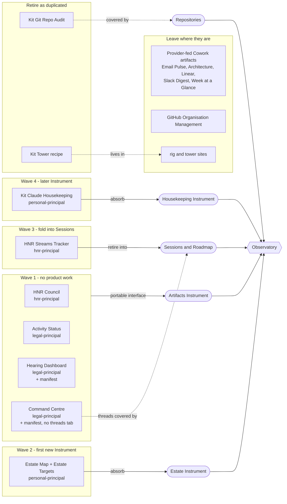

# Live artifacts across the territories, and what comes into the Observatory first

A read-only inventory of the live artifacts built across the estate, taken on 18 October 2026 for OBS-ARTIFACTS a), and a proposed order for bringing them into the Observatory. Kris's words that started it: "I really want to get the live artifacts that we've had built over the different various purposes to sort of consolidate a lot of those into the observatory too." Nothing here is decided; Kris decides from the proposal under OBS-ARTIFACTS-ORDER.

## What the Observatory can take today

Two routes exist, and they set the order.

- **Instrument.** A view the Observatory renders itself from observed evidence behind a typed backend port, sharing the design language and feeding the Beacon. Any data source can sit behind a port, but it costs product work in `apps-observatory.local`.
- **Portable live-artifact interface** (the Artifacts Instrument, OBS-ART, PDR-KI-OBSERVA-006). It frames a Knowledge Base's pair unchanged, but only a pair directly under `Admin/Operations/Live Artifacts/` whose Markdown declares `artifact_bridge: 1`, `artifact_id` and `artifact_tools` (OBS-ART-001), and it answers only the read tools it reproduces, which today means `mcp-ki-kb-fs` `kb_list` and `kb_read` (OBS-ART-005, OBS-ART-006). Reads under `+/` or `-/` are refused. It calls no LLM and no provider MCP (OBS-ART-008).

So an artifact that reads only its own Knowledge Base outside `+/` can be shown portably for the cost of a manifest. One that reads Linear, Slack, Microsoft 365, a calendar or a local MCP server other than `mcp-ki-kb-fs` cannot be served portably, and only comes in as an Instrument or not at all.

## Inventory

Dates are the last commit touching the Markdown source and, after the slash, the HTML. Many pairs share a 12 October commit that looks like an estate-wide tidy rather than a substantive change. "Updates" says what keeps the view current: every pair here reads live at view time through `callMcpTool`, and no scheduled task, launch agent or generator script renders any of them. The Cowork artifact folder `~/workspaces/claude-desktop/Artifacts/` and its `Scheduled/` sibling are empty on this machine, so the `artifact_path` targets the legal recipes name no longer exist locally; no private Claude content was opened.

### Live Artifact pairs

| # | Artifact | Territory and repository | Purpose | Reads | Last commit | Today in the Observatory | Overlapping Instrument |
| --- | --- | --- | --- | --- | --- | --- | --- |
| 1 | HNR Council | Humans Not Robots, `hnr-principal`, `Admin/Operations/Live Artifacts/` | Read-only command surface of current HNR work, attention, active areas and decisions | `mcp-ki-kb-fs` | 13 Oct / 12 Oct | Offered (manifest present) | Partly Work, Sessions, Beacon |
| 2 | Activity Status | Legal, `legal-principal`, `Admin/Operations/Live Artifacts/` | Status of the island's recurring Activity notes | `mcp-ki-kb-fs` | 13 Oct / 12 Oct | Offered (manifest present) | None; Automation covers scheduled jobs, not Activity notes |
| 3 | Command Centre | Legal, `legal-principal`, `Admin/Operations/Live Artifacts/` | Command Centre Areas and Items, plus a Session Threads tab over `+/_RESUME` checkpoints | `mcp-ki-kb-fs` | 12 Oct / 12 Oct | Refused: no manifest; its `+/` reads would be refused too | Session Threads tab overlaps Sessions and Work |
| 4 | Hearing Dashboard | Legal, `legal-principal`, `Admin/Operations/Live Artifacts/` | Hearing preparation status | `mcp-ki-kb-fs` | 12 Oct / 12 Oct | Refused: no manifest | None |
| 5 | Estate Map, with Estate Targets | Personal, `personal-principal`, `Admin/Operations/Live Artifacts/` | The whole estate: territories, source stores, GitHub homes, repositories, renames and domains; Estate Targets is its machine-readable source | Static HTML, no tool calls; `Estate Targets.json` alongside | 12 Oct | Not a pair (no `.md` half), not offered | None; Repositories and Trade routes touch the edges |
| 6 | HNR Streams Tracker | Humans Not Robots, `hnr-principal`, `Admin/Knowledge Management/Integrations/Claude/Live Artifacts/` | Streams status and momentum by priority pipeline | `mcp-ki-kb-fs` | 12 Oct / 12 Oct | Not offered: outside the artifact folder, no manifest | Sessions (themes and Projects) and Roadmap |
| 7 | HNR Email Pulse | Humans Not Robots, `hnr-principal`, same Integrations folder | HNR Outlook `_TRIAGE` folders with drill-down and a suggestions panel | `hnr-mcp-m365`, `mcp-ki-kb-fs` | 12 Oct / 12 Oct | Cannot be served portably | None |
| 8 | HNR Architecture Tracker | Humans Not Robots, `hnr-principal`, same Integrations folder | ADRs, components and the Linear projects bound to them, by engineering area | Linear (claude.ai connector) | 18 Aug / 1 Aug | Cannot be served portably | Decisions, for the ADR side only |
| 9 | HNR Linear Open Issues Tracker | Humans Not Robots, `hnr-principal`, same Integrations folder | Open Linear issues by project and priority, with stale callouts | Linear (claude.ai connector) | 18 Aug / 31 Jul | Cannot be served portably | None |
| 10 | HNR Slack Digest | Humans Not Robots, `hnr-principal`, same Integrations folder | Last 24 hours of Slack, summarised per channel and DM | Slack (claude.ai connector), with summarising | 18 Aug / 31 Jul | Cannot be served portably; summarising needs an LLM | None |
| 11 | Kit Git Repo Audit | Personal, `personal-principal`, `Pillars/Productivity/Knowledge Management/Integrations/Claude/Live Artifacts/` | Git health across the old `hnr` and `kit` workspace roots and chezmoi, with fetch, pull, commit and push | `mcp-git-audit` | 12 Oct / 12 Oct | Cannot be served portably | Repositories, which already does this with governed fetch, pull and push |
| 12 | Kit Claude Housekeeping | Personal, `personal-principal`, same Integrations folder | Claude Code and Desktop storage, memory, artifact and plugin health | `mcp-housekeeping-claude` | 18 Aug / 7 Aug | Cannot be served portably | Partly MCP servers and Sessions; storage and memory health not covered |
| 13 | Kit Week at a Glance | Personal, `personal-principal`, same Integrations folder | Rolling seven-day multi-calendar overview | Google Calendar (claude.ai connector) | 18 Aug / 31 Jul | Cannot be served portably | None |
| 14 | Kit The Tower Dashboard | Personal, `personal-principal`, same Integrations folder | Recipe only, marked `archive - August 2026`; moved to a web experiment | None | 18 Aug | Not a pair | None |
| 15 | GitHub Organisation Management | Personal, `personal-principal`, `Admin/Operations/Live Artifacts/` | Organisation-level GitHub work list across territories | Markdown only, no HTML | 11 Oct | Not a pair | None |

The Knowledge Islands Principal artifact index says "None adopted yet". No live artifact was found in Equal Remedy, Sacred Inquiry, Techmedix or Valle Armonia.

### Rendered dashboards that are not Live Artifact pairs

| Artifact | Territory and repository | Purpose | Last commit | Overlapping Instrument |
| --- | --- | --- | --- | --- |
| `rig.midnight.ninja` | Personal, `apps-rig.midnight.ninja` | Eleventy catalogue of this Mac's working setup | 18 Oct | Rig |
| `tower.midnight.ninja` | Personal, `apps-tower.midnight.ninja` | Personal dashboard for an idle tower-defence game, with a macOS helper | 18 Oct | None |

### Seen and set aside

These came up in the sweep and are not live artifacts in the sense meant here: the product dashboards in `hnr-backend` (CloudWatch, analytics and Grafana definitions are product code), the Lighthouse run reports in `hnr-benchmarks`, the 5G-EMERGE presentation slides and diagrams, the `ki-agentic-harness` skill-area diagrams (already readable through the Documents Instrument), and the review previews under `+/_THREADS/` in `hnr-principal`.

## Proposal

| Order | Artifact | Route | Reason | Confidence |
| --- | --- | --- | --- | --- |
| 1 | HNR Council | Show portably, as now | Already offered and reads only its own Knowledge Base | High |
| 1 | Legal Activity Status | Show portably, as now | Already offered and reads only its own Knowledge Base | High |
| 1 | Legal Hearing Dashboard | Show portably, add a manifest in `legal-principal` | A manifest is the only gap; it reads only `kb_list` and `kb_read` | High |
| 1 | Legal Command Centre | Show portably, add a manifest; drop the Session Threads tab | The Areas and Items view is legal-specific; the threads tab reads `+/`, which the host refuses, and Sessions covers threads | Medium - the tab may matter more to the legal owner than the record shows |
| 1 | Kit Git Repo Audit | Retire as duplicated | Repositories already shows checkout health with governed fetch, pull and push, and the artifact still scans the old workspace roots | High |
| 1 | Kit The Tower Dashboard | Retire the recipe | Already archived; the dashboard lives in `apps-tower.midnight.ninja` | High |
| 2 | Estate Map, with Estate Targets | Absorb as an Instrument | Kris already approved it as an Observatory idea (ESTATE-MAP-OBSERVATORY, 16 October); the JSON is a ready machine source and the map is static, so a portable frame would add nothing | Medium - the editable read-back Kris asked for is a Bridge write, not yet designed |
| 3 | HNR Streams Tracker | Retire once Sessions reads HNR Streams; until then move it under `Admin/Operations/Live Artifacts/` with a manifest | Sessions and Roadmap own themes, Projects and records; the tracker's priority pipeline is the one HNR-specific part | Medium - depends on whether the HNR pipeline buckets map onto Sessions |
| 4 | Kit Claude Housekeeping | Absorb as an Instrument behind a backend port | Storage, memory and plugin health is this-machine evidence like MCP servers and Automation, and sits beside the token-economics view the Project already plans | Medium - large surface; could wait for the Sessions token work |
| - | HNR Email Pulse, Architecture Tracker, Linear Open Issues Tracker, Slack Digest; Kit Week at a Glance | Leave in Cowork | They read provider connectors or need an LLM, which the Observatory's mechanical-first boundary keeps out | High |
| - | GitHub Organisation Management | Leave where it is | A work list with no render; it belongs in Streams if anywhere | High |
| - | `rig.midnight.ninja`, `tower.midnight.ninja` | Leave where they are | Separate published sites; the Rig Instrument already covers the operational side of the first | Medium - the Rig site may later be generated from the same evidence |

Each step lands in the repository that owns the artifact: manifests in `legal-principal` and `hnr-principal`, retirements as each island's own change, Instruments in `apps-observatory.local`. This note captures no records.

## Diagram

