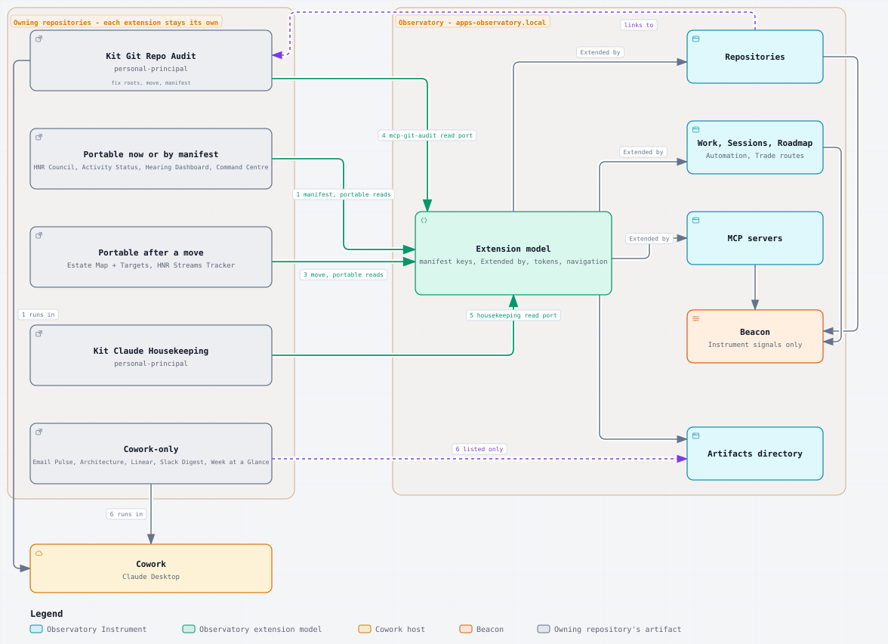
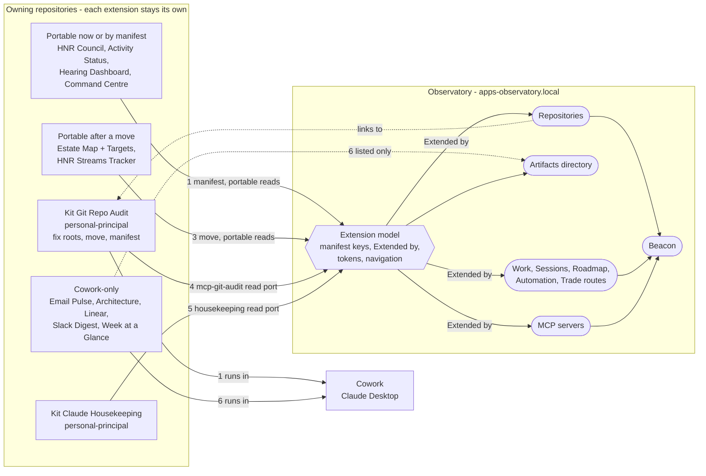

# Live artifacts and the Observatory: a two-way bridge

The live artifacts built across the estate, and how each becomes a natural extension of the Observatory while staying its own thing. The inventory was taken read-only on 18 October 2026 for OBS-ARTIFACTS a). The first proposal absorbed artifacts into Instruments and retired Kit Git Repo Audit; Kris withdrew it the same day under ARTIFACTS-EXTEND: "Kit Git Repo Audit is far richer though, and I'd much prefer it over the basic tool in the observatory. Really, we want Live Artifacts to be natural extensions of the Observatory rather than something inside it." OBS-ARTIFACTS-ORDER is superseded. On 19 October Kris settled the model under EXT-MODEL: "observatory extensions has an adapter or bridge to those written as live-artifacts, and we should have the reverse too, so we have a live artifact adapter for observatory? kit git repo audit I would like to become a first class view in the observatory, so it would be subsumed into the observatory replacing the existing simplier git management view and then if I want it in claude desktop it becomes available through the Observatory live artifact bridge". The model is now a two-way bridge, and Kit Git Repo Audit becomes a first-class Observatory view replacing Repositories. The records live in `apps-observatory.local`: [KI-OBSERVA-INT-003](/Users/krisbrown/workspaces/knowledge-islands/apps-observatory.local/docs/roadmap/KI-OBSERVA-INT-003-extensions-switchboard.md) inbound, [KI-OBSERVA-INT-004](/Users/krisbrown/workspaces/knowledge-islands/apps-observatory.local/docs/roadmap/KI-OBSERVA-INT-004-outbound-live-artifact-adapter.md) outbound and [KI-OBSERVA-VIS-041](/Users/krisbrown/workspaces/knowledge-islands/apps-observatory.local/docs/roadmap/KI-OBSERVA-VIS-041-git-view-replaces-repositories.md) the Git view, each waiting on [KI-OBSERVA-APP-042](/Users/krisbrown/workspaces/knowledge-islands/apps-observatory.local/docs/roadmap/KI-OBSERVA-APP-042-design-tokens-and-glyphs.md) for the ki-design tokens and glyphs.

## The two-way bridge

The bridge has two halves, and a view or artifact crosses it in one direction only.

| Half | Direction | What crosses | Record |
| --- | --- | --- | --- |
| Inbound adapter, Observatory Extensions | Live artifact into the Observatory | A live artifact its own repository owns, framed as an extension of the view it names, on the five units below | [KI-OBSERVA-INT-003](/Users/krisbrown/workspaces/knowledge-islands/apps-observatory.local/docs/roadmap/KI-OBSERVA-INT-003-extensions-switchboard.md) |
| Outbound adapter, the live-artifact adapter | Observatory view out to Claude Desktop | A view the Observatory builds, offered as a live artifact that reads the Observatory's typed read contracts | [KI-OBSERVA-INT-004](/Users/krisbrown/workspaces/knowledge-islands/apps-observatory.local/docs/roadmap/KI-OBSERVA-INT-004-outbound-live-artifact-adapter.md) |

- Boundary: the inbound half never reimplements an artifact, and the outbound half never reimplements a view; what is built lives on one side only. Neither half carries a write: inbound writes wait for confirmed Bridge operations, and a write from Claude Desktop into the Observatory needs its own decision on authority, confirmation and receipts across hosts.
- Hands on: inbound, a validated list of extensions to navigation; outbound, a live artifact pair Claude Desktop opens.

When something both halves could carry is wanted in the Observatory and in Claude Desktop, the Observatory builds it once as a view and the outbound adapter carries it out. Kit Git Repo Audit is the first case.

The rest of this section is the inbound half.

### The extension model

An **extension** is a live artifact that its own repository owns, authors and changes, that runs wherever its data can be reached, and that declares which part of the Observatory it extends. The Observatory does not take it in, restyle it or reimplement it. It finds the extension, links to it from the view it extends, frames it where it can answer the extension's reads, and says plainly where it cannot. Five units carry the model; each names its boundary and what it hands on.

#### 1. Registration: the manifest

The Markdown half of the pair stays the extension's only declaration. Today's manifest (OBS-ART-001) already names `artifact_bridge`, `artifact_id`, `artifact_tools` and `artifact_servers`. The extension model adds three keys, all optional so that every pair offered today stays offered:

| Key | Says | Example |
| --- | --- | --- |
| `artifact_extends` | The Instruments it extends, by Instrument id | `[repositories]` |
| `artifact_subject` | What it observes: its own Knowledge Base, the selected scope, or this machine | `machine` |
| `artifact_runs` | The hosts it is written for: `observatory`, `cowork`, or both | `[observatory, cowork]` |

Discovery stays where the `ki-repo-kb-live-artifacts` standard puts the pair: directly under `Admin/Operations/Live Artifacts/` in a Knowledge Base the selected scope holds, with the Markdown and HTML sharing a stem. Several personal and HNR artifacts sit instead in a `Pillars/.../Integrations/Claude/Live Artifacts/` folder, and Kit Git Repo Audit's halves do not share a stem (`Kit Git Repo Audit Artifact.md` beside `Kit Git Repo Audit.html`). Each such artifact registers by moving its pair, which is its own repository's change; the Observatory gains no second discovery rule.

- Boundary: the owning repository writes the manifest; the Observatory only reads it and refuses what does not parse, by name and reason, as now.
- Hands on: a validated list of extensions, each with the Instruments it extends, to navigation.

#### 2. Navigation both ways

From the Observatory to the extension. An Instrument that an offered extension names shows it in the Instrument's own header as **Extended by** with the extension's title and the host it runs in, so a reader on Repositories sees "Kit Git Repo Audit" without hunting for it. A Beacon row raised by that Instrument carries the same link in its detail. The Artifacts view becomes the directory of every extension in scope, grouped by the Instrument each extends, including those that run only in Cowork, which are listed with where they run and why they do not open here.

From the extension to the Observatory. An extension links back to the Observatory address of the view it extends, which the shell already makes stable: `?scope=<scope>&view=<instrument>` with the Instrument's grouping and filters. Inside the Observatory's opaque-origin frame a page cannot open a window (OBS-ART-003), so the link travels as a host request over the MCP Apps wire, which the host answers only for its own addresses by moving the page itself; in Cowork the same link is a plain loopback address. Which MCP Apps request carries it is to be checked against SEP-1865 when shaped.

- Boundary: the Observatory draws the links on its side and answers navigation requests; the extension authors its own back-links.
- Hands on: nothing new to the backend; navigation is page-side.

#### 3. Shared look and identity

The Observatory's identity is derived from `ki-website` and held by digest (PDR-KI-OBSERVA-002). An extension reads as part of the Observatory when it uses the same tokens: paper, ink, muted, ocean, forest, gold and rust in both themes, the meaning roles `--accent`, `--ok`, `--warn` and `--bad` with their washes, and the system serif and sans stacks. The host hands them over at start: the answer to `ui/initialize` carries the current theme and the token values as host context, and the bridge sets them as custom properties on the frame's `:root`. An extension that reads `var(--ok, <its own value>)` looks native in the Observatory and keeps its own palette in Cowork, unchanged. The Observatory frame still loads no stylesheet from outside itself.

- Boundary: the Observatory owns the token set and its digest; the extension chooses to read it.
- Hands on: one host-context field in the bridge, versioned with it.

#### 4. Data access

Three tiers, decided per tool by the manifest:

| Tier | Reads | Answered by | Today |
| --- | --- | --- | --- |
| Portable | `mcp-ki-kb-fs` `kb_list` and `kb_read` over the extension's own Knowledge Base, outside `+/` and `-/` | The Observatory, natively from tracked files (OBS-ART-005, OBS-ART-006) | Conforming |
| Own server | The extension's own local MCP server, such as `mcp-git-audit` or `mcp-housekeeping-claude` | The Observatory backend, through a typed port to the server it already reaches through mcporter, for the read tools the manifest declares | A listed gap in OBS-ART |
| Provider or inference | Linear, Slack, Microsoft 365, calendars, `askClaude`, `runScheduledTask` | Cowork only | Answered unavailable (OBS-ART-008) |

A write an extension asks for, such as Kit Git Repo Audit's commit or push, is refused in the Observatory until it can be carried out as a confirmed Bridge operation with a receipt, which OBS-ART already lists as a gap. The extension keeps its writes in Cowork in the meantime, and should show "not available here" rather than an empty result, as the bridge's typed errors allow.

- Boundary: the backend owns every process and MCP call, and the browser still receives only typed answers; the extension owns its tool list.
- Hands on: one backend port per own-server tier, each with its declared read tools.

#### 5. What runs where

| Host | Runs on | Reaches | Suits |
| --- | --- | --- | --- |
| Observatory | This machine and each host, loopback only, under Rig's launchd service | Tracked files natively; local MCP servers through the backend; no LLM, no provider connector | Mechanical, read-only extensions; and, once ported, own-server reads |
| Cowork | Claude Desktop on this machine | The MCP servers configured for Claude Desktop, claude.ai provider connectors, `askClaude` and scheduled tasks | Provider-fed and inference-led extensions, and every write until Bridge writes exist |
| Published site | Static hosting | Nothing at view time | Catalogues and personal dashboards outside the estate's evidence |

One HTML page runs in both live hosts unchanged (PDR-KI-OBSERVA-006). The Cowork artifact folder on this machine is empty, so a Cowork-only extension has to be re-saved into Cowork from its HTML half before it opens there again.

## Built-in view or richer extension

Where an extension covers ground an Instrument already covers, the Instrument stays as the floor and the extension becomes the preferred surface. The Instrument keeps what only it can do: it feeds the Beacon, degrades with a stated reason (OBS-ART-009 and each Instrument's degraded rule), records receipts for governed operations, and needs no LLM, no Cowork and no particular artifact to be present. It stops growing toward the extension: it links to the extension under Extended by, and new interactive depth goes into the extension's own repository.

### Worked case: Kit Git Repo Audit becomes the Git view

Under EXT-MODEL this worked case no longer keeps both. Kit Git Repo Audit is subsumed into the Observatory as a first-class view replacing Repositories ([KI-OBSERVA-VIS-041](/Users/krisbrown/workspaces/knowledge-islands/apps-observatory.local/docs/roadmap/KI-OBSERVA-VIS-041-git-view-replaces-repositories.md)), and reaches Claude Desktop through the outbound adapter ([KI-OBSERVA-INT-004](/Users/krisbrown/workspaces/knowledge-islands/apps-observatory.local/docs/roadmap/KI-OBSERVA-INT-004-outbound-live-artifact-adapter.md)). Under PUSH-ALL every Repositories capability, governed operation and `?view=` address carries over, so nothing is lost:

- Capabilities: the scope selector, the attention ranking and its printed rule, every Beacon signal and the row it lands on, the `git` source with the `mcp-git-audit` bridge and its stated fallback, history, raw status and committed Archify diagrams.
- Governed operations: fetch dry run, fetch, fast-forward pull and push, with their tiers, confirmations and receipts under the authority specification, and the declare, confirm, receipt presentation of KI-OBSERVA-BRG-003.
- Addresses: `?view=repositories` keeps opening the view for good, by id or by redirect.

From the artifact the view takes grouping by root, chezmoi, the heatmap, diff and bulk per group where each can be served without an LLM. Commit and every bulk write wait for confirmed Bridge operations; the `askClaude` commit suggestion stays Cowork-only, since the Observatory has no LLM path; open in VS Code and GitHub Desktop would launch a process from the page and stays out. The artifact itself stays in `personal-principal` until its owner decides its future.

The comparison and reading below are the 18 October case, kept for the record.

| | Repositories (Instrument) | Kit Git Repo Audit (extension) |
| --- | --- | --- |
| Scope | The selected scope's checkouts | Every repository under its declared roots, grouped by root, plus chezmoi |
| Shape | Ranked table by what warrants attention, with history and raw status in detail | Heatmap by group, commit recency and branch state, expandable detail with diff |
| Operations | Fetch dry run, fetch, fast-forward pull and push, each confirmed with a receipt | Fetch, pull, commit and push per repository and in bulk per group, with live progress |
| Extras | Committed Archify diagrams; Beacon signals | Open in VS Code and GitHub Desktop; commit message suggested through `askClaude` |
| Source | `git` directly, with the `mcp-git-audit` bridge for counts | `mcp-git-audit` throughout, at the server's `destructive` access level |

Superseded by EXT-MODEL: keep both. Repositories stays the Beacon's source and the governed, receipted path. Kit Git Repo Audit is the place Kris works from, and Repositories links to it. In the Observatory frame its scan, audit, detail and diff are own-server reads; its fetch, pull, commit and push wait for Bridge writes and stay in Cowork until then; its commit suggestion answers unavailable. The suggested message is a plain imperative line rather than a Conventional Commit, which its owner may want to change at the same time.

**Fix for its owner, `personal-principal`.** The page's `ROOT_DEFS` still scans `~/workspaces/hnr` and `~/workspaces/kit`, which no longer exist, so in Cowork it finds no repository but chezmoi. The `mcp-git-audit` safe roots configured in chezmoi already list the eight territory roots, `~/workspaces/_external` and chezmoi, so the server needs no change: the fix is the artifact's own `ROOT_DEFS` and recipe, ideally read from the territory roots rather than written in. Moving the pair under `Admin/Operations/Live Artifacts/` with one stem and a manifest is the same change. Both are handoffs to `personal-principal`, not changes here; under EXT-ROOTS they went to `personal-principal` (KB-PRINCIPAL-044) and `mcp-git-audit` (KI-MCP-GIT-FND-006), the interim until the Git view lands.

## Inventory

Dates are the last commit touching the Markdown source and, after the slash, the HTML. Many pairs share a 12 October commit that looks like an estate-wide tidy rather than a substantive change. "Updates" says what keeps the view current: every pair here reads live at view time through `callMcpTool`, and no scheduled task, launch agent or generator script renders any of them. The Cowork artifact folder `~/workspaces/claude-desktop/Artifacts/` and its `Scheduled/` sibling are empty on this machine, so the `artifact_path` targets the legal recipes name no longer exist locally; no private Claude content was opened.

### Live Artifact pairs

| # | Artifact | Territory and repository | Purpose | Reads | Last commit | Today in the Observatory | Overlapping Instrument |
| --- | --- | --- | --- | --- | --- | --- | --- |
| 1 | HNR Council | Humans Not Robots, `hnr-principal`, `Admin/Operations/Live Artifacts/` | Read-only command surface of current HNR work, attention, active areas and decisions | `mcp-ki-kb-fs` | 13 Oct / 12 Oct | Offered (manifest present) | Partly Work, Sessions, Beacon |
| 2 | Activity Status | Legal, `legal-principal`, `Admin/Operations/Live Artifacts/` | Status of the island's recurring Activity notes | `mcp-ki-kb-fs` | 13 Oct / 12 Oct | Offered (manifest present) | None; Automation covers scheduled jobs, not Activity notes |
| 3 | Command Centre | Legal, `legal-principal`, `Admin/Operations/Live Artifacts/` | Command Centre Areas and Items, plus a Session Threads tab over `+/_RESUME` checkpoints | `mcp-ki-kb-fs` | 12 Oct / 12 Oct | Refused: no manifest; its `+/` reads would be refused too | Session Threads tab overlaps Sessions and Work |
| 4 | Hearing Dashboard | Legal, `legal-principal`, `Admin/Operations/Live Artifacts/` | Hearing preparation status | `mcp-ki-kb-fs` | 12 Oct / 12 Oct | Refused: no manifest | None |
| 5 | Estate Map, with Estate Targets | Personal, `personal-principal`, `Admin/Operations/Live Artifacts/` | The whole estate: territories, source stores, GitHub homes, repositories, renames and domains; Estate Targets is its machine-readable source | Static HTML, no tool calls; `Estate Targets.json` alongside | 12 Oct | Not a pair (no `.md` half), not offered | None; Repositories and Trade routes touch the edges |
| 6 | HNR Streams Tracker | Humans Not Robots, `hnr-principal`, `Admin/Knowledge Management/Integrations/Claude/Live Artifacts/` | Streams status and momentum by priority pipeline | `mcp-ki-kb-fs` | 12 Oct / 12 Oct | Not offered: outside the artifact folder, no manifest | Sessions (themes and Projects) and Roadmap |
| 7 | HNR Email Pulse | Humans Not Robots, `hnr-principal`, same Integrations folder | HNR Outlook `_TRIAGE` folders with drill-down and a suggestions panel | `hnr-mcp-m365`, `mcp-ki-kb-fs` | 12 Oct / 12 Oct | Cannot be served portably | None |
| 8 | HNR Architecture Tracker | Humans Not Robots, `hnr-principal`, same Integrations folder | ADRs, components and the Linear projects bound to them, by engineering area | Linear (claude.ai connector) | 18 Aug / 1 Aug | Cannot be served portably | Decisions, for the ADR side only |
| 9 | HNR Linear Open Issues Tracker | Humans Not Robots, `hnr-principal`, same Integrations folder | Open Linear issues by project and priority, with stale callouts | Linear (claude.ai connector) | 18 Aug / 31 Jul | Cannot be served portably | None |
| 10 | HNR Slack Digest | Humans Not Robots, `hnr-principal`, same Integrations folder | Last 24 hours of Slack, summarised per channel and DM | Slack (claude.ai connector), with summarising | 18 Aug / 31 Jul | Cannot be served portably; summarising needs an LLM | None |
| 11 | Kit Git Repo Audit | Personal, `personal-principal`, `Pillars/Productivity/Knowledge Management/Integrations/Claude/Live Artifacts/` | Git health across the old `hnr` and `kit` workspace roots and chezmoi, with fetch, pull, commit and push | `mcp-git-audit` | 12 Oct / 12 Oct | Cannot be served portably | Repositories, which already does this with governed fetch, pull and push |
| 12 | Kit Claude Housekeeping | Personal, `personal-principal`, same Integrations folder | Claude Code and Desktop storage, memory, artifact and plugin health | `mcp-housekeeping-claude` | 18 Aug / 7 Aug | Cannot be served portably | Partly MCP servers and Sessions; storage and memory health not covered |
| 13 | Kit Week at a Glance | Personal, `personal-principal`, same Integrations folder | Rolling seven-day multi-calendar overview | Google Calendar (claude.ai connector) | 18 Aug / 31 Jul | Cannot be served portably | None |
| 14 | Kit The Tower Dashboard | Personal, `personal-principal`, same Integrations folder | Recipe only, marked `archive - August 2026`; moved to a web experiment | None | 18 Aug | Not a pair | None |
| 15 | GitHub Organisation Management | Personal, `personal-principal`, `Admin/Operations/Live Artifacts/` | Organisation-level GitHub work list across territories | Markdown only, no HTML | 11 Oct | Not a pair | None |

The Knowledge Islands Principal artifact index says "None adopted yet". No live artifact was found in Equal Remedy, Sacred Inquiry, Techmedix or Valle Armonia.

### Rendered dashboards that are not Live Artifact pairs

| Artifact | Territory and repository | Purpose | Last commit | Overlapping Instrument |
| --- | --- | --- | --- | --- |
| `rig.midnight.ninja` | Personal, `apps-rig.midnight.ninja` | Eleventy catalogue of this Mac's working setup | 18 Oct | Rig |
| `tower.midnight.ninja` | Personal, `apps-tower.midnight.ninja` | Personal dashboard for an idle tower-defence game, with a macOS helper | 18 Oct | None |

### Seen and set aside

These came up in the sweep and are not live artifacts in the sense meant here: the product dashboards in `hnr-backend` (CloudWatch, analytics and Grafana definitions are product code), the Lighthouse run reports in `hnr-benchmarks`, the 5G-EMERGE presentation slides and diagrams, the `ki-agentic-harness` skill-area diagrams (already readable through the Documents Instrument), and the review previews under `+/_THREADS/` in `hnr-principal`.

## The artifacts under the extension model

Every artifact stays with the repository that owns it. Order 1 needs no product work; order 2 is the first Observatory unit, the extension model itself; later orders each wait on one named port or on Cowork.

| Order | Artifact | Extends | Tier and host | First step, and who owns it | Confidence |
| --- | --- | --- | --- | --- | --- |
| 1 | Kit Git Repo Audit | Repositories | Own server; Cowork now, Observatory after the `mcp-git-audit` port | `personal-principal`: replace the stale `ROOT_DEFS` with the territory roots, give the pair one stem under `Admin/Operations/Live Artifacts/` with a manifest, re-save it into Cowork | High - the roots and the server's safe roots were checked directly |
| 1 | HNR Council | Work, Sessions, Beacon | Portable; both | `hnr-principal`: add `artifact_extends` when the key exists; offered today | High |
| 1 | Legal Activity Status | Automation | Portable; both | `legal-principal`: add `artifact_extends` when the key exists; offered today | High |
| 1 | Legal Hearing Dashboard | None; a legal-only view listed in Artifacts | Portable; both | `legal-principal`: add the manifest | High |
| 1 | Legal Command Centre | Work and Sessions, for its Session Threads tab | Portable for Areas and Items; the threads tab stays Cowork-only, since the host refuses `+/` | `legal-principal`: add the manifest, and have the tab say it is unavailable in the Observatory rather than drop it | Medium - the tab reads `+/_RESUME`, which the estate has since replaced with `+/_WORK` |
| 2 | Extension model in the Observatory | All | - | `apps-observatory.local`: the three manifest keys, Extended by links, the Artifacts directory grouped by Instrument, host-context tokens, navigation requests | Medium - the MCP Apps request names are still to be checked |
| 3 | Estate Map, with Estate Targets | Repositories and Trade routes | Portable: the static page reads `Estate Targets.json` through `kb_read`; both | `personal-principal`: add the Markdown half and manifest, and have the page read the JSON rather than embed it. The editable read-back Kris asked for under ESTATE-MAP-OBSERVATORY on 16 October waits for Bridge writes | Medium - the page must be changed to read rather than embed |
| 3 | HNR Streams Tracker | Sessions and Roadmap | Portable; both | `hnr-principal`: move the pair under `Admin/Operations/Live Artifacts/` with a manifest; its priority pipeline stays HNR's own | High - it reads only `mcp-ki-kb-fs` |
| 4 | Kit Git Repo Audit in the Observatory | Repositories | Own server | `apps-observatory.local`: a read port to `mcp-git-audit` for scan, audit, detail and diff; writes later as confirmed Bridge operations. Under EXT-MODEL this becomes the Git view replacing Repositories, [KI-OBSERVA-VIS-041](/Users/krisbrown/workspaces/knowledge-islands/apps-observatory.local/docs/roadmap/KI-OBSERVA-VIS-041-git-view-replaces-repositories.md), carried to Claude Desktop by [KI-OBSERVA-INT-004](/Users/krisbrown/workspaces/knowledge-islands/apps-observatory.local/docs/roadmap/KI-OBSERVA-INT-004-outbound-live-artifact-adapter.md) | Medium - the first own-server port sets the pattern |
| 5 | Kit Claude Housekeeping | MCP servers and Sessions | Own server, `mcp-housekeeping-claude`, machine subject | `personal-principal`: move and manifest; then `apps-observatory.local`: a read port on the order 4 pattern | Medium - a large surface, and the server's reads touch private Claude state |
| 6 | HNR Email Pulse, Architecture Tracker, Linear Open Issues Tracker, Slack Digest; Kit Week at a Glance | Listed in Artifacts only | Provider or inference; Cowork | Each owner: move and manifest with `artifact_runs: [cowork]`, so the Observatory lists them with where they run | High - nothing here crosses the Observatory's no-LLM, no-provider line |
| - | Kit The Tower Dashboard recipe | None | None | Nothing; it is archived and `apps-tower.midnight.ninja` succeeded it | High |
| - | GitHub Organisation Management | None | Markdown only | Nothing; a work list with no render, which belongs in Streams if anywhere | High |
| - | `rig.midnight.ninja` | Rig | Published site | Link both ways between the Rig Instrument and the site; the site may later be generated from the same evidence | Medium |
| - | `tower.midnight.ninja` | None | Published site | Nothing; personal and outside the estate's evidence | High |

Each step lands in the repository that owns it, as a handoff through `ki-work-roadmap` when approved: manifests and moves in `personal-principal`, `hnr-principal` and `legal-principal`, the model and ports in `apps-observatory.local`.

## Where the model forks

### Fork 1 - data for an extension that needs its own server

a) **The backend answers the declared read tools through mcporter (recommended).** Kit Git Repo Audit opens in the Observatory with its own page and live data; writes come later as confirmed Bridge operations. Cost: one typed port per server, each answer validated and stripped of paths the way OBS-ART-006 shapes `mcp-ki-kb-fs`; the Observatory's MCP surface widens by each server it serves.

b) **Link out only.** The Observatory lists the extension and links to it; it runs in Cowork alone. Cost: almost no product work, but the extension never sits inside the Observatory's frame or look, needs Claude Desktop open, and has to be re-saved into Cowork's now empty folder first.

c) **Pass every declared tool through, writes included, at the server's access level.** Cost: the least product work for full function, but it breaks the Bridge rule that every change shows its inputs, is confirmed and leaves a receipt, and puts `destructive` git operations one click from a framed page.

### Fork 2 - what a built-in Instrument does beside a richer extension

For Kit Git Repo Audit, EXT-MODEL took none of these: the extension is built into the Observatory as the view itself, so the Beacon keeps its signals and nothing vanishes when the artifact is missing. The forks stand for every other extension.

a) **The Instrument stays as the floor and links to the extension (recommended).** Cost: two views over the same ground, kept apart by role; the Instrument's interactive depth stops where it is.

b) **The extension replaces the Instrument's tab when it is offered.** Cost: one place to look, but the Beacon loses that Instrument's signals unless the extension emits them through a new contract, and the view vanishes whenever the extension, its server or Cowork is missing.

c) **The Instrument grows to match the extension.** Cost: the product work ARTIFACTS-EXTEND turned away, and two rich implementations to keep level.

### Fork 3 - where an extension registers

a) **In its own Knowledge Base, under `Admin/Operations/Live Artifacts/`, with the manifest (recommended).** Cost: moving the Integrations-folder pairs in `personal-principal` and `hnr-principal`, and giving Kit Git Repo Audit one stem.

b) **Wherever the base's `.ki.toml` `artifacts_dir` declares.** Cost: no moves, but OBS-ART-001 changes, bases differ in where their artifacts live, and the `ki-repo-kb-live-artifacts` audit and the Observatory must read the same binding.

c) **A registry in the Observatory's own configuration.** Cost: quickest to start, but the Observatory then owns knowledge about other repositories' artifacts, against its product boundary.

## Diagram

Earlier Mermaid diagram, kept until the Archify diagram above is signed off. The Archify diagram is a plain light export and will be re-exported in the KI theme once KI-HARNESS-GOV-205 lands.

Solid arrows are the order's steps, numbered by order; dotted arrows are links, not data. The Beacon takes signals from Instruments only, never from an extension.

This diagram predates EXT-MODEL and shows the inbound half only. It was redrawn in Archify under DIAGRAM-REPLACE on 19 October 2026, meaning for meaning; the outbound half of the two-way bridge and the Git view are still to draw.
