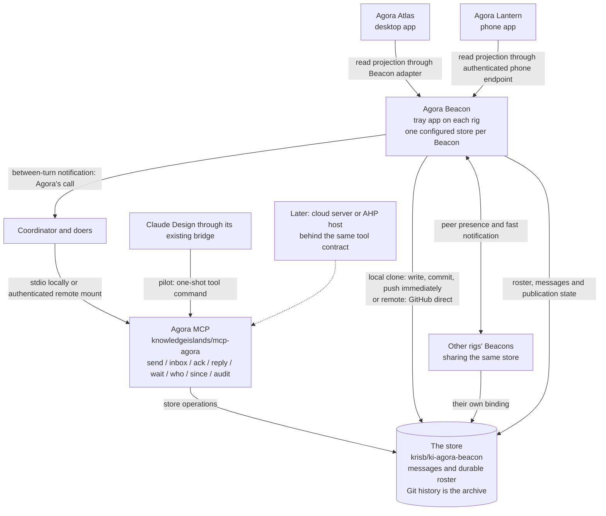

# Agora: the gap from today's system to the durable store

Design for Kris's request of 6 November 2026, about 23:20 GMT. Evidence read locally on 7 November 2026, from 03:45 GMT. This is a proposal for agreement, not implementation authority or an independent review.

## 1. The target in one picture

**The missing centre is a durable message and roster store behind the Agora MCP.** Beacon, Atlas and Lantern already exist. Their current signal, mailbox and snapshot paths do not yet implement that centre. The shortest useful delivery is the MCP and store contract, then a Beacon binding and a three-party pilot; changing every package or building a cloud service is not a prerequisite.

The target is the owner's [AGORA-STORE, AGORA-MCP-DESIGN, BEACON-REPO and APP-NAMES decisions](</Users/krisbrown/kis/knowledge-islands/ki-principal/+/_WORK/ki.prj.agora/decisions.md>). AGORA-STORE settles the draft MCP specification's Q1, Q2 and Q10: the store writer is authorised in this particular store, territories share one store with folders, and the MCP has its own repository. Those questions should not be put to Kris again. They do not authorise this read-only run to implement, publish or configure anything.

The diagram describes responsibility and direction, not a new requirement that every operation traverse every box. The MCP is the agents' gateway; Beacon may use the shared store library directly. Atlas and Lantern can read projections through Beacon without embedding Git writers or receiving store credentials.

### The five parts and their modes

- **Beacon:** the running connector on each rig, in `apps-agora.local/src/`. It binds to exactly one store, publishes its roster contribution, supplies presence and wake signals, and keeps the existing checkout observations. Several Beacons may bind to the same store. The store exception must not allow it to commit or push ordinary watched repositories.
- **Atlas:** the desktop app in `src/app/`. It presents the civilisation and the store's state, with the age and source of observations visible. It need not become a second messaging authority.
- **Lantern:** the phone app in `ios/`. It currently reads a rig's roster over the tailnet. It can gain durable store views through that read-only path before any independent remote-store client is considered.
- **Agora MCP:** the separate `knowledgeislands/mcp-agora` implementation and stable tool interface. A stdio mount, one-shot bridge command, authenticated remote mount, later cloud service and later AHP route should preserve message identity and state semantics.
- **The store:** `krisb/ki-agora-beacon`, containing `messages/<territory>/<recipient>/<timestamp>-<uuid>.md` and `roster/<territory>/<work-id>.md`. Timestamp means ISO-8601 UTC with milliseconds and `Z`. Filename order is processing order; UUID breaks equal-millisecond ties. Messages are immutable; acknowledgements and answers are further messages referring to the original. Roster files are current declarations, owned by their packages. Pruning handled messages removes tree entries in ordinary commits; history retains the archive and supports audit. Only Kris may truncate history.

**Local mode:** a registered clone, write a file, commit and attempt a fast-forward push immediately. When disconnected, retain the accepted message and its original identity locally and explicitly report that it is unpublished. Reconnection reconciles only this writer's pending operations under a bounded store-specific policy; unexpected changes stop it. Immediate push is an attempt and a status promise, not a claim that an offline write reached another rig.

**Remote mode:** no clone is required; the writer uses GitHub directly. It needs connectivity, a configured store and a credential appropriate to that store. Retry a rejected branch update using the same message identity, never a second message or a forced update. When unavailable, return a visible failure or pending result; remote mode alone has no offline durability.

**Peer fast path:** today's Beacons exchange signals over the tailnet. A later full-message fast path may reduce latency, but cannot replace the durable record or change its order. Sending the same id by peer and Git must produce one logical message. The draft's proposed `say` route is not present in today's `src/protocol.ts`.

**MCP mount versus store mode:** a remote MCP mount can use a local clone on its server; a local MCP process can use GitHub direct. Do not make the words local and remote conflate client transport with storage. A cloud server and AHP are future routes, not delivered parts of version 1. A `wait` call holds a turn already running; it cannot start a closed cloud session.

### Evidence and limits

The original `agora-gap.log` contains only a session-limit stop. There was no earlier `agora-gap` design or report in the run state directory when checked. No earlier delivery by this run was identified in the recent local history. This restart therefore continues the brief without claiming a recovered draft.

This run made no remote call or fetch. “Pushed today” can therefore only mean locally available evidence; freshness on GitHub and the other rig is unverified. At inspection, `mcp-agora` had no commits and only untracked scaffolding, dependencies and configuration, with no source implementation, README or store contract delivery observed. Its [AGENTS.md](</Users/krisbrown/kis/knowledge-islands/mcp-agora/AGENTS.md>) and [package.json](</Users/krisbrown/kis/knowledge-islands/mcp-agora/package.json>) state intended boundaries and tools, not passing implementation. The [agora-store restart brief](<agora-store-r.prompt.md>) commissions version 1 and explicitly leaves Beacon unchanged. Treat that work as in progress and reconcile its delivered contract before Phase 1.

The store's locally observed head was `b32aa28`, the repository rename; its tree still held foundation documents and working areas, with no message or roster implementation observed. The app checkout was actively changing under other runs; a later sampled head was `db31975`, with unrelated Atlas changes still dirty. This document describes source inspected during that moving window, not a frozen build or an installation audit.

**Late evidence update:** during the final pass, the concurrent store run added an uncommitted [MCP README](</Users/krisbrown/kis/knowledge-islands/mcp-agora/README.md>), `src/` implementation and [STORE.md](</Users/krisbrown/kis/personal/ki-agora-beacon/STORE.md>). The earlier observations above describe the start of the reading window, not the final tree. The MCP still had no commit at this check. These additions were read, not executed, and no passing delivery or remote publication is claimed. They substantially narrow the implementation gap but expose the following acceptance differences:

- The new contract implements the decided Markdown paths, durable roster, linked status, history-based audit and previewed harvest. Its MCP exposes the eight commissioned tools plus `presence` and `harvest`. Reads are side-effect-free; `wait` polls up to once per second, observes only locally received commits in clone mode, and does not fetch. Beacon still needs to supply refresh and wake integration.
- Clone writes fetch before adding a message and require a clean checkout and published baseline. This does not yet establish the target's ability to accept new work while fully offline. A failed push can retain a commit, but that is different from accepting a write when the initial fetch itself cannot run. Test and define both cases before calling local mode offline-capable.
- The CLI currently supports audit, harvest, who, inbox, since and refresh. Inspection of `src/cli.ts` found no send, ack, reply or wait dispatch and no draft-style `call <tool>` interface. The proposed Claude Design one-shot pilot therefore has an actual missing capability, not merely an unmeasured timeout. Add that bounded CLI surface or prove a different bridge-to-stdio route before the pilot.
- The README says reply is additive, so a repeated successful reply creates another answer. The inspected send method generates a fresh UUID, and its public schema has no client retry id. Transport retries within one operation and caller retries after an ambiguous result are different. The pilot's one-logical-message retry test still needs a stable client operation identity or an explicit constrained recovery procedure.
- Harvest currently allows an acknowledgement to satisfy a `needs_reply` message. That can remove an acknowledged but unanswered question from the active tree. Preserve the outstanding answer obligation until GAP-HARVEST is settled; an audit record alone does not keep an inbox obligation visible.
- The new contract treats the whole store as trusted to one person and allows tools to read other packages' inboxes and the whole audit. This differs from the earlier draft's per-mount message-read boundary. Mount sender identity and owned roster writes are enforced intentions, but message confidentiality between mounts is not; settle GAP-ACCESS before any broader remote/cloud mount.

Primary evidence:

- [Current app boundary](</Users/krisbrown/kis/knowledge-islands/apps-agora.local/AGENTS.md>), [product specification](</Users/krisbrown/kis/knowledge-islands/apps-agora.local/docs/spec/agora.md>), [MCP draft](</Users/krisbrown/kis/knowledge-islands/apps-agora.local/docs/spec/agora-mcp.md>), [peer protocol](</Users/krisbrown/kis/knowledge-islands/apps-agora.local/src/protocol.ts>), [mailbox watcher](</Users/krisbrown/kis/knowledge-islands/apps-agora.local/src/watch.ts>) and [state-file writes](</Users/krisbrown/kis/knowledge-islands/apps-agora.local/src/files.ts>).
- [Roster derivation](</Users/krisbrown/kis/knowledge-islands/apps-agora.local/src/roster.ts>), [package-file reader](</Users/krisbrown/kis/knowledge-islands/apps-agora.local/src/packages.ts>), [broadcast bookkeeping](</Users/krisbrown/kis/knowledge-islands/apps-agora.local/src/broadcast.ts>), [Orca waker](</Users/krisbrown/kis/knowledge-islands/apps-agora.local/src/waker.ts>) and [fixed wake wording](</Users/krisbrown/kis/knowledge-islands/apps-agora.local/src/wake.ts>).
- [Atlas model](</Users/krisbrown/kis/knowledge-islands/apps-agora.local/src/app/model.ts>), [loopback read server](</Users/krisbrown/kis/knowledge-islands/apps-agora.local/src/local.ts>), [phone endpoint](</Users/krisbrown/kis/knowledge-islands/apps-agora.local/src/phone.ts>) and [Lantern readme](</Users/krisbrown/kis/knowledge-islands/apps-agora.local/ios/README.md>).
- [Coordinator mailbox](</Users/krisbrown/kis/knowledge-islands/ki-principal/+/_WORK/ki.prj.agora/messages.md>), [illustrator mailbox](</Users/krisbrown/kis/knowledge-islands/ki-principal/+/_WORK/ki.prj.agora/identity/chatgpt/messages.md>), [information architect mailbox](</Users/krisbrown/kis/knowledge-islands/ki-principal/+/_WORK/ki.prj.agora/identity/claude-design/messages.md>) and [coordination standard](</Users/krisbrown/kis/knowledge-islands/ki-agentic-harness/skills/change-management/ki-coordination/references/standards-coordination.md>).
- [Store readme](</Users/krisbrown/kis/personal/ki-agora-beacon/README.md>) and [store contribution boundary](</Users/krisbrown/kis/personal/ki-agora-beacon/AGENTS.md>).

## 2. Gap table

Size describes delivery scope, not elapsed time: **S** is a bounded correction; **M** needs one integration plus its failure tests; **L** crosses several components or method owners. Risk is the consequence of getting the transition wrong. The detail after the table is part of each assessment.

| Capability | Exists today | Target | Gap | Size | Risk |
| --- | --- | --- | --- | --- | --- |
| Message storage | Package mailbox files | Immutable store files | Writer and adapter † | L | Lost or duplicate work |
| Presence and roster | Memory and snapshots | Durable declarations | Publisher and freshness ‡ | M | False availability |
| Addressing | Watched ids, focus lookup | Territory and recipient | Stable identity mapping ‡ | M | Wrong recipient |
| Ordering | Mailbox queue order | Filename order | Cursor and late arrivals § | M | Skipped messages |
| Read, ack, answer | ACK lines, ping files | Explicit linked status | State reducer § | M | False completion |
| Wake and listen | Call files, Orca terminal | Call plus MCP wait | Shared notification path ¶ | M | Silent queue |
| Broadcast and health | Outbox, JSONL, ack files | Store-backed fan-out | Recipient and status map ¶ | L | False healthy state |
| Offline and remote | Git mailboxes, peer queue | Clone or GitHub direct | Retry and reconciliation ‖ | L | Lost publication |
| Archive and audit | Dispersed Git history | Tree plus log audit | Harvest and reconstruction ‖ | M | Hidden obligations |
| Trust and identity | Tailnet rig identity | Mount identity and store | Tool access boundary †† | L | Impersonation |
| Atlas store view | Beacon's live projection | Durable store projection | Read adapter ‡‡ | M | Stale view as live |
| Lantern store view | Tailnet roster endpoint | Durable roster and status | Read projection ‡‡ | M | Broader data exposure |
| Doers and cloud | Two file mailboxes | One MCP contract | Identity and bridge pilot §§ | L | No reliable reply |

† **Message storage.** `src/watch.ts` notices newly added lines in a watched remote `messages.md`; `src/protocol.ts` sends `ring`, not message content. Writers still share whole mailbox files. The target separates messaging from package commits and checks, with one immutable Markdown file per message. Version 1 must supply validation, idempotency, publication status, explicit-path writes and a readable store contract. Beacon has no `[store]` binding or store adapter in the inspected code. The store writer's narrow Git exception must be documented separately from ordinary checkout synchronisation.

‡ **Presence, roster and addressing.** `src/packages.ts` reads each watched package's `work.md`, `state.md` and `messages.md`; `src/roster.ts` derives role, focus, listening and queue counts. `src/agora.ts` retains and exchanges these rows, and `state.json` is a per-rig snapshot, not the shared store. Peer presence already distinguishes present, unknown and gone. Durable roster entries should retain last-seen provenance even when a rig is unreachable. A declaration that a listener is enabled must not prove that its wait is currently armed. Unknown presence must never transfer ownership. Territory folder names need stable canonical values, rather than today's display-title fallback. Resolve focus suggestions to explicit recipients before sending and show the resolution. Doers currently have mailbox paths, not verified registered sub-package identities; the proposed illustrator and information-architect ids need adoption, not silent invention.

§ **Ordering and state.** The coordination method takes important lines first, then ordinary lines from the top; AGORA-STORE instead makes filenames processing order. The draft also describes commit order and UUID-only order in places. These are three different rules. Keep filename order for returned message batches, and use Git ancestry only to discover changes. A newly published offline message can sort before a previously handled message, so a last-filename cursor alone loses it: every newly discovered id must still be delivered once. Record an important flag as an alert unless the method owner explicitly defines an exception to processing order. ACK lines and removal commits currently mean receipt/disposition, not necessarily finished work. The MCP draft models read, acked and answered separately; the scaffold instead says read-only tools never mark read and unread means not yet acked or answered. Q3 must settle the public meaning. An ack must not close an unanswered question, and an art delivery must not silently answer an unrelated question. State reconstruction must include historical ack and answer files after harvest.

¶ **Waking, broadcasts and health.** `src/files.ts` writes both `call/<work-id>` and `doorbell/<work-id>`; the former is a one-line signal, not a mailbox. `src/waker.ts` debounces calls and sends only a fixed line to the named Orca terminal between turns; it cannot wake an Orca chat through this implementation. MCP `wait` is an in-turn listener. A store change must notify both active waits and the existing between-turn wake path, with no lost wake between checking and subscribing. Broadcasts currently use `broadcast/<work-id>.jsonl`, `ack/<work-id>/<id>` and `outbox.json`, including absent-peer queuing and refusal states. Version 1's eight-tool brief does not by itself deliver owner-only broadcast and mark tools. Preserve those paths until an adapter records the original broadcast id, the resolved recipient set, each acknowledgement and each answer. Transport delivery, message receipt, listener health and owner-requested action are distinct. Preserve the agreed health timing rather than treating a recent roster write as a successful ping.

‖ **Offline, remote, archive and audit.** Existing Git mailboxes survive offline work; the persisted broadcast outbox queues absent peers, but neither is the new store. Clone mode must record pending publication visibly and retry idempotently; GitHub-direct mode cannot accept durable offline work without another persistence mechanism. Serialise local writers and use branch-head checks remotely. Unique message names prevent ordinary message-file collisions, but roster updates and acknowledgements to the same logical question still need ownership and reduction rules. The target archives through Git history, not an `archive/` tree or monthly moves. Harvest should remove only an eligible complete thread whose obligations are satisfied under the agreed policy, in one ordinary commit, with preview and audit. ACK alone is insufficient for a question requiring an answer. An audit must find pruned originals and replies through the log, reconstruct status, and distinguish never-seen from pruned data. History truncation remains Kris's alone; neither retries nor cleanup may rewrite it.

†† **Trust and identity.** Peer requests already require a configured peer vouched for by Tailscale and the same `rig` in the body (`src/server.ts`). The phone's separate rule permits this Tailscale user's devices, not only configured rigs. Atlas's action socket is owner-only and accepts only broadcast, away and mark requests. None establishes the work-id identity of an MCP caller. Bind sender identity to a mount, never a tool's freely supplied `from`; verify remote credentials independently of transport reachability. Anyone's ability to query the roster is not permission to read every message or overwrite another package's roster. The same-user local-process limit must be stated honestly: filesystem access cannot be turned into cryptographic isolation by a schema. Public remote MCP authentication, owner broadcasts and broader cloud access need their own bounded design before exposure.

‡‡ **Atlas and Lantern.** Atlas builds its model from Beacon's live view and local estate information. Lantern's `GET /v1/roster` on the rig's tailnet address returns the same in-memory group roster and is read-only. Neither reads the new durable store today. Introduce one tested store projection in Beacon, then expose durable roster, open obligations, publication lag and historical queries without making UI reads acknowledge messages. Keep the phone's authenticated read boundary, cache age and unavailable state. A phone need not hold GitHub credentials to show the store. Reading while all rigs sleep needs a later remote reader or cloud route; it is not delivered by the existing endpoint.

§§ **Doers and cloud.** The two doer mailboxes still instruct replies into the coordinator's Inbound and allow uncommitted replies. The recorded ILL-24/ILL-25 episode shows that an art delivery can hide a question, and the later ACKs describe polling and idle-wake limitations. The MCP draft proposes a one-shot bridge command for Claude Design, with `wait` shorter than the bridge's reported 180-second bound; that blocking behaviour has not been measured here. Verify actual command support, identity, timeouts and cancellation before claiming a listener. No local source inspection proves a cloud connector can mount a public MCP or wake between turns. The pilot can use the existing bridge without opening a public service. AHP remains a future delivery substrate.

### Draft specification changes required by the target

The [MCP specification](</Users/krisbrown/kis/knowledge-islands/apps-agora.local/docs/spec/agora-mcp.md>) remains useful for the tool semantics and modes, but its current paths and several guarantees have been overtaken:

- Replace `store/v1/<territory>/messages/<month>/<uuid>.json` with the decided recipient-specific Markdown path, and the old JSON roster path with `roster/<territory>/<work-id>.md`.
- Replace the draft's approximately 30-second batching promise with immediate commit/push attempts. Document offline pending publication rather than promising network success.
- Replace month-folder archival with pruning from the tree and reconstruction from history; specify harvest eligibility and preview.
- Remove Q1, Q2 and Q10 from open decisions, recording AGORA-STORE's answers. Align the eight-tool version 1 scope with the larger draft tool catalogue; `view`, `broadcast`, `mark`, `join` and `leave` are not proved by that scope.
- Reconcile filename processing order with the draft's commit-order and UUID-only descriptions. Distinguish discovery order, processing order and publication checkpoints.
- Reconcile durable roster ownership, multi-rig seats and receipt semantics with the delivered `STORE.md`. The scaffold's no-read-side-effects rule is a current implementation intention, not an owner answer to Q3.
- Narrow `AGENTS.md` and the product specification's blanket no-commit/no-push language only for the configured store. Keep all ordinary watched repositories under the current rule.

## 3. Misnamings and how to fix each

These are proposed migrations, not edits performed by this run. “Now” means the next approved bounded delivery. Keep historical decisions, old message ids, quoted instructions and retirement constants as history; a global search-and-replace would corrupt the distinction between products and the model.

### N1 - Portal used for the running Beacon

**Current → proposed:** `Agora Portal` as the running app → `Agora Beacon`; `Portal open` for the Beacon's availability → `Beacon connected` or equivalent state wording.

**Where:** `src/app/shell.ts`'s `beaconStatus`, older app design notes, generated architecture source/pages, and `ki.prj.agora/_emerging/agora-plan.md`. `src/main.ts`, `src/menu.ts` and packaging largely use Beacon already. `PORTAL-*` decision tags in comments are historical references, not product names requiring renumbering.

**Migration:** correct active prose and status wording now in one owned slice; regenerate owned diagrams from their source rather than editing only exported pages. Keep old decision tags and dated history. Agora owns app files; the coordinator owns its package notes. No model-wide rename of portal.

### N2 - `portal.sock`

**Current → proposed:** `$STATE/door/portal.sock` → `$STATE/door/beacon.sock`.

**Where:** `src/door.ts`'s `doorPath`, its tests and callers in Beacon and Atlas, and `docs/design/agora-app.md`.

**Migration:** update both applications in the same installation. If mixed builds must coexist during the two-rig rollout, let the new Atlas try the new socket then the old socket; remove fallback after both running builds use the new path. Avoid a permanent alias. Keep the owner-only directory/socket and the three allowed actions. Households own installation; this is unrelated to the peer transport or MCP mount.

### N3 - `doorbell`

**Current → proposed:** `doorbell/<work-id>` → `call/<work-id>`, already the preferred name.

**Where:** `src/files.ts` dual writes, tests, README and design/spec transition text; `ki.prj.agora/state.md` still names the old path; current mailbox ACKs say some threads wait on both. Household-terra's history also records the earlier stale install.

**Migration:** confirm the installed Beacon and each actual listener on sol and terra uses `call/`, then stop the dual write and remove active old-path instructions. End condition is observed consumer migration, not 20 November or another arbitrary long window. FAST-MOVE permits a short transition. Preserve historical ACKs and the installer evidence. Agora owns the producer; listener owners and households must confirm their side. Do not retire it solely because source was renamed.

### N4 - Agora's call versus `wait`

**Current → proposed:** keep **Agora's call** for the wake signal; name **MCP wait** for the active tool listener. Proposed register value `agora-mcp`, subject to Q8.

**Where:** README's `agora-call`, `poll`, `on-open`, `off` values; `docs/spec/agora-mcp.md` Section 15; coordination-standard watcher descriptions and package worker registers.

**Migration:** add the MCP listening value with the method owner's agreement, retaining `agora-call` for actual file/terminal listeners. A worker may receive a call between turns and use `wait` within a turn; these are complementary capabilities. No blanket rename to `wait`, and no claim that a mounted but idle MCP is listening. Cross-owner: coordination method, work-package schema and binding owners.

### N5 - `call/<work-id>` mistaken for the mailbox

**Current → proposed:** retain `call/<work-id>` as a notification path; move payloads to `messages/<territory>/<recipient>/...md` and tool reads.

**Where:** `src/files.ts`, `src/calls.ts`, the waker, README and listener examples. `src/wake.ts` currently tells a woken thread to read `messages.md` and its broadcast file.

**Migration:** store-aware wake wording directs migrated recipients to their MCP inbox while retaining the old wording for unmigrated recipients. Keep the line fixed and free of message text. Calls also carry checkout `ahead` and `settle` notices, so even complete mailbox migration does not justify deleting all call machinery. A call path can be retired only after every notification class has a proven replacement and every consumer has moved.

### N6 - Planar portal versus beacon store

**Current → proposed:** keep **planar portal** as the conceptual crossing; call the durable repository **the beacon store** or **Agora store** in operational instructions.

**Where:** the store's README, AGENTS and `.ki.toml` still define an almost-empty transit-only island that holds nothing longer than crossing needs; app specifications and walkthroughs use the planar portal model.

**Migration:** revise the store's purpose and layout to durable state and history, while explaining how it serves the planar portal. Preserve island/principal/planar portal vocabulary under APP-NAMES. The watchman remains a valid keeper name; clarify its audit and harvest stewardship against Beacon's automated writes. The store owner must agree the contribution boundary with the MCP owner. Do not rename the repository again to remove Beacon from its name.

### N7 - `ki-portal` repository identifiers and paths

**Current → proposed:** `krisb/ki-portal`, checkout `.../personal/ki-portal`, island key `ki-portal` → `krisb/ki-agora-beacon`, `.../personal/ki-agora-beacon`, key `ki-agora-beacon`.

**Where:** `src/app/renderer/index.ts`'s `drawPortal` still searches the literal island key `ki-portal`; this can put the map arc on its fallback household instead of the store's island. The chezmoi source checkout has `kis/personal/dot_mgit.toml` with `[members."ki-portal"]` and the old Git remote. `personal.reg.inbox-sol/state.md` still conditions a held Inbox rename on `ki-portal`; household and Inbox decisions and design boards also contain historical references. The store README correctly explains the old name. Some walkthrough/design prose now incorrectly says `ki-agora-beacon` was renamed to itself or was named itself until 6 November.

**Migration:** fix the active Atlas island lookup and the self-renaming prose now; retain a short old-key lookup only if a verified old registry consumer still requires it. Household owners update chezmoi source, registry, trust and mgit bindings and terra's physical checkout through their own workflow, reviewing `chezmoi diff` before apply. This run did not inspect private client trust files or terra, so those remain a household inventory requirement. Update active dependency descriptions in Inbox; preserve dated decisions and original artboards with a dated annotation. No upstream redirect is a substitute for correcting local bindings. Cross-owner: households/chezmoi, Personal registry and Inbox. No active `ki-portal` match was found in the tracked text searched in `tools-rig`; Rig is still affected by configuration ownership, not a proved stale literal there.

### N8 - Bundle ids and launch agents

**Current → proposed:** current Mac ids are already correct: `info.knowledgeislands.agora.beacon` and `info.knowledgeislands.agora.atlas`. Keep them. Retire old `info.knowledgeislands.agora` and `info.knowledgeislands.agora.viewer` installations only through the existing installer.

**Where:** `src/bundle.ts`, `electron-builder.json`, `electron-builder.app.json`, `packaging/macos/`, and the old-program migration in `src/install.ts`. The installer already recognises `Agora Portal.app` and `Agora.app`, removes only old program paths and retires the old launch agent/login items.

**Migration:** verify both rigs' installed apps, launch agent and login items after a household-owned update. Keep retirement constants while any old install remains; their old names are intentional compatibility code. Do not change working bundle ids for style. Lantern's current signing file already declares `info.knowledgeislands.agora-lantern`, with the display name Agora Lantern. Preserve that identifier; a gratuitous identifier change would create a different app identity. Installed behaviour was not checked here.

### N9 - iOS source and project still named Beacon

**Current → proposed:** `ios/AgoraBeacon/`, `AgoraBeacon.xcodeproj`, target/scheme/product `AgoraBeacon`, `BeaconApp.swift` and `struct BeaconApp` → the corresponding `AgoraLantern` and `LanternApp` names.

**Where:** iOS directory, project file and build commands in `ios/README.md`. The display name and signing identifier are already Lantern, so this is internal naming debt, not a missing product rename.

**Migration:** one atomic source/project/command rename, preserve bundle id and settings keys, build for a simulator and verify a device upgrade under the same identity. No alias is needed if the households' documented build commands move in the same delivery. Coordinate with the current Lantern owner before touching this actively changing area.

### N10 - `[phone]`

**Current → proposed:** retain `[phone]`, `PhoneConfig` and `/v1/roster` as the generic read-only phone-view capability. Rename the app to Lantern in visible prose only.

**Where:** `src/config.ts`, `src/phone.ts`, tests and iOS setup documentation.

**Migration:** no configuration rename is justified by APP-NAMES: this key names a transport capability, not the app. If Kris wants a branded `[lantern]` key, accept `[phone]` temporarily, reject conflicting dual settings, and remove the alias only after both households render the new key. That optional churn is not a dependency for the store or pilot.

### N11 - Package naming and scope

**Current → proposed:** keep `ki.prj.agora` and its title `KI > Techne > Agora`; update its definition to encompass the five parts.

**Where:** package `work.md`, `state.md`, `_emerging/agora-plan.md` and related vision/alignment notes. `work.md` still describes only a menu-bar app, puts some KIV ownership outside, and carries broader jobs/account ambitions than the current read-only boundary. Its state still describes early-November next steps and the old listener path.

**Migration:** coordinator-owned scope and state correction, retaining ids and links. Refresh the [Agora Project](</Users/krisbrown/kis/knowledge-islands/ki-principal/Streams/Projects/agora.md>) if its current definition needs the same five-part scope. Do not split into five Projects merely because there are five software parts. Package definitions and roadmap capture belong to the coordinator; no records were changed here.

### N12 - Mailbox and identity folder names

**Current → proposed:** `identity/chatgpt/messages.md` → the illustrator's store address; `identity/claude-design/messages.md` → the information architect's store address. Proposed work ids in the draft are `ki.prj.agora.illustrator` and `ki.prj.agora.information-architect`, not provider names.

**Where:** both mailbox headers and instructions, doer briefs, the MCP pilot spec, and references to art/design packs under `identity/`. The owner decision DOER-PACKAGES explicitly deferred conversion, so these identities are not established just by appearing in the draft.

**Migration:** adopt the two role identities with the method/package owner, mount them, move open obligations with a source-message mapping, then leave an explicit store pointer in the old mailbox for a short transition. Reconcile fallback messages before the pointer becomes authoritative. The art directories may stay in place; transport migration must not move or break design artifacts. A later role-based asset-folder rename is optional and must update links atomically. Retain old ILL/CD/MSG ids as legacy references, never reinterpret them as globally unique store ids.

### N13 - MCP executable and specification vocabulary

**Current → proposed:** product **Agora MCP**, repository `mcp-agora`; choose one executable spelling and document it consistently. The draft examples say `agora-mcp`, while current scaffolding declares binary `mcp-agora`.

**Where:** `docs/spec/agora-mcp.md` mount and bridge examples, scaffold `package.json`, future client binding inventory. The draft also names `store/v1`, JSON messages, monthly archives and `register.toml` as if they were the selected version 1 layout.

**Migration:** prefer the implemented binary `mcp-agora` in setup examples once delivery confirms it; an `agora-mcp` CLI alias can cover already deployed mounts if any exist. Product naming does not require the listening register word to match the executable. Replace obsolete layout claims through the spec's owning run. Do not add a register or a new configuration source simply because the earlier draft drew one; households and Rig already own configuration. Cross-owner: MCP, specification and binding owners.

## 4. Plan

**Recommendation: follow these six gates, confidence high.** They preserve the existing delivery paths until each replacement has a concrete acceptance test. No phase authorises another owner's edit or an installation. These are proposed roadmap captures by their receiving owners, not newly allocated record ids; no roadmap record is created by this read-only run.

### Phase 0 - MCP and store version 1, in progress

**Goal:** one tested contract and a usable gateway, independent of Beacon changes.

**Steps:** receive the agora-store delivery; reconcile its `STORE.md` and MCP README with AGORA-STORE; document local/direct modes, sender identity, failure results and the actual tool surface. Test immutable files, filename order, linked ack/reply status, local writer serialisation, remote branch races, retries after ambiguous success, `wait` timeout/cancellation, `since` and history-backed audit. Preview harvest and distinguish an acknowledged request from an answered question. Close or explicitly defer the late-pass gaps: initial-fetch-offline acceptance, caller retry identity, the missing one-shot mutation/wait commands and mount read scope. Resolve target-versus-draft discrepancies explicitly.

**Done when:** the delivered MCP checks pass in its repository; tests use temporary repositories and injected remote transports; a clean temporary clone round-trip and a simulated GitHub-direct round-trip produce the same logical state and filenames; a pruned message remains auditable from history. Include test evidence and limitations in the store run's report. This run has not executed those checks or certified version 1.

**Dependencies and agreement:** agora-store owns delivery; Kris and the method owners settle the open semantics below before those semantics are adopted broadly. No Beacon binding, client configuration or production messages are required to finish this phase.

**Roadmap captures:** MCP/store version 1 and contract reconciliation, owned by Agora with records in the implementing repositories; a separate historical-audit/harvest slice if not delivered in version 1. Do not duplicate work already being built by agora-store.

**Reversal:** keep production mailboxes authoritative; remove the unused MCP mount if later installed. Retain test/delivery evidence and history; no production message migration has occurred.

### Phase 1 - Bind Beacon to one store and publish its roster

**Goal:** durable roster and an explicit store binding without moving existing package mailboxes.

**Steps:** add a proposed `[store]` configuration with mode, repository identity, local checkout when required and canonical territory mapping; validate one store per Beacon, and leave store mode off until configured. Households provision the clone/credentials; Beacon installs nothing. Use the canonical MCP store library through a local path or vendored copy with a drift check, following the delivered distribution arrangement; no registry publication is needed. Put I/O in an adapter outside `src/main.ts`, retaining pure presence/protocol logic. Publish package-owned roster entries, with provenance and last-seen time, through the store-specific writer; expose publication errors and stale data. Decide the single active roster writer rule before allowing two rigs to update one package. Add store-change notification to the existing call path, without claiming the draft's full peer `say` implementation.

**Done when:** two Beacons against a temporary shared store see the same durable roster after restart, stale entries stay queryable with their age, a network outage retains pending local updates, and recovery loses no message or declaration. Remote-mode tests cover branch-head races. Only the configured store is ever committed/pushed; unrelated dirty paths stay untouched; ordinary checkout sync still never commits or pushes. App `self:check` and tests pass before its implementation commit.

**Dependencies and agreement:** Phase 0's frozen contract and local-writer behaviour; Agora/MCP owners for code sharing; package owners for roster updates; households/Rig for provisioning and configuration. The product boundary documentation must name the narrow store exception.

**Roadmap captures:** Beacon store binding and writer boundary; durable roster publisher; household adoption instructions owned by each household. Route adoption as agreed handoff messages later, not foreign roadmap writes now.

**Reversal:** disable the store binding and use the existing roster source; store history remains. Do not overwrite newer store declarations with a stale snapshot during rollback.

### Phase 2 - Pilot the coordinator and two doers over the MCP

**Goal:** prove useful interaction and visible obligations, including Claude Design, before changing the coordination method for everyone.

**Steps:** adopt the two doer identities and register their owner/rig; mount the coordinator and illustrator; first provide the one-shot send/ack/reply/wait operations missing from the inspected CLI, or prove an equivalent bridge-to-stdio adapter, then verify it through Claude Design's existing bridge. Start with bounded waits, then measure the bridge limit and cancellation. Declare a per-recipient cutover point and one authoritative send path for each exchange. Run a ten-round interaction exercise on each link, then a real brief with a question in each direction and an art delivery referring to its brief. Replay the missed-question case from ILL-24. Exercise a timeout, a repeated send, an offline sender and the coordinator restarting. Keep mailbox fallback with an explicit source/id mapping and reconciliation rule; do not blindly dual-send every message.

**Done when:** no message or question is lost, repeated operations produce one id, ack leaves a required answer open, all pilot questions end answered, and the final owed count is zero. Measure per-link latency against the agreed listening interval; distinguish tool wait latency from waking an idle session. `who` shows actual/stale listening honestly. The pilot writes no mailbox line unless an intentional fallback test requires it, and each fallback line is reconciled exactly once. Reports identify the clouds' unproved between-turn wake behaviour.

**Dependencies and agreement:** Phases 0–1; Kris approves the pilot window and proposed plan; coordinator, both doers, package/method and binding owners agree identities and listening words. No public endpoint, Funnel or new scheduler is part of the initial pilot.

**Roadmap captures:** three-party messaging pilot; cloud bridge capability probe; MCP binding adoption. Capture a later remote-cloud design only if the measured bridge route is inadequate and Kris chooses it.

**Reversal:** stop pilot sends, reconcile every pending store message and fallback line, record the last authoritative checkpoint, then resume the two file mailboxes. Preserve store history and doer art paths.

### Phase 3 - Atlas and Lantern read the store

**Goal:** the person can see who holds work and which messages need a reply, with durable state behind both viewers.

**Steps:** make Beacon's projection combine store declarations and message state with independently observed rig presence. Add age, pending publication, owed/waiting counts and history links. Make Atlas use it through its read adapter; extend Lantern's authenticated read endpoint with only the agreed fields and version the response when compatibility requires it. Read-only UI actions must not acknowledge messages. Show unavailable/stale state when the store or rig cannot be reached. Fix the Atlas `ki-portal` island key and the incorrect active product wording in a bounded slice; handle iOS internal renaming separately from store integration if that makes review easier.

**Done when:** both viewers agree on a seeded store before and after restart/harvest, a missing Beacon is shown honestly, viewing a question leaves it open, and the phone rejects other identities and all writes. A same-bundle-id Lantern upgrade keeps settings and its configured endpoint. Test the adapter with controlled fixtures, not live production traffic.

**Dependencies and agreement:** store contract and roster/status semantics; Atlas and Lantern owners, Kris for the visible design, households for installation. A standalone phone route while every rig sleeps is a separate later scope.

**Roadmap captures:** store-backed Atlas view; store-backed Lantern projection; optional atomic iOS internal rename. Existing [KI-AGORA-NET-001](</Users/krisbrown/kis/knowledge-islands/apps-agora.local/docs/roadmap/KI-AGORA-NET-001-observatory-read-endpoint.md>) is the current read-endpoint context, not evidence that this store slice is already delivered.

**Reversal:** retain/version the old read projection for the short consumer transition and switch viewers back; no message or roster write is undone.

### Phase 4 - Migrate packages' `messages.md` with method owners

**Goal:** messaging is independent of package-repository commits, while the method still requires real receipt and disposition.

**Steps:** agree changes to coordination and work-package standards, inbox checks, route receipts, important-message handling, listening state, marks and report counts. Coordinate the portable MCP binding inventory and the checks that currently assume `messages.md`. Move one package at a time after the pilot, starting with `ki.prj.agora` and then an agreed Inbox package. Inventory open inbound/outbound items; import each once with its legacy source/id, recipient and status; publish a cutover checkpoint. Leave a store pointer where the package standard requires one. Old file history remains in the source repository. A notification never becomes receipt, and an ACK never becomes execution authority.

**Done when:** every source obligation maps to exactly one store record with no pending item silently closed; sender and recipient counts reconcile; important notices are still surfaced under an agreed processing rule; both rigs and every runtime used by that package can read, ack and answer; bootstrapping the package finds the right queue. Method tests/audits accept the new representation and fallback, and the owners explicitly receive the change.

**Dependencies and agreement:** successful pilot and visible store view; coordination method owner (the current scope points to Ways of working, while TOPIC-HOMES routes communication questions through Inbox), `ki.sop.main`/work-package owner, binding/guild owner, and each migrating package's owner. Resolve that routing before any cross-owner change. Households own client provisioning. No method edit or adoption message is sent by this run.

**Roadmap captures:** method/store mailbox contract owned by the harness/method owners; per-package migration owned by each receiver; binding inventory adaptation owned there. The Agora coordinator captures only its implementation and pilot work; a rollout request is a handoff, not a sender-created roadmap record in someone else's repository.

**Reversal:** pause the affected recipient, reconcile store changes since cutover, export still-open items to its fallback mailbox with stable source ids, then re-enable the old watcher. Preserve the cutover map and store history. Never run two independently authoritative queues during rollback.

### Phase 5 - Retire only the replaced paths

**Goal:** one understandable messaging system, with the remaining wake paths named for their actual purpose.

**Steps:** verify every consumer and notification class; stop `doorbell/` dual writes after its shorter transition, then stop migrated-mailbox `ring` watches. Retire the legacy broadcast/ack files and outbox only when store-backed fan-out, absent-peer delivery and health acknowledgement are proved. Remove socket/executable aliases after their consumers move. Update active docs and package state; keep historical names in dated evidence and audit mappings. Keep call machinery for checkout and between-turn notifications unless an independently proved replacement covers those too.

**Done when:** observed consumer inventory has zero old-path readers/writers over an agreed active cycle including both rigs and an offline/reconnect case; no outstanding legacy obligations remain; current instructions have no unintended old identifiers; audit still reconstructs pruned message threads. Kris and affected owners agree the retirement, rather than inferring it from an absence of traffic.

**Dependencies and agreement:** Phases 2–4 for the relevant consumers, households' installed-build confirmation, method owners and all affected package owners. FAST-MOVE favours hours needed to migrate known consumers over fixed multi-week deprecation windows.

**Roadmap captures:** call/doorbell retirement, legacy mailbox watcher retirement, broadcast/outbox retirement and active-name cleanup as separate small slices. Any remaining cloud or AHP capability remains separate.

**Reversal:** re-enable a compatibility adapter only with its cutover checkpoint and idempotency map intact; do not restore archived messages as new messages or rewrite history. Removal of an obsolete path must not require deleting its historical evidence.

## 5. Decisions for Kris

Q3–Q9 below are the still-open questions from the MCP draft, preserved under their original ids. Q11 and Q12 remain relevant to checkpoints and multi-seat status; AGORA-STORE did not answer them. Additional tags identify target-specific design choices. These are written proposals, not questions taken interactively. Recommendations requiring the method's independent query review have not received that review: the brief prohibits starting agents and calls this an independent design run. The supervisor should arrange that review before presenting those recommendations for a final owner decision; this run neither claims review nor launches it.

### Q3 - What reading a message records

**Context:** The draft says inbox/wait create read receipts, with a choice about persisting them. The current MCP scaffold instead says reads have no side effects and unread means not yet acknowledged or answered. Durable ack and answer records provide recovery, but they do not prove that someone merely looked at a message.

**Query:** Should version 1 retain only durable acknowledgements and answers, or also record reading separately?

**Options:**

a) (recommended, confidence medium - explicit acknowledgements survive retries and avoid making a viewer's read change workflow state) Keep reads side-effect-free in version 1; persist ack and answer messages, label the queue as unacknowledged/open where appropriate, and reserve read telemetry for a later explicit capability.

b) Record durable read receipts in Git, distinguishing read, acknowledged and answered, and make receipt-writing an explicit documented effect of the relevant tools.

c) Keep read telemetry only in a live queue and label it as unavailable or unknown after restart or across offline rigs.

### Q4 - Message kinds and default reply obligations

**Context:** The six target kinds are brief, question, answer, art, ack and info. The draft makes brief and question need a reply by default. This catches missed questions but can leave a completed brief open unless art delivery or a closing answer is defined carefully.

**Query:** Should both briefs and questions require a reply by default?

**Options:**

a) (recommended, confidence medium - explicit closure makes an unanswered instruction visible while allowing informational exceptions) Keep the six kinds; default brief and question to needs_reply, permit an explicit override, and require a linked closing answer when a deliverable alone does not satisfy the brief.

b) Default only questions to needs_reply, requiring a sender to opt each brief into a reply obligation.

### Q5 - Who may send a brief

**Context:** Addressability is not authority. The current coordination method requires routed work to receive and dispose of a request within its own authority. A transport allow-list could block legitimate cross-package routing, while an unrestricted sender must not acquire execution rights.

**Query:** Should the MCP enforce coordination routes, or leave authority judgement with the recipient?

**Options:**

a) (recommended, confidence high - the existing method already assigns authority judgement to the recipient and a stable sender identity permits audit) Allow an identified package to send a brief to a known recipient; enforce identity and message access, and leave execution authority and disposition to the recipient's rules.

b) Encode allowed coordination routes in the MCP and refuse briefs outside those routes, with a separately owned policy and update process.

### Q6 - Where a mark's Summary appears

**Context:** Today's Summary belongs in the agent's owner-facing conversation. The draft proposes that the mark can receive an answer so Atlas can show a complete picture. A transport acknowledgement must not imply that the Summary was delivered or that its work was accepted.

**Query:** Should a completed mark also receive a store answer?

**Options:**

a) (recommended, confidence medium - the conversation remains the owner's surface while the store can distinguish acknowledgement from completed reporting) Keep the full Summary in its normal conversation and send a linked answer identifying that Summary after it exists; Atlas shows that completion and pointer.

b) Keep the Summary solely in the conversation and store only the mark acknowledgement, leaving Atlas unable to prove reporting completion.

c) Store the full Summary as the mark's answer as well, accepting duplicate retained content and defining which copy governs.

### Q7 - Claude Design's route for the pilot

**Context:** The existing bridge already reaches the local mailbox, but a blocking MCP command has not been measured here. Public remote mounting, authentication support and between-turn waking remain unverified. A cloud server would add a new operational dependency.

**Query:** Which route should the initial Claude Design pilot use?

**Options:**

a) (recommended, confidence medium - it uses the existing route and can be measured without exposing a new endpoint) Verify the one-shot MCP command through the bridge first, with bounded waits below the bridge limit and explicit timeout/cancellation tests.

b) First investigate a directly mounted authenticated remote MCP, and require a separate connection/security design before exposing it.

c) Defer the cloud doer until a cloud-hosted Agora service is designed and operated.

### Q8 - The listening word for MCP wait

**Context:** `agora-call` currently describes a file/terminal notification route. `wait` holds a live turn and does not wake a closed one. Treating them as the same listening mechanism would hide materially different guarantees.

**Query:** Should the worker register name MCP wait separately?

**Options:**

a) (recommended, confidence high - the listener name should distinguish an active tool wait from a between-turn notification) Add `agora-mcp` for a worker actively listening with wait, preserve `agora-call` for the call route, and have the method owner define how both capabilities are represented.

b) Keep `agora-call` as the umbrella value and add a separate field explaining whether the current listener is a file wait, terminal wake or MCP wait.

### Q9 - Join and leave at MCP mounts

**Context:** Version 1 is commissioned with eight tools and does not necessarily implement join/leave. Today's roster is derived from package files; the target roster is durable and package-owned. Automatically treating any mount as listening could leave false live entries after abrupt exit.

**Query:** Should every MCP mount have to join, or should Beacon remain the initial roster publisher?

**Options:**

a) (recommended, confidence medium - it keeps version 1 bounded and avoids two competing writers before the pilot establishes mount lifetimes) Keep explicit join/leave optional initially; Beacon publishes the package declaration, mounts bind a verified identity, and an active wait reports only its observed listening lifetime. Revisit mandatory mount registration after the pilot.

b) Require an idempotent join at mount startup, lease its live status and mark leave on clean shutdown; specify expiry and single-writer reconciliation before delivery.

### Q11 - Checkpoints across durable and live routes

**Context:** A Git commit records discovery/publication, while filenames define processing order. A future live queue can expose an id before its Git commit arrives. A commit reference from unpublished offline history may also cease to be a usable ancestor after reconciliation.

**Query:** Should agents receive one opaque combined checkpoint or manage a checkpoint for each route?

**Options:**

a) (recommended, confidence medium - one gateway can deduplicate routes without exposing their implementation to every agent) Give version 1 a store-scoped Git checkpoint, with explicit pending-publication status; extend it opaquely for live delivery later, retaining stable ids and a defined recovery scan when a reference is unknown.

b) Return separate Git and live checkpoints and require each client to retain both and deduplicate messages.

### Q12 - A package seated on two rigs

**Context:** The old draft's receipt filenames could collide across two seats. The target's immutable ack/answer messages avoid that physical receipt-path collision, but status still needs to say whether one seat or both must respond. The roster now has one path per work id, not one per rig.

**Query:** Should package-level acknowledgement be enough when two rigs have seats for the same work?

**Options:**

a) (recommended, confidence medium - the recipient is a work package and one accountable active owner avoids duplicate obligations during the pilot) Treat receipt and reply obligations as package-level, retaining each event's rig provenance; use one active roster writer per package and require an explicit handoff before another rig writes it.

b) Require per-seat receipts and represent several seats inside the package's roster file, with explicit rules for which seat owns each obligation and for concurrent updates.

### GAP-ORDER - Filename order and important messages

**Context:** AGORA-STORE specifies filename processing order. The coordination standard currently takes important mailbox lines first, then ordinary lines from the top. Late offline publication can also introduce a filename earlier than one already processed. Neither commit order nor a last-filename cursor resolves both issues.

**Query:** Should the store retain strict filename processing order and treat importance as an alert rather than reordering?

**Options:**

a) (recommended, confidence high - this preserves deterministic processing and a change-based scan prevents older offline messages being skipped) Keep filename order for each discovered batch, surface importance as an alert, and require the method owner to state any urgent handling exception explicitly; use stable ids plus change checkpoints for late arrivals.

b) Have the method owner define an explicit priority-order exception and amend the processing contract to describe when priority may override filename order.

### GAP-HARVEST - Keep unanswered obligations active

**Context:** The new in-progress store contract permits harvest when a reply-requesting message is acknowledged or answered. The draft's workflow semantics distinguish receipt from an answer. An acknowledged question could therefore disappear from the active tree while its sender still needs the answer, although history retains it.

**Query:** Must a message requesting an answer remain in the active queue until answered or explicitly closed by its sender?

**Options:**

a) (recommended, confidence high - acknowledgement proves receipt but does not satisfy the outstanding answer obligation) Keep needs_reply obligations active after ack; permit harvest only after an answer or explicit sender closure, with the complete thread and audit provenance preserved.

b) Permit ack-only harvest, but require every inbox/open-obligation query to reconstruct unresolved answer obligations from history so pruning cannot hide them.

### GAP-ACCESS - Who can read messages through a mount

**Context:** The earlier MCP draft limits a mount to its own messages and threads, while the new uncommitted contract explicitly trusts the whole store to one person and permits cross-package inbox and audit reads. The target explicitly makes the roster queryable by anyone; it does not settle message-read scope. A remote cloud mount makes this difference material.

**Query:** Should version 1 retain whole-store reading only within the person's trusted local environment, with broader remote mounts gated on a separate access design?

**Options:**

a) (recommended, confidence medium - this states the actual trust boundary honestly while keeping the pilot usable without a new public service) Permit whole-store reads for explicitly trusted local or existing-bridge mounts, disclose that scope, and require a separate least-privilege design before granting a wider remote/cloud mount access.

b) Require per-work-id message-read filtering before the pilot, retaining universal roster queries and owner-only full audit.

### GAP-PLAN - Approve the next bounded delivery gates

**Context:** MCP/store version 1 is in progress. Beacon integration, a three-party pilot, viewer reads and method-wide mailbox migration are distinct changes with different owners. The design identifies them without opening records or granting implementation authority.

**Query:** After version 1 is received, should the coordinator prepare and bring back the Beacon binding and pilot as the next bounded plan?

**Options:**

a) (recommended, confidence high - these two gates prove durability and real reply handling before requiring other packages to migrate) Agree the phase order, receive version 1, and have the coordinator prepare the Phase 1 and Phase 2 records and owner agreements; later phases remain gated on their tests and method-owner agreement.

b) Hold after receiving version 1 and revise this design before planning Beacon integration or the pilot.
