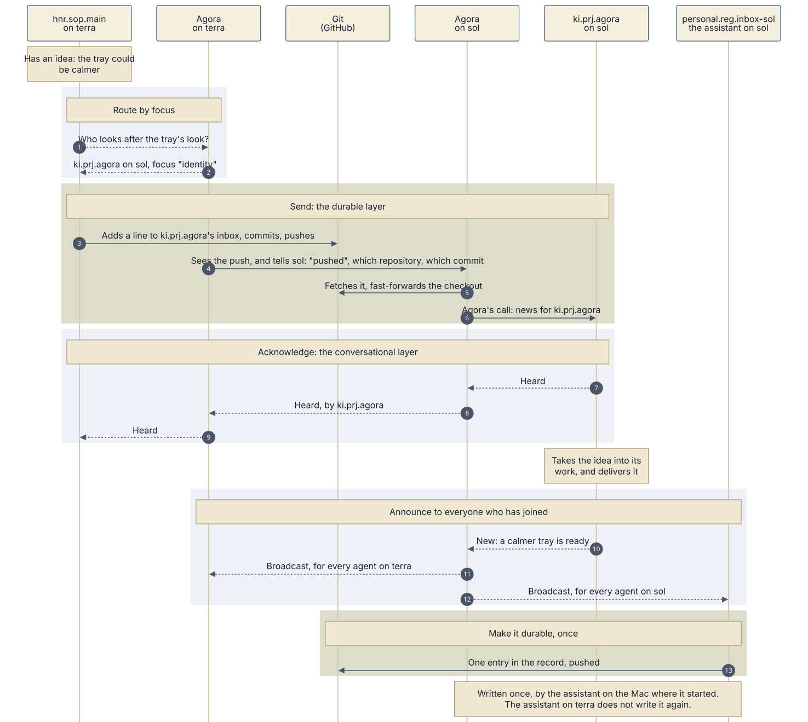

# How Agora fits together

Three pictures of Agora for Kris, in plain terms. Each has its Mermaid source and a rendered SVG in [diagrams/](diagrams/), in light and in night.

In every picture, solid lines work today and dashed lines are the target or a gap. Blue outlines are agents, teal is Agora and green is Git. Amber with a dashed outline is not built yet, and rust with a dashed outline is a gap with no way through today. Colour is never the only carrier: each target is also dashed and says so in words.

Two layers run through all three (TWO-LAYERS, Kris, 6 November about 05:00 GMT):

- **Durable: Git.** Work packages, messages that carry instructions, decisions, hand-offs and announcements. Written once, kept for good.
- **Conversational: Agora.** Presence, calls, broadcasts, pings, acknowledgements and quick exchanges. Fast, with no commits; if one is lost, it costs only time.

## 1. One Mac

[Source](diagrams/1-one-mac.mmd) · [night](diagrams/1-one-mac-night.svg)

Read it left to right.

- **Joining.** An agent joins the Agora when its household lists its work package in Agora's watch list. From then on Agora watches its inbox, its `messages.md`, and calls it when something arrives.
- **Local messaging.** An agent with something to say adds a line to the owner's `messages.md` and commits. Agora sees the commit the moment it lands and writes the owner's **Agora's call**, one small file per agent. Quick exchanges that need no record go straight to the call, with no commit; that path is the target, not yet built.
- **Speaking to everyone.** Kris's Broadcast, Away, I'm back, Ping and Mark all go into each agent's broadcast file, then ring its call.
- **Waking, by kind of agent.**
  - Claude Code, in an Orca chat or a terminal, keeps its own wait on its call file, so the call wakes it. This is proved on sol.
  - Claude Code or Codex in an Orca terminal is woken by Agora typing one fixed line between turns. This is built, and proved on a plain shell.
  - Codex in an Orca chat has no way in yet. It waits for Orca to ship chat send.
  - Claude Desktop and Claude Design read their inbox only when opened. For them, Agora's target is to tell Kris.
- **Heard or silent.** An agent that hears a ping or a mark answers, and the tray shows who answered and who stayed silent.

## 2. Two Macs

[Source](diagrams/2-two-macs.mmd) · [night](diagrams/2-two-macs-night.svg)

- **The two Agoras talk directly**, over Kris's private network (Tailscale) and nothing else. Every 30 seconds each asks whether the other is there. Every five minutes each sends its picture: agents, checkouts and runs. At any time they pass broadcasts, calls and answers. None of this is committed.
- **Git is the record.** Everything durable travels through GitHub. A push from one Mac travels like this:
  1. An agent on sol pushes.
  2. Agora on sol sees the push as it lands in the checkout.
  3. It tells terra: "pushed", with the repository and the commit.
  4. Agora on terra fetches that repository once.
  5. It fast-forwards the checkout if it is clean and only behind.
  6. If the agent's inbox gained a line, Agora calls that agent.
- **Nothing is lost if a signal is.** Every 15 minutes each Agora fetches anyway.
- **Cooperation first.** If both Macs changed the same branch, the push that went first stands, and Agora calls the other agent to bring its work in on top. Agora itself never rebases or pushes. This is the target (the settle run).

## 3. The life of a message

[Source](diagrams/3-life-of-a-message.mmd) · [night](diagrams/3-life-of-a-message-night.svg)

One idea, from first thought to the record. The example: hnr.sop.main on terra thinks the tray could be calmer.

1. **Route by focus** (steps 1 and 2, target). It asks Agora who looks after the tray's look. Agora's address book, built from each agent's focus areas, answers: ki.prj.agora on sol, focus `identity`.
2. **Send** (steps 3 to 6, today). It adds a line to ki.prj.agora's inbox, commits and pushes. The push travels to sol as in picture 2, and Agora on sol calls ki.prj.agora.
3. **Acknowledge** (steps 7 to 9, target). ki.prj.agora says "heard". Agora carries that back to terra, so the sender knows it landed without waiting for a reply in Git.
4. **Announce** (steps 10 to 12, target). When the calmer tray is delivered, ki.prj.agora announces it. Agora broadcasts it to every agent that has joined, on both Macs.
5. **Make it durable, once** (step 13). The assistant on the Mac where the news started, personal.reg.inbox-sol, writes one entry in the record and pushes it. The assistant on terra hears the same announcement but does not write it again.

## What is today and what is the target

| Part | Today | Target |
| --- | --- | --- |
| Agora's call on one Mac | Works | |
| Waking Claude Code by its own wait | Proved | A hook, so it needs no re-arm |
| Waking an agent in an Orca terminal | Built, proved on a shell | In use, once a package names its terminal |
| Waking Codex in an Orca chat | No way in | Orca chat send, when Orca ships it |
| Desktop and Design | Read on open | Agora tells Kris |
| Push travelling between Macs | Works | |
| Quick messages with no commit | | Built into Agora |
| Routing by focus (the address book) | | The live roster |
| Acknowledging an ordinary message | Only pings and marks | Every message |
| An agent announcing to everyone | Only Kris's broadcasts | Any agent |
| Settling two Macs that both changed a branch | Shown as diverged | The settle call |

The wake facts come from [the wake map](../../../../../../apps-agora.local/docs/design/wake-map.md) as proved on sol on 6 November 2026.
