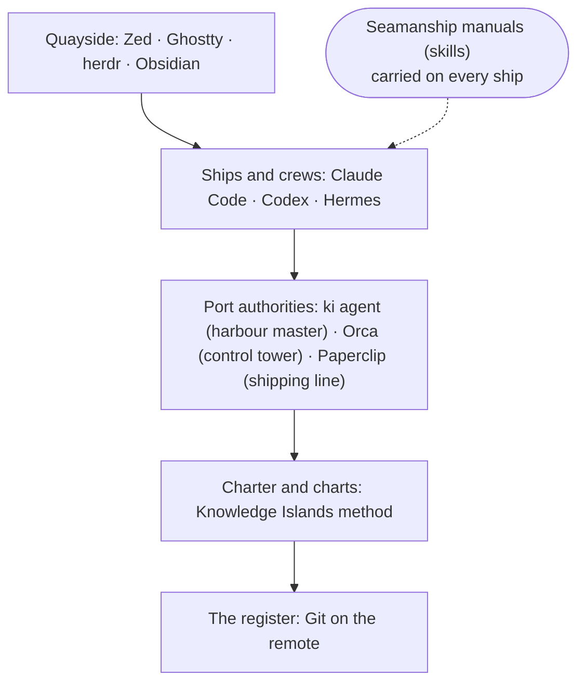

# The islands and the tools, plainly

For Kris, who asked for "something which talks about or understands where all these tools sit together and how what I'm doing with Knowledge Islands is complementary to these so-called tools". The detailed design, with its evidence and numbered claims, is [landscape](landscape.md). Nothing here is decided yet.

## The picture in one breath

Knowledge Islands is the charter, the charts and the register: what work exists, who may decide it, what was decided and what has been accepted. The tools are the ships, crews and ports that do the sailing. Ships and ports change; the register does not. That is what makes you independent of any one of them, and why Knowledge Islands should not build ships.

## The mapping

Tested against the starting mapping in the brief; it held, with three changes marked.

| Thing | In the islands | Why it fits |
| --- | --- | --- |
| A repository | An island | Its own land, its own rules, its own records |
| Knowledge Islands Principal | The Capital | Holds the charter, Known Lands and the voyage papers of every coordinated piece of work |
| A roadmap | The harbour works schedule | The island's own list of jobs, with their status |
| A work package | A voyage's papers | Purpose, where the voyage stands, questions for you, letters received, your decisions |
| The thread agent (the orchestrator) | The voyage's master (**added**) | Holds the papers, talks to you, sends crews out and receives them back; does no sailing itself |
| An agent runtime (Claude Code, Codex) | Ship and crew | Does the sailing; any crew can be hired for any voyage |
| Orchestrators | Port authorities | Send ships out, give each a berth, track who is at sea |
| `ki agent` | A harbour master with a logbook | Plain, reliable, works in any harbour, including the one with no lights on (`vega`) |
| Orca | A port with a control tower | Radar, radio and berths for each ship; one port, on one machine |
| Paperclip | A shipping line | A company with its own fleet and offices; not trading for us now |
| A worktree | A ship's own berth (**added**) | Each crew works in its own dock, so no two crews trip over one another |
| Merging back | Entering the cargo in the register (**added**) | Only checked cargo enters, in order, one ship at a time |
| The method | The charter and the charts | How voyages are run, the same in every port |
| Git on the remote | The register | Every port reads it; it survives the loss of any port |
| Skills | Seamanship manuals | Any crew carries them aboard any ship |
| Trades between islands | Shipping routes | Work and knowledge carried from island to island as letters in the receiving voyage's papers |
| The editor, terminal and Obsidian | The quayside and the bridge window | Where you stand to watch and steer |

Where it strains: a port authority in real life does not decide which voyages run; here, neither should Orca or `ki agent`. That is the master's job, with your say-so.

## The layers

Every tool sits on more than one deck. Orca is quayside and port; Warp was quayside, ship and port; Hermes is ship and port and would like to be a shipping line. So Knowledge Islands binds to a deck, never to a brand.

## What only the islands do

- **Keep the papers safe from any port fire.** Orca's records live in one machine's database; Paperclip's in its server; Hermes's in a file on one machine. The voyage papers and the works schedule are in the register, readable anywhere.
- **Record your word as authority.** Tools ask "allow this command?". None writes down a decision in your words and ties it to the work it allows.
- **Keep "back in port" apart from "accepted".** Every tool's "done" means the ship came back. Only you say the cargo is good.

And what the islands should stop doing: building radar, multiplexed bridge screens and remote berths. The ports do those well.

## The manuals on board

Which manuals touch which deck, and what should happen to each. A dot means the manual governs something on that deck.

| Manual | Quayside | Ship | Port | Charter | Register | What happens |
| --- | :-: | :-: | :-: | :-: | :-: | --- |
| Coordination (the master's manual) | | | ● | ● | ● | Keep; thin it; stop naming one harbour master |
| Delegation (sending crews out) | | ● | ● | ● | | Keep as the one contract every port honours |
| Orca's own manuals | ● | ● | ● | | | Carry only on voyages using Orca |
| Paperclip manual | | | ● | ● | | Thin it; leave ashore until Paperclip is used |
| Work package, design, recap | | | | ● | ● | Keep |
| Works schedule manuals (next, plan, implement, accept) | | | | ● | ● | Keep |
| Git | | | ● | ● | ● | Keep; becomes the one home for berths and merging back |
| Binding (MCP), tokenomics, housekeeping | | ● | | ● | | Keep; tokenomics should weigh the whole load, not part of it |

The heaviest standing load is not the manuals but the master's own instructions, the coordinator output style, at 26 KB.

## Who owns what

| Thing | Owner | Lives in | Survives a lost machine |
| --- | --- | --- | --- |
| What work exists and its status | The island's works schedule | The roadmap, in Git | Yes |
| A voyage's purpose, standing, questions, your decisions | The voyage papers | `+/_WORK/<id>/` at the Capital, in Git | Yes |
| Authority, decisions, acceptance | You | Your words, logged in the papers | Yes |
| Running the voyage, talking to you | The master (thread agent) | One session on one machine | No; the papers are its memory |
| Doing one job | Ship and crew (a worker) | One process, in its own berth | Its merged, pushed work only |
| Launching, berths, who is at sea, quick questions | The port authority | `ki agent`'s state folder or Orca's database, one machine | No, by design |
| How voyages are run | The charter and charts | The harness skills and the Capital's notes | Yes |
| Moving anything between sol and terra | The register | The remote | Yes |

## What you are asked to decide

- **Which harbour master on the headless host.** Orca can run without a screen and send crews to other machines, but that mode is in beta, and the Techné focus allows no unattended agents. The recommendation: Orca only on attended Macs, for voyages that choose it; `ki agent` on `vega`.
- **Where `ki agent` lives.** Recommended: stays in the `ki` tool as the plain harbour master; its four commands that write the voyage papers move under `ki work`; a Techné-run harbour stays an idea until you take it up.
- **How the master hears a ship is back.** Recommended: one "wait for the next ship" instruction, which each port answers its own way.
- **Names.** You named the thread agent "the orchestrator" on 29 October, so calling the crew-sending manual "orchestration" would give one word two jobs. Recommended: keep "coordination" and "delegation", and name the port-specific manuals `ki-delegation-orca` and `ki-delegation-paperclip`.
