# The islands and the tools, plainly

**Follows:** [the merged report](landscape-report.md) of 30 October 2026, which reconciles the two independent reviews of [landscape](landscape.md); where this explainer and the report ever differ, the report governs.

For Kris, who asked for "something which talks about or understands where all these tools sit together and how what I'm doing with Knowledge Islands is complementary to these so-called tools". The detailed design, with its evidence and numbered claims, is [landscape](landscape.md), revised after two reviews. Nothing here is decided yet.

## The picture in one breath

Knowledge Islands is the charter, the charts and the register: what work exists, who may decide it, what was decided and what has been accepted. The tools are the ships, crews and ports that do the sailing. Ships and ports change; the register does not. That is what makes you independent of any one of them, and why Knowledge Islands should not build ships.

## The mapping

Tested against the starting mapping in the brief; it held, with three changes marked.

| Thing | In the islands | Why it fits |
| --- | --- | --- |
| A repository | An island | Its own land, its own rules, its own records |
| Knowledge Islands Principal | The Capital | Holds the charter, Known Lands and the voyage papers of every Project; a regular or ad hoc voyage may keep its papers on another island with approval |
| A roadmap | The harbour works schedule | The island's own list of jobs, with their status |
| A work package | A voyage's papers | Purpose, where the voyage stands, questions for you, letters received, your decisions |
| The thread agent (the orchestrator) | The voyage's master (**added**) | Holds the papers, talks to you, sends crews out and receives them back; does no sailing itself |
| An agent runtime (Claude Code, Codex) | Ship and crew | Does the sailing; any crew can be hired for any voyage |
| Orchestrators | Port authorities | Send ships out, give each a berth, track who is at sea |
| `ki agent` | A harbour master with a logbook | Plain, reliable, works in any harbour, including the one with no lights on (`vega`), where it is the only one today |
| Orca | A port with a control tower | Radar, radio and berths for each ship; one port, on one machine |
| Paperclip | A shipping line | A company with its own fleet and offices; not trading for us now |
| A worktree | A ship's own berth (**added**) | Each crew works in its own dock, so no two crews trip over one another |
| Merging back | Entering the cargo in the register (**added**) | Only checked cargo enters, in order, one ship at a time |
| The method | The charter and the charts | How voyages are run, the same in every port |
| Git on the remote | The register | Every port reads it; it survives the loss of any port; nothing is in it until it has been sent to the remote |
| Skills | Seamanship manuals | Any crew carries them aboard any ship |
| Trades between islands | Shipping routes | Work and knowledge carried from island to island as letters in the receiving voyage's papers |
| The editor, terminal and Obsidian | The quayside and the bridge window | Where you stand to watch and steer |

Where it strains: a port authority in real life does not decide which voyages run; here, neither should Orca or `ki agent`. That is the master's job, with your say-so.

## The layers

```mermaid
flowchart TB
  Q["Quayside: Zed · Ghostty · herdr · Obsidian"]
  S["Ships and crews: Claude Code · Codex · Hermes"]
  P["Port authorities: ki agent (harbour master) · Orca (control tower) · Paperclip (shipping line)"]
  C["Charter and charts: Knowledge Islands method"]
  R["The register: Git on the remote, beside every deck"]
  Q --> S --> P --> C
  Q -.- R
  S -.- R
  P -.- R
  C -.- R
  M(["Seamanship manuals (skills)<br/>carried on every ship"]) -.-> S
```

Every tool sits on more than one deck. Orca is quayside and port; Warp was quayside, ship and port; Hermes is ship and port and would like to be a shipping line. So Knowledge Islands binds to a deck, never to a brand. The register is not the bottom deck: every deck writes to it, and a voyage's work counts only once it reaches the remote.

## What only the islands do

Some shipping lines keep good books too: GitHub Issues, Linear and a Paperclip server are durable and reachable from any machine. What only the islands do is the three together:

- **Keep the papers on the island itself.** The voyage papers and the works schedule sit in the island's own Git, beside the cargo they describe, readable without any port's tools. Orca's records live in one machine's database; Hermes's in a file on one machine.
- **Record your word as authority.** Tools ask "allow this command?". The islands write down your decision in your words, with the question that led to it, and tie it to the work it allows.
- **Keep "back in port" apart from "accepted".** Every tool's "done" means the ship came back. Only you say the cargo is good.

And what the islands should stop extending: radar, multiplexed bridge screens and remote berths. The ports do those well. The harbour master keeps its plain logbook views, because on `vega` they are the only ones.

## The manuals on board

Which manuals touch which deck, and what should happen to each. A dot means the manual governs something on that deck.

| Manual | Quayside | Ship | Port | Charter | Register | What happens |
| --- | :-: | :-: | :-: | :-: | :-: | --- |
| Coordination (the master's manual) | | | ● | ● | ● | Keep; thin it; stop naming one harbour master |
| Delegation (sending crews out) | | ● | ● | ● | | Keep as the one contract every port honours; it cites the batch authority rather than absorbing it |
| Orca's own manuals | ● | ● | ● | | | Carry only on voyages using Orca |
| Paperclip manual | | | ● | ● | | Thin it, keeping its company and authority rules; leave ashore once nothing else depends on it |
| Work package, design, recap | | | | ● | ● | Keep |
| Works schedule manuals (next, plan, implement, accept) | | | | ● | ● | Keep |
| Git | | | ● | ● | ● | Keep; becomes the one home for berths and merging back |
| Binding (MCP), tokenomics, housekeeping | | ● | | ● | | Keep; tokenomics should weigh the whole load, not part of it |

The master's own instructions, the coordinator output style, are 26 KB on disk, more than the manuals' descriptions; how much of a session's real load that is has not been measured.

## Who owns what

| Thing | Owner | Lives in | Survives a lost machine |
| --- | --- | --- | --- |
| What work exists and its status | The island's works schedule | The roadmap, in Git | Yes |
| A voyage's purpose, standing, questions, your decisions | The voyage papers | `+/_WORK/<id>/` at its declared home, the Capital for every Project, in Git | Yes |
| Authority, decisions, acceptance | You | Your words, logged in the papers | Yes |
| Running the voyage, talking to you | The master (thread agent) | One session on one machine | No; the papers are its memory |
| Doing one job | Ship and crew (a worker) | One process, in its own berth | Its merged, pushed work only |
| Launching, berths, who is at sea, quick questions | The port authority | `ki agent`'s state folder or Orca's database, one machine | No, by design |
| How voyages are run | The charter and charts | The harness skills and the Capital's notes | Yes |
| Moving anything between sol and terra | The register | The remote | Yes |

## What you are asked to decide

- **Which harbour master on the headless host.** Orca can run without a screen and send crews to other machines, by its own help, though the vendor calls that mode beta. Recommended: Orca only on attended Macs, for voyages that choose it; `ki agent` alone on `vega` as a matter of choice, not rule. **Still open for you:** whether Orca may run on `vega` in sessions you open yourself. The Techné focus's words do not forbid it; an always-on Orca server taking crews from elsewhere would be closer to the execution fabric the focus keeps as an idea.
- **Where `ki agent` lives.** Recommended: stays in the `ki` tool as the plain harbour master, kept sound but given nothing new that Orca already does; its four commands that touch the voyage papers are sorted one by one, the one that ties a run to its voyage staying with the run; a Techné-run harbour stays an idea until you take it up.
- **How the master hears a ship is back, while you are there.** Recommended: one "wait for the next ship" instruction, which each port answers its own way, with the master setting how long to wait and each runtime shown to work.
- **How the voyage wakes when nobody is there.** Already chosen: on 26 October you chose the headless pass under WAKE-SUBSTRATE, so this is not deferred. Only doorbells stay deferred.
- **Where that headless pass runs.** **Still open for you.** A scheduled pass is a scheduled agent, which the Techné focus forbids on sol and `vega`. The choices: terra first, which the focus does not cover, though it would see only terra's ships; change the focus through the Enactment Process to admit sol, where most of the work now runs; or no host until a voyage needs one.
- **Every crew in its own berth.** Recommended: every crew that writes gets its own berth, with only read-only crews exempt, once the merge-back command exists; until then today's short-voyage rule stands.
- **Names.** Recommended: keep "coordination", "delegation" and `ki agent`, and name the port-specific manuals `ki-delegation-orca` and `ki-delegation-paperclip`. The main reason is the cost of renaming in mid-rollout. You named the thread agent "the orchestrator" on 29 October; that gives it a role without reserving the word, but calling the crew-sending manual "orchestration" would still give one word two jobs.
