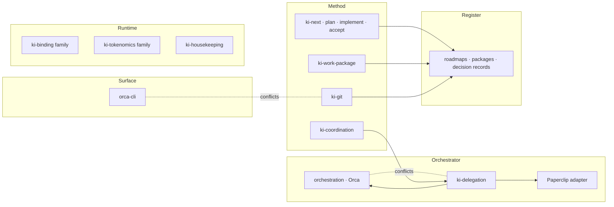

# Where Knowledge Islands sits among the tools

**Owner:** Kris Brown · **Owning repository:** knowledgeislands/ki-principal · **Owning work:** `ki.prj.ways-of-working` · **Date:** 2026-10-30

Design note for LANDSCAPE, which Kris agreed on 30 October 2026 ("Okay, yes."), as logged in this package's [decisions log](../decisions.md#landscape---commission-the-landscape-study-30-october-2026). It takes over the frame of [ORCA-FIT](orca-fit.md) and tests the starting proposal in [the brief](../briefs/landscape.md): four layers, three owners, one handoff contract as the seam, and a naming family. Kris's goal, in his words: "commission something which talks about or understands where all these tools sit together and how what I'm doing with Knowledge Islands is complementary to these so-called tools". It is to make him independent of any one editor, agent runtime or orchestrator, without a lowest-common-denominator approach and without rebuilding what the tools already do well.

Under `ki-work-design` this note is the design brief. Its numbered claims are for at least two independent reviews before Kris decides anything. [The explainer](landscape-explainer.md) gives the same picture in plain words. Nothing here changes a standard, skill, record, hook, configuration or Orca state.

## Contents

- [Evidence and its limits](#evidence-and-its-limits)
- [Verdict on the starting proposal](#verdict-on-the-starting-proposal)
- [The layers](#the-layers)
- [Landscape](#landscape)
- [Skills matrix](#skills-matrix)
- [Overlap ledger](#overlap-ledger)
- [Orchestration family](#orchestration-family)
- [Worktree isolation as a baseline](#worktree-isolation-as-a-baseline)
- [Starting work at package level](#starting-work-at-package-level)
- [Answers](#answers)
- [What the second brief needs](#what-the-second-brief-needs)
- [Numbered claims for review](#numbered-claims-for-review)
- [Homing table](#homing-table)

## Evidence and its limits

All evidence was gathered on **sol**, the Mac Studio, on 30 October 2026 between 01:40 and 02:00 GMT.

**Installed on sol**, from read-only version and help commands:

| Tool | Installed | Latest upstream seen | Note |
| --- | --- | --- | --- |
| Orca | 1.4.244 | 1.4.244 (29 Oct) | Runtime listening on port 6768; `orca serve` is in local help, `orca serve service install` is not |
| Zed | 1.26.2 | 1.26.2 (28 Oct) | Current |
| Claude Code | 2.1.308 | 2.1.314 | On the stable channel |
| Codex CLI | 0.165.0 | 0.166.0 | One release behind |
| herdr | 0.9.5 | 0.9.5 | Current |
| Hermes Agent | 0.22.4 | 0.22.5 | Version string prints "vunknown" in the brew build |
| `ki` | 0.14.1 | - | `ki agent launch --worktree` is present |
| Paperclip | Fork checkout only (0.3.1, 25 Oct), not running | v2026.1023.0 | Removed from the Rig site on 24 October |
| Cursor, Warp, Amp, opencode, OpenClaw, Conductor | Not installed | - | Vendor documentation only |

**Vendor documentation** was read from each vendor's public pages on 30 October; the URLs are kept with the run's research notes and summarised under [Landscape](#landscape). **Not verified:** whether Orca automations run with the desktop app closed on a laptop; how Orca's in-app merge works; Codex `exec` exit codes; Hermes's full webhook event list; Oz's licence and any Warp completion callback; Cursor's licence and memory features in Codex, Cursor, Amp and opencode; what is installed on terra and on the agent host `vega`, which were not inspected. A September public beta of Delta appears only in search results.

**The island's own evaluations**, found by a read-only search of ki-principal, the two harnesses, tools-ki, tools-techne and tools-rig:

| Tool | Where it is evaluated | Standing |
| --- | --- | --- |
| Orca | [orca-fit](orca-fit.md); [Orca evaluation](../../../../Streams/Projects/orca-evaluation.md) Project and its package `ki.prj.orca-evaluation` (ORCA-EVAL, 30 Oct); [orca-trial](../../ki.prj.mac-studio-setup/design/orca-trial.md) and ORCA-HOST, GO-PLAN, ORCA-SKILL in Mac Studio setup's decisions; ORCA-HOOKS, ORCA-ADOPT, ORCA-PER-PANE in ki.prj.chezmoi's decisions; PERSONAL-DOTFILES-UE-107 in chezmoi's roadmap | On trial on sol; one unit run through it (plan069), then back to `ki agent` |
| Paperclip | [Paperclip capture and rebuild](../../../../Streams/Projects/paperclip-capture-and-rebuild.md); `ki-techne-harness/+/paperclip-as-techne-prior-art.md`; harness radar `[subjects.paperclip]` (assess, 19 Oct); [Techne Programme Focus](<../../../../Admin/Governance/Policies/Techne Programme Focus.md>) and GDR-KI-PRINCIPAL-004; ADR-KI-PRINCIPAL-007 | Remote Paperclip in any form is an idea only; removed from Rig on 24 Oct; `ki-agent-coordination-paperclip` remains installed |
| Delta | [Delta evaluation](../../../../Streams/Projects/delta-evaluation.md) (idea stage); `+/delta-paperclip-assessment-2026-10-02.md` in Git history | Trial decision outstanding since 21 Oct |
| Hermes Agent | SDR-KI-HARNESS-002 (intended first conforming environment for persistent, scheduled steward-style work); Technology Radar | Installed on sol; not in use |
| Zed | Technology Radar (Adopt, primary engineering interface); ADR-KI-TOOL-KI-003 (read-only editor projection); ZED-MD in Mac Studio setup | In daily use |
| Warp, Ghostty | ki.prj.chezmoi decisions and queries (SOL-WARP-REWRITE, WARP-CONTAINER, WARP-HANDLER; Ghostty applied on sol) | Warp being retired for Ghostty |
| Claude Code, Codex | SDR-KI-HARNESS-002, ADR-KI-HARNESS-AGENTS-002, ADR-KI-HARNESS-SKILLS-007, ADR-KI-HARNESS-009; tools-ki `background-agents.md` | The two runtimes `ki agent` supports |
| OpenClaw, opencode, herdr, Muxie, Continue.dev, VS Code | SDR-KI-HARNESS-002 and Technology Radar entries; herdr installed with no evaluation found | Assess or Hold |
| Amp, Cursor, Conductor, Claude Squad, Vibe Kanban, Aider, Goose, Windsurf | No evaluation found | Not evaluated |

## Verdict on the starting proposal

The proposal holds in its core: the work model stays with Knowledge Islands, dispatch is a replaceable mechanism, and a handoff contract is the seam. Six corrections.

1. **Layers are roles, not products.** Almost no tool sits in one layer. Orca is a terminal workspace and an orchestrator; Warp is a terminal, a runtime and, through Oz, an orchestrator; Hermes is a runtime, an orchestrator and an agent platform; Claude Code is a runtime with its own subagents, background tasks and hooks. So each tool is placed by the layers it occupies, and Knowledge Islands binds to a layer, never to a product.
2. **A surface layer, not an editor layer.** The terminal workspace (Ghostty, herdr, Warp, Orca's own panes) is as much where Kris meets the agents as Zed is. Obsidian is where he reads the islands. The top layer is the surface, editor and terminal together.
3. **The register sits under everything.** Git on a remote is the only thing that crosses hosts and survives every session; the method is not the same thing as the record. The proposal's fourth layer splits into the method (skills and standards, carried by the harness) and the register (packages, roadmaps, decisions, in Git).
4. **Dispatch and the work model are tangled inside `ki agent` itself.** Of its 17 subcommands, four are work-model commands, not dispatch: `decide` and `reconcile` write the decisions log, `home` records a work folder, `prompts` prints the coordination openers. AGENT-HOME must split these first; they stay in Knowledge Islands whatever happens to dispatch.
5. **"Orchestrator" already has an owner.** On 29 October Kris set the roles under ROLES-ORCHESTRATOR: "the thread agent is effectively the orchestrator of the state machine". The thread agent is what `ki-coordination` governs. Naming the dispatch family `ki-orchestration` would give one word two meanings in the same week. The naming is tested under [Orchestration family](#orchestration-family).
6. **Techné cannot take dispatch yet.** The [Techne Programme Focus](<../../../../Admin/Governance/Policies/Techne Programme Focus.md>) keeps "the execution fabric" as an idea, and allows agents on sol and `vega` "only in sessions the binding owner opens, with no unattended or scheduled agents". A Techné agent owning dispatch, an always-on Orca server and a durable wake all need the island owner's decision through the Enactment Process first.

## The layers

| Layer | What it does | Knowledge Islands' stance |
| --- | --- | --- |
| Surface | Where Kris reads, writes and watches: editor, terminal workspace, note reader | Bind to none; every artefact is plain Markdown and Git, readable in any of them |
| Runtime | The agent itself: a model in a loop with tools, skills, MCP, hooks, its own subagents | Bind thinly: skills, `AGENTS.md`, MCP and hooks through each runtime's native mechanism |
| Orchestrator | Launches workers, isolates them, queues and orders them, watches liveness, carries live questions, wakes the supervisor | Own the contract, not the machinery: `ki agent` is the floor, Orca or Paperclip the adapters |
| Method | The work model and its standards: packages, seven states, queries, decisions, reports, authority, acceptance | Own it outright; no tool offers it |
| Register | What exists, where it stands and what was decided, durably and across hosts | Git on a remote; never a tool's database |

```mermaid
flowchart TB
  S["Surface<br/>Zed · Ghostty · herdr · Obsidian · Orca panes · Warp"]
  R["Runtime<br/>Claude Code · Codex · Hermes · opencode · Amp · Cursor"]
  O["Orchestrator<br/>ki agent (floor) · Orca · Paperclip · Hermes kanban · Oz"]
  M["Method<br/>Knowledge Islands: work model, standards, skills"]
  G["Register<br/>Git on a remote: packages, roadmaps, decisions"]
  S --> R --> O --> M --> G
  K["Skills<br/>carried by every runtime, cut across layers"] -.-> R
  K -.-> O
  K -.-> M
```

## Landscape

Fit is for the three hosts: **sol** (Mac Studio, attended, evidence gathered here), **terra** (Kris's other Mac, not inspected) and **vega** (the cloud agent host, headless Linux, under the Techne Programme Focus). "Native" is what the vendor documents as shipped on 30 October.

| Tool | Layers | Native today, relevant to the work model | Maturity | sol | terra | vega |
| --- | --- | --- | --- | --- | --- | --- |
| Zed | Surface; hosts runtimes over ACP | Threads sidebar running several agents, each optionally in a worktree; external agents (Claude, Codex, opencode, Cursor and others) over the Agent Client Protocol; `SKILL.md` and `AGENTS.md` for its own agent; MCP; manual merge-back; desktop notification only; no headless mode | Stable, several releases a week, GPL | Primary editor | Primary editor | None: no headless mode |
| Delta (Zed Industries) | Surface and runtime host, collaborative | A shared thread holding conversation and worktree in real time; cloud runner; Claude Code as first harness; no API, notification or self-hosting stated | Private or public beta since August 2026 | Trial undecided under Delta evaluation | As sol | Not applicable; hosted, data leaves the estate |
| Ghostty | Surface | Terminal only | Stable | In use, replacing Warp | Unverified | None |
| Warp and Oz | Surface, runtime, orchestrator | Agentic terminal; Oz cloud agents with run states including BLOCKED, schedules, REST API; no outbound webhook found | Weekly releases; client AGPL since April 2026; Oz commercial | Being retired | Unverified | Oz is a hosted platform, outside Techne focus |
| herdr | Surface, light orchestrator | TUI multiplexer with a background server; per-pane agent status (working, blocked, idle, done); `agent wait --until done\|blocked`; worktree create and remove; multi-machine over SSH; no queue | Pre-1.0, Apache-2.0 | Installed, unused | Unverified | Plausible headless status layer; not evaluated |
| Obsidian | Surface | Reads the vault in the primary checkout | Established | Primary reader of islands | As sol | None |
| Claude Code | Runtime | Skills, `CLAUDE.md`, MCP, hooks (Stop, SubagentStop, Notification), subagents, background tasks that re-invoke the session, headless `-p`, Agent SDK, worktrees | Mature, frequent releases | Default runtime | Default runtime | Installed per the agent-host guide |
| Codex CLI | Runtime | Skills from `~/.agents/skills`, `AGENTS.md`, MCP, hooks after trust, `notify` command, `exec --json`, app server | Mature, frequent releases | Second runtime; Orca trial used it | As sol | Unverified |
| Hermes Agent | Runtime, orchestrator, platform | Worktrees, delegated subagents, SQLite kanban with dependencies, heartbeats, blocked state, subscriptions that wake the subscriber, cron, gateway, A2A, memory | Fast-moving, MIT | Installed, unused | Unverified | SDR-KI-HARNESS-002's intended steward environment; idea under Techne focus |
| opencode, Amp, Cursor | Runtime, with Cursor and Amp also hosted agents | All read `AGENTS.md` and MCP; Cursor is the only tool with a documented merge-back command and a signed status webhook | Mature to fast-moving | Not installed | Not installed | Not evaluated |
| OpenClaw | Platform | Personal-assistant gateway over chat channels; sub-agents announce results; `events_wait` long-poll | Foundation-run, MIT | Not installed | Not installed | Messaging channels are an idea under Techne focus |
| Orca | Surface and orchestrator | Runs, Tasks with dependencies, Dispatches, gates, blocking `ask` and `reply`, one `worker_done` with outcome and report path, heartbeats and a liveness projection, worktrees (`current`, `new-child`, `new-top-level`) with setup, automations with shell pre-check, `orca serve` headless, remote workers by `--on`; **no merge step**; idle-coordinator wake is "best-effort attention only" | Roughly daily releases, MIT; orchestration marked experimental; server mode beta | On trial (ORCA-HOST) | Unverified | Possible as a paired environment; needs Enactment |
| Paperclip | Orchestrator and platform | Company of agents, issues with blockers and atomic checkout, routines, blocked inbox, budgets, adapters for Claude, Codex, Hermes and others, MCP; no outbound webhook | Weekly or fortnightly, MIT | Not running | Not running | Remote Paperclip is an idea only |
| `ki agent` | Orchestrator, with four work-model commands | Detached launch, queue and dispatcher, `--wait-for` chaining, status file and heartbeat, run inbox, `wait --next`, `watch`, stop, recover, reconcile and close gates, `--worktree` launch with dependencies and project skills; no integrate step; Claude and Codex only | Built here, 0.14.1 | Floor | Floor | Floor, the only option allowed today |
| Knowledge Islands | Method and register | Work package, seven states, queries, decisions in Kris's words, owner reports, authority footers, acceptance, roadmaps, handoffs as messages, decision records | Built here | All hosts | All hosts | All hosts |

Three things no tool offers, which is where Knowledge Islands is complementary rather than duplicative:

- **A durable, cross-host statement of the work.** Orca's Run lives in one host's `orchestration.db`; Paperclip's issues live in its server database; Hermes's kanban is SQLite on one machine; Oz's runs are in Warp's cloud. Only the package and the roadmap, in Git, survive the loss of every machine and are readable without the tool.
- **The owner's authority as a first-class object.** Tools ask for permission per tool call or per gate. None records a decision in the owner's words, links it to the work it authorises and reads it back. Gates and approvals are mechanisms; `decisions.md` is the authority.
- **Acceptance separate from completion.** Every orchestrator's "done" means an attempt settled. Only the record's `awaiting-review` and `ki-accept` mean Kris has accepted it.

And three things Knowledge Islands should stop building because the tools do them well: live liveness views, terminal multiplexing and watching, and remote worker placement.

## Skills matrix

Layers across, skills down. A mark means the skill governs something in that layer. Standing cost is the `description` length in characters, loaded into every session of a runtime where the skill is installed; the body and references load only when the skill is used. Loaded skills in a ki-principal session: 30 harness skills in each runtime, 9,117 description characters in Claude Code and 9,112 in Codex, out of 17,233 and 14,818 for all on-disk skills. The coordinator output style, 26,337 bytes, is the largest single standing item in a coordinating Claude Code session.

### Work model and dispatch

| Skill | Surface | Runtime | Orch. | Method | Register | Desc | Overlaps and conflicts | Verdict |
| --- | --- | --- | --- | --- | --- | --- | --- | --- |
| `ki-coordination` | | | x | x | x | 827 | Names `ki agent` on 41 lines; RECAP and RESUME modes collide with `ki-recap` and `ki-work-package` triggers; 217 KB standard | **Slim**: move launcher mechanics behind contract verbs, shorten description, split the standard |
| `ki-delegation` | | x | x | x | | 377 | Launch mechanics are entirely `ki agent` (31 lines); second authority vocabulary beside `ki-batch` | **Split**: keep the portable contract here; `ki agent` mechanics to `man ki` |
| `ki-agent-coordination-paperclip` | | | x | x | | 344 | Parallel delegation model to `ki agent` and Orca; 115 KB references; Paperclip not running | **Slim and rename** as the Paperclip adapter; unload until Paperclip is taken up |
| `orchestration` (Orca) | | x | x | | | 587 | Triggers on "coordinator loops", "heartbeats", "decomposing work across agents"; says "never substitute a non-Orca subagent tool", against `ki agent` | **Keep as vendor**, load only for packages that chose Orca; the adapter states precedence |
| `orca-cli` (Orca) | x | | x | | | 558 | Claims "handoff", "give this to another agent", "prefer it over raw git worktree" | **Keep as vendor**, same scoping |
| `ki-work-package` | | | | x | x | 632 | Shares RESUME with `ki-coordination`; others write into its folder | **Keep**, shorten description |
| `ki-work-design` | | | | x | x | 487 | Reviews run as background agents under `ki-delegation` | **Keep**, shorten description |
| `ki-recap` | | | | x | | 268 | Trigger overlap with `ki-coordination` RECAP and SUMMARY | **Keep**; coordinating sessions route to `ki-coordination` |
| `ki-batch` | | | x | x | | 289 | A second authority envelope beside the delegation footers | **Merge later**: its envelope becomes a footer of the portable contract |

### Work items and change

| Skill | Surface | Runtime | Orch. | Method | Register | Desc | Overlaps and conflicts | Verdict |
| --- | --- | --- | --- | --- | --- | --- | --- | --- |
| `ki-next`, `ki-plan`, `ki-implement`, `ki-accept` | | | | x | x | 263, 200, 230, 279 | A clean lifecycle gradient; pruning also in `ki repo roadmap prune` and a delegation footer | **Keep** |
| `ki-work`, `ki-work-roadmap`, `ki-repo-kb-streams` | | | | x | x | 248, 298, 234 | Five skills describe one record; ki-principal uses the Streams adapter yet loads `ki-work-roadmap` | **Keep**; check whether KB repositories need `ki-work-roadmap` loaded |
| `ki-trades` | | | | x | x | 244 | Its operating half `ki-trade` is installed nowhere; handoffs now go as `messages.md` lines | **Keep, review** after HANDOFF-AS-MESSAGE settles |
| `ki-git` | | | x | x | x | 245 | Commit and push rules restated in five places; worktree choice contested by `orca-cli` and Paperclip | **Keep and grow**: the one home for the worktree merge model and the push rule |
| `ki-decision-records` | | | | x | x | 188 | None | **Keep** |

### Environment and repository

| Skill | Surface | Runtime | Orch. | Method | Register | Desc | Overlaps and conflicts | Verdict |
| --- | --- | --- | --- | --- | --- | --- | --- | --- |
| `ki-binding`, `-claude`, `-chatgpt` | | x | | x | | 213, 232, 243 | Clean per-runtime split; `ki-binding-chezmoi` not installed although rendering runs through chezmoi | **Keep**: the model for thin binding |
| `ki-tokenomics`, `-claude`, `-chatgpt` | | x | | x | | 194, 271, 256 | Repository-only evidence; blind to user skills, user instructions and the output style, which are most of the load | **Keep, extend** to user-level surfaces |
| `ki-housekeeping-claude`, `-chatgpt` | | x | | | | 268, 267 | None | **Keep** |
| `ki-bootstrap` | | x | | x | | 247 | None | **Keep** |
| `ki-repo`, `ki-repo-kb`, `-activities`, `-live-artifacts`, `-principal` | | | | x | x | 288, 293, 314, 240, 338 | None material | **Keep** |
| `ki-authoring`, `ki-engineering` | | | | x | | 310, 256 | None material | **Keep** |

Out of scope and left alone: Anthropic's synced document skills, Codex's system and plugin skills, `archify` and `caveman`; they cost about 8,000 description characters in Claude Code and 5,700 in Codex but belong to no layer of this model.

## Overlap ledger

| Capability | What the tools do natively | Verdict | Why |
| --- | --- | --- | --- |
| Work package, seven states, queries, decisions, owner report | Nothing equivalent; Orca Runs, Paperclip issues and Hermes kanban are host- or server-local task stores | **Keep as method** | The durable, cross-host, owner-authority layer is the gap the tools leave |
| Roadmaps and records | Linear, GitHub Issues, Paperclip issues | **Keep as method**, with adapters already in `ki-work` | Records live with the repository they change |
| Skills | Every runtime loads `SKILL.md`; Zed, Hermes, Paperclip and Orca too | **Keep as method, bind thinly** through each runtime's native skills folder | The content is ours; the loading is theirs |
| `ki agent` launch, queue, chain, status, wait, stop | Orca, Paperclip, Hermes kanban, herdr in part | **Keep as the floor; bind thinly** to Orca where a package has chosen it; freeze features that duplicate Orca | The only launcher allowed on `vega` today and the reference for the contract |
| `ki agent decide`, `reconcile`, `home`, `prompts` | Nothing equivalent | **Keep as method**; move under `ki work` when dispatch moves | They write the package, not a run |
| Prompt rendering with authority footer | Nothing equivalent | **Keep as method**; add a render-only step | ORCA-FIT's one tooling gap at the seam |
| Worktree creation | Orca, Claude Code, Codex, Hermes, herdr, Zed | **Bind thinly** to the launcher's native worktree | Creation is cheap and well done by the tools |
| Worktree merge-back to `main` | Only Cursor documents one; Orca leaves it to the app or Git | **Keep as method** in `ki-git` | Fast-forward, verified, serial integration is ours |
| Liveness and heartbeat | Orca heartbeats and projection, herdr pane status, Hermes heartbeats, Claude and Codex hooks | **Bind thinly**: one liveness source per worker, the launcher's | Two protocols per worker is waste |
| Steering a running worker | Orca `send`, `ki agent send` | **Bind thinly** | Same verb, different pipe |
| Operational question | Orca `ask` and `reply`, Paperclip blocked inbox, Hermes block | **Bind thinly** for questions the brief already authorises | Owner questions stay queries |
| Owner question | Nothing equivalent | **Keep as method**: a query plus a blocking wait, never a timed ask | Authority is Kris's |
| Wake on done or blocked | Orca `check --wait`, `ki agent wait --next`, herdr `agent wait`, Claude Code background tasks and hooks, Codex `notify` | **Bind thinly**: one contract verb, each launcher's native wait | Durable unattended wake stays deferred |
| Scheduled and unattended runs | Orca automations, Hermes cron, Paperclip routines, Oz schedules | **Retire from KI scope for now**; when Kris takes it up, bind to one tool | Forbidden on sol and `vega` by the Techne focus |
| MCP binding | Each runtime's own MCP configuration | **Bind thinly**: `ki-binding` renders one inventory into each | Already the right shape |
| Hooks | Runtime hooks; Git hooks | **Keep** Git hooks as gates; **bind thinly** to runtime hooks for wake and liveness only | Gates must run whichever runtime commits |
| Memory | Claude memory, Hermes `MEMORY.md`, Paperclip memory (in progress) | **Keep as method** in Git (`Admin/MEMORY.md`, decisions); runtime memory is a personal retrieval aid only | Already the rule in `memory-scope.md` |
| Session acquisition | Runtime transcripts | **Keep as method** (`ki-acquire`, housekeeping) | Turns sessions into durable notes |
| Status views | Orca, Paperclip and herdr dashboards | **Keep** `ki work status` and the Observatory for the durable view; use the tools' views for live state | Different questions: what exists versus what is running |

## Orchestration family

### The portable contract

The contract is what any launcher must do for a Knowledge Islands package. Each line is a verb the method uses; each launcher maps it.

| Verb | Requirement | `ki agent` (floor) | Orca | Paperclip |
| --- | --- | --- | --- | --- |
| start | Start one unit of a named package from its brief, with the work id, the job (a `state.md` next step or a record id) and the target repository | `launch <run> <name> <workdir> <prompt>`; run named from the work id | `task-create` then `worker-start --spec`; Run per package per host | Issue assigned to an agent |
| render | Turn a brief into a self-contained prompt with the authority footer and report rule | Inside `launch`; no render-only step | Takes the rendered prompt as `--spec` | Issue body |
| isolate | Give every writing run its own worktree from committed `main` | `--worktree <repo>` | `new-top-level` or `new-child` with setup | Execution workspace (experimental) |
| integrate | Rebase, run gates on the range, fast-forward into primary `main`, verify, dispose, under one lock per repository | Manual under `ki-git` | Manual under `ki-git` | Manual under `ki-git` |
| chain | Start one unit only after another finishes | `--wait-for` | `--deps` | Blockers |
| liveness | One heartbeat source per worker | Status file | Heartbeats | Heartbeat runs |
| steer | Send guidance within existing authority | `send` | `send --to dispatch:<id>` | Comment |
| ask | Operational question the brief authorises the coordinator to answer | Blocking query in the report | `ask` and `reply` | Blocked inbox |
| wait | Block, bounded, until the next done, failed, blocked or question event | `wait --next` | `check --wait --types worker_done,escalation,question` | Poll the API |
| done | Done signal plus a report at a known path outside every repository | `DONE` in the status file, report in the state folder | `worker_done --outcome --report-path` | Issue state |
| stop | Stop at a safe point, record where | `stop` | `worker-stop` | Pause |
| close | Retire the run once reconciled and its worktrees integrated | `close` | `worker-release` | Close issue |

Invariants, unchanged from ORCA-FIT and the brief: workers never write the package; the coordinator copies the report in at receive, its queries into `queries.md`; an owner decision is a query plus a blocking wait, never a timed ask; launcher chatter never goes into Git; one launcher per package per host, recorded in the package's decisions log; the launcher's "completed" never means accepted.

### `ki agent` as the floor

`ki agent` is the reference implementation of every verb but `integrate` and the only launcher allowed on `vega`. It stays maintained, with new features that duplicate Orca's dependency graph, liveness projection, remote placement or terminal watching frozen while Orca is on trial (ORCA-FIT's OF-KI-AGENT). Two additions serve every launcher, not just itself: a render-only step and an integrate step.

### Adapters

- **Orca adapter.** Maps the verbs above, states that the Orca `orchestration` skill governs mechanics while the KI contract governs authority, reports and owner questions, and scopes itself to packages that chose Orca on that host. It carries ORCA-FIT's corrections: gates only for blocking queries, the armed `check --wait`, Orca ids in `state.md` Now.
- **Paperclip adapter.** Today's `ki-agent-coordination-paperclip`, slimmed to the verb mapping and the company-per-group rules, unloaded until remote Paperclip is taken up.
- **No adapter for `ki agent`.** Its mechanics are `man ki` and `ki agent --help`; the contract cites them.

### Lines that name `ki agent` directly

`ki-coordination` names `ki agent` on 41 lines and `ki-delegation` on 31; the coordinator output style on 5 and `~/.claude/delegation.md` on 2. By kind, in `ki-coordination`:

| Kind | Where | What to do |
| --- | --- | --- |
| `status` | `SKILL.md`; `rubric.md:45`; `sources.md:42`; `standards-coordination.md:195, 205, 390, 652, 698, 741, 868, 959, 1037, 1055, 1066`; `threads.ts:147` | Replace with "the package's launcher status"; `ki agent status` becomes the floor's example |
| `prompts` | `SKILL.md:23, 108`; `standards-coordination.md:342, 684, 804, 808, 859, 863` | Keep: a work-model command; later `ki work prompts` |
| Launcher by name | `sources.md:104`; `standards-coordination.md:100, 118, 165, 649, 745, 817, 829, 841, 853, 1039, 1043` | Replace with "the launcher" and a pointer to the contract |
| `close` | `sources.md:123`; `standards-coordination.md:632, 941, 992`; `:201` with `new` | Replace with the contract's `close` |
| `send` and `status` | `standards-coordination.md:400` | Contract's `steer` |
| `decide` | `standards-coordination.md:905` | Keep: work-model command |
| `status --worktrees` | `standards-coordination.md:1087` | Keep as the floor's estate sweep; Orca's `worktree list` under the adapter |

In `ki-delegation`, every line is launcher mechanics (`SKILL.md:10, 24, 54, 70`; `sources.md:28, 54, 63, 89, 97`; `standards-background-runs.md:36, 79, 81, 83, 102, 172, 230, 232, 236, 254, 262, 271, 275, 297`; the six footer assets and `run-prompt.md:15`). The footers stay in the contract; the command forms move to `man ki`.

### Names

Tested against ROLES-ORCHESTRATOR (29 October: the thread agent is "the orchestrator of the state machine"), KI-AGENTS-NAME (17 October: "Keep "agents" ... nothing is renamed") and vendor usage, where Orca, Oz and Paperclip all use "orchestration" for driving agents.

| Thing | Brief's proposal | Recommended | Why |
| --- | --- | --- | --- |
| The work model with Kris | `ki-coordination` | `ki-coordination` | The thread advised against renaming it and the advice holds: it would rename the output style, a 217 KB standard and every live package mid-rollout, for a word now taken by the role |
| The portable dispatch contract | `ki-orchestration` | `ki-delegation`, slimmed | It is already "runtime-neutral contracts"; "delegation" is what the orchestrator does to workers and collides with neither the role word nor Orca's `orchestration` skill |
| Orca adapter | `ki-orchestration-orca` | `ki-delegation-orca` | Follows the contract's name |
| Paperclip adapter | `ki-orchestration-paperclip` | `ki-delegation-paperclip` | Renamed from `ki-agent-coordination-paperclip` |
| `ki agent` adapter | none | none | Agreed |
| The command | `ki agent`, or `ki orchestrate` | `ki agent`, with `decide`, `reconcile`, `home`, `prompts` moving under `ki work` | KI-AGENTS-NAME; the split matters more than the name |

Confidence medium: the evidence is direct, but the choice is one of words and Kris's ear decides. ORCH-NAME in the report asks it.

## Worktree isolation as a baseline

Kris on 30 October: "we've got that as a kind of baseline feature that we'd expect across all of the orchestration capabilities". The baseline:

1. **Every writing run gets its own worktree**, created from the target repository's committed `main`, whichever launcher starts it. This is the contract's `isolate` verb.
2. **Merge-back is fast-forward and verified**, by [checkout-isolation](checkout-isolation.md)'s merge model: rebase on local `main` with no fetch; run the gates on the rebased range, because hooks do not run during a rebase; `git merge --ff-only` in the primary checkout; verify that the primary `HEAD` is the branch tip, the primary status unchanged and the report's commits reachable; remove the worktree and delete the branch with `-d`; a conflict or red gate stops and keeps the worktree. One integrator per repository at a time.
3. **Coordinators stay on primary `main`** under MAIN-NOT-WORKTREES, because the package, `messages.md` routing and Obsidian read the live primary checkout.
4. **Opt-outs.** A read-only run may run in the primary checkout, provided it writes nothing inside any repository; its report goes outside every repository, as the contract already requires. A trivial run gets no opt-out: the collisions in checkout-isolation's incident map came from the shared index and lock, not from the size of the change, and a worktree costs a quarter of a second plus about 1.5 seconds to clone dependencies. The coordinator's own one-line package fix is not a run and stays on `main`.

What has to be true first:

| Gap from checkout-isolation | State on 30 October | Needed |
| --- | --- | --- |
| Project skill links missing in a worktree (RUNTIMES-2) | `ki agent launch --worktree` "retains managed project skill links"; Orca worktrees: unverified | Orca's repository setup links the project skills, or the Orca adapter runs `ki` to do it |
| `node_modules` missing, so the pre-commit refuses | `--worktree` clones installed dependencies; Orca's setup hook: unverified | Same as above |
| Registry does not know a linked worktree (REPO-REG-1), so source stores do not resolve | Unverified; not in the 0.14.1 help | Registry resolution of a linked worktree to its registered repository |
| No integrate step | Not present in `ki agent` or Orca | A `ki` integrate command running the merge model under a per-repository lock, usable by any launcher |
| Pathspec commit helper and landed check | Unverified | Still needed for coordinators, who stay in the shared checkout |
| Stale-worktree sweep and disk headroom | `ki agent status --worktrees` inventories; Rig doctor finding unverified | Rig doctor finding |

## Starting work at package level

Today `ki agent` launches into a repository directory with a prompt file, its run named after the work, and Orca launches into a worktree with a free-text objective. Neither starts work "in this package, from its job list".

**Requirement on the contract.** `start` takes a work id and a job reference. The launcher resolves the package through the registry to the Capital's `+/_WORK/<id>/`, checks the job against `state.md`'s next steps or the named record, resolves the target repository from the job (a record id names its repository; a next step names it explicitly), creates the worktree there, renders the brief with its footer and passes both ids to the worker. The coordinator still chooses the job and writes the brief; the launcher never infers work from the list, and never writes the package. The run's ids return to the coordinator, which records them in `state.md` Now.

## Answers

### ORCA-REACH - Does Orca run headless, across hosts, with Codex?

**Findings.** Headless: yes, `orca serve` runs the runtime without a window, with `--supervise` for launchd or systemd; the vendor marks server mode beta and for LAN or tailnet use only, and on Linux the command is `orca-ide`. Across hosts: yes for workers, `worker-start --on <environment>` places a worker on a paired server while the Run and Tasks stay on the coordinator's host; remote workers need `new-top-level` worktrees, and lost contact shows as `unverifiable`. With Codex: yes; Codex and Claude appear in every example, and the trial ran Codex. Not verified here: no environment is paired, and `orca serve service install` is absent from 1.4.244's local help.

a) (recommended) Use Orca on attended Macs only, for packages that opt in by a logged decision; keep `ki agent` as the only launcher on `vega`; revisit Orca on `vega` only through an Enactment decision under the Techne focus, after the server mode leaves beta.

b) Pair `vega` as an Orca environment now and place remote workers on it from sol.

### AGENT-HOME - Where does `ki agent` live?

a) (recommended) It stays in tools-ki as the floor launcher, maintained and frozen against features Orca duplicates; first split its four work-model commands under `ki work`; record "dispatch as a Techné agent, with at most a thin KI shim" as an `Idea:` line on the Techne theme page, to be taken up only through the Enactment Process.

b) Move dispatch to tools-techne now with a thin `ki agent` shim. Blocked: the Techne focus keeps the execution fabric an idea.

c) Retire `ki agent` and use Orca everywhere. Fails on `vega` and on any host where Orca's beta server mode is not acceptable.

### WAKE - How does each launcher wake the coordinator on done or blocked?

| Launcher | Wake while the coordinator session is open | Durable wake with no session |
| --- | --- | --- |
| `ki agent` | One detached `ki agent wait --next`, bounded at five minutes and re-armed each wake; a background task's exit re-invokes the session | None today; deferred |
| Orca | One detached `orca orchestration check --wait --types worker_done,escalation,question`, bounded and re-armed; `send`'s nudge is best effort only | Orca automation with a shell pre-check; not adopted |
| Paperclip | Poll the API; no outbound webhook | Plugin only |
| Runtime-native | Claude Code background tasks and Stop or Notification hooks; Codex `notify` and Stop hooks; herdr `agent wait --until done\|blocked` | Hooks could call a doorbell; deferred |

a) (recommended) One contract verb, `wait`: block, bounded, until the next done, failed, blocked or question event; each launcher implements it natively and the coordinator keeps exactly one armed. A durable wake stays deferred under WAKE-SUBSTRATE and the Techne focus's bar on unattended agents.

b) Adopt Orca automations with a shell pre-check as the durable wake now, under an away grant.

## What the second brief needs

The second brief is to use Orca to work through the roadmap incrementally and get Knowledge Islands into a solid state. Not designed here. Its inputs:

- Kris's decisions on this note's queries, above all ORCA-REACH, AGENT-HOME, WAKE and ORCH-NAME, and on ORCA-FIT's open choices, OF-LAUNCHER first.
- The [Orca evaluation](../../../../Streams/Projects/orca-evaluation.md) Project and its package `ki.prj.orca-evaluation`, which should own it, and the Mac Studio trial log.
- The roadmaps it would work through, by repository, with horizons and sizes, and the [finish-line plan](finish-line-plan.md) and [state-machine rollout plan](state-machine-rollout-plan.md) for this package's own close-out.
- The current `ki-coordination` and `ki-delegation` standards and Orca 1.4.244's guide.

Its prerequisites:

- A logged decision naming which packages use Orca, on which host.
- The Orca adapter, at least as a design note the coordinator follows.
- The worktree baseline's gaps closed for the repositories it will touch: project skills and dependencies in Orca worktrees, and an integrate step.
- A render-only `ki` step, or an agreed manual equivalent.
- HOST-SYNC settled, so that commits stay level between sol and terra while Orca, which is host-local, runs on one of them.
- An away grant if any part is to run while Kris is not present.

## Numbered claims for review

Reviewers mark each Agree, Differ or Add, with evidence for Differ.

1. Tools occupy several layers; Knowledge Islands binds to layers, never to products.
2. The top layer is the surface, editor and terminal together, with Obsidian as the island reader.
3. The register, Git on a remote, is distinct from the method and sits under every layer.
4. No tool examined offers a durable, cross-host statement of the work, owner authority recorded in the owner's words, or acceptance separate from completion; those are Knowledge Islands' complement.
5. Knowledge Islands should not build live liveness views, terminal multiplexing or remote worker placement.
6. Four `ki agent` subcommands, `decide`, `reconcile`, `home` and `prompts`, are work-model commands and stay in Knowledge Islands whatever happens to dispatch.
7. ROLES-ORCHESTRATOR gives "orchestrator" to the thread agent, so the dispatch family should not be named `ki-orchestration`.
8. `ki-coordination` keeps its name.
9. The portable dispatch contract keeps the name `ki-delegation`, with adapters `ki-delegation-orca` and `ki-delegation-paperclip` and no adapter for `ki agent`.
10. `ki agent` keeps its name under KI-AGENTS-NAME.
11. The contract has twelve verbs: start, render, isolate, integrate, chain, liveness, steer, ask, wait, done, stop, close.
12. `integrate` is the verb no orchestrator provides natively except Cursor; it stays in `ki-git` with a `ki` command any launcher can call.
13. Every writing run gets its own worktree under every launcher; read-only runs may opt out; trivial runs may not.
14. Coordinators stay on primary `main`.
15. The registry's linked-worktree resolution and an integrate command are the two prerequisites still open for the baseline; skills and dependencies are closed for `ki agent` and unverified for Orca.
16. `start` takes a work id and a job reference and resolves the target repository; the coordinator chooses the job.
17. Orca runs headless, places workers across hosts and runs Codex, with its server mode in beta.
18. Orca on `vega`, a Techné-owned dispatch agent and a durable wake each need an Enactment decision under the Techne focus.
19. `ki agent` stays in tools-ki as the floor, frozen against features Orca duplicates.
20. One `wait` verb, natively implemented per launcher, is the wake; durable wake stays deferred.
21. The Orca skills `orchestration` and `orca-cli` conflict with `ki-delegation` and `ki-git` on triggers and on the non-Orca route, and should load only where a package has chosen Orca.
22. `ki-coordination` should be slimmed: its launcher lines replaced by contract verbs and its 217 KB standard split.
23. `ki-agent-coordination-paperclip` should be slimmed to an adapter and unloaded until Paperclip is taken up.
24. `ki-batch`'s envelope should become a footer of the portable contract.
25. `ki-tokenomics` cannot see most of the measured standing load and should extend to user-level surfaces.
26. `ki-git` should be the single home of the commit, push and worktree merge rules, with others citing it.
27. Skills, MCP and hooks bind thinly through each runtime's native mechanism, as `ki-binding` already does.
28. Scheduled and unattended runs are out of Knowledge Islands' scope until Kris takes them up, then bind to one tool.
29. Runtime memory is a retrieval aid; durable memory stays in Git.
30. The second brief belongs to `ki.prj.orca-evaluation` and waits on the decisions and prerequisites listed.

## Homing table

Every finding, verdict and recommended change, with its proposed durable home and who must act. None of these homes is created by this run.

| # | Finding or change | Proposed home | Who acts |
| --- | --- | --- | --- |
| 1 | Five layers (surface, runtime, orchestrator, method, register); tools placed by layers occupied | [Work Process](<../../../../Pillars/Philosophy/Model/Processes/Work Process/Work Process.md>) note, a short section, through the Enactment Process | This package proposes; Kris approves |
| 2 | Knowledge Islands' complement: durable cross-host work, owner authority, acceptance | Same Work Process section, and a governance decision record recording the stance | Kris decides; this package drafts |
| 3 | Tool placements and maturity | [Technology Radar](<../../../../Pillars/Engineering Practice/Technology/Technology Radar.md>) entries for Orca, herdr, Delta, Hermes, Ghostty, at its 31 October review, through the Enactment Process | Radar owner in Engineering Practice |
| 4 | Contract of twelve verbs and invariants | `ki-delegation` standard rewrite | This package, which owns `ki-delegation` |
| 5 | `ki-coordination` launcher lines replaced by contract verbs; standard split; description shortened | `ki-coordination` change | This package |
| 6 | Orca adapter | New `ki-delegation-orca` skill in ki-agentic-harness, sent as a `messages.md` line to the harness's owning work; drafted with `ki.prj.orca-evaluation` | Harness owner; Orca evaluation package |
| 7 | Paperclip adapter renamed and slimmed; unloaded from ki-principal | Harness change as a `messages.md` line; project-skill declaration in ki-principal | Harness owner; ki-principal's repository owner |
| 8 | Orca skills loaded only where a package has chosen Orca | Rig or chezmoi skill-link configuration, as a line to `ki.prj.chezmoi` | ki.prj.chezmoi |
| 9 | Names: `ki-coordination`, `ki-delegation`, adapters, `ki agent` | A decision in this package's decisions log, then a decision record if adopted | Kris decides (ORCH-NAME) |
| 10 | Split `decide`, `reconcile`, `home`, `prompts` under `ki work` | tools-ki record captured by its owning work | `ki.prj.tools-burndown` |
| 11 | Render-only step and integrate command in `ki` | tools-ki records captured by its owning work | `ki.prj.tools-burndown` |
| 12 | Registry resolution of linked worktrees | tools-ki record | `ki.prj.tools-burndown` |
| 13 | Freeze `ki agent` features that duplicate Orca | Decision in this package's log (OF-KI-AGENT), message to `ki.prj.tools-burndown` | Kris decides; tools-burndown acts |
| 14 | Worktree baseline, opt-outs and merge model | `ki-git` change, plus a line in `ki-delegation`'s contract | Harness owner, by message |
| 15 | Orca repository setup links skills and dependencies | Orca evaluation trial step | `ki.prj.orca-evaluation` |
| 16 | Stale-worktree and disk-headroom doctor finding | tools-rig record captured by its owner | ki.prj.mac-studio-setup or ki.prj.chezmoi |
| 17 | Package-level `start` requirement | `ki-delegation` contract; tools-ki record for `ki agent`; Orca adapter for Orca | This package; tools-burndown; Orca evaluation |
| 18 | ORCA-REACH answer | Decision in `ki.prj.orca-evaluation`'s log | Kris decides |
| 19 | AGENT-HOME answer; Techné dispatch as an Idea line | This package's decisions log; `Idea:` line on the Techne theme page through the Enactment Process | Kris decides |
| 20 | WAKE answer and the `wait` verb | `ki-coordination` armed-check rule and `ki-delegation` contract; WAKE-SUBSTRATE entry updated | This package |
| 21 | `ki-batch` envelope folded into the contract | Harness change by message, after 4 | Harness owner |
| 22 | `ki-tokenomics` extended to user-level surfaces | Harness change by message | Harness owner |
| 23 | Commit, push and worktree rules homed once in `ki-git` | Harness change by message; the other skills cite it | Harness owner |
| 24 | Check whether KB repositories need `ki-work-roadmap` loaded | Harness owner's review, by message | Harness owner |
| 25 | `ki-trade` installed nowhere | Harness owner's review, by message | Harness owner |
| 26 | Delta trial decision still outstanding | [Delta evaluation](../../../../Streams/Projects/delta-evaluation.md) Project's Outcome | Kris decides |
| 27 | Scheduled and unattended runs out of scope until taken up | Already homed in the Techne Programme Focus and WAKE-SUBSTRATE; no new home | None |
| 28 | Second brief's inputs and prerequisites | `ki.prj.orca-evaluation`'s `messages.md`, as a line | This package sends; Orca evaluation receives |
