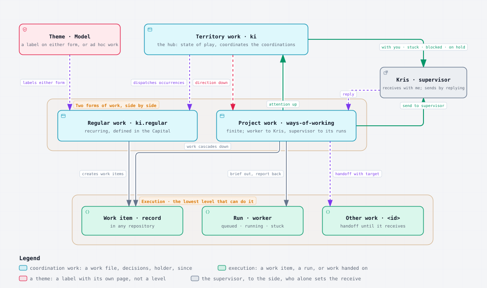

# MOD-011 proposed canonical wording

**Status:** Proposed wording for Kris's Enactment review, not adopted. This design product does not amend canonical content, approve a plan, confer Ready status or accept the model or a pilot.

**Work:** [Ways of working](<../../../../Streams/Projects/ways-of-working.md>) (`ki.ways-of-working`), under [Model](<../../../../Streams/Themes/model.md>). **Record:** [KI-PRINCIPAL-MOD-011](<../../../../Streams/Roadmap/KI-PRINCIPAL-MOD-011-amend-work-model-assigned-package-cascade.md>).

## Provenance and authority

Created locally on 27 October 2026 by GPT-6 in Codex as a temporary input to further work in this repository. The original `wow-mod011-plan` brief and the owner's `wow-mod011-resume` brief expressly authorise this named product and planning; the coordinator reads the current owner grant to keep bringing deferred work back, consolidate ways-of-working functionality and act on high confidence as taking this already-decided amendment forward now. This is not an invented literal option-a answer, new wording approval or authority to change canonical notes.

The [merged model shape report](<model-shape-report.md>) and its two linked independent reviews supply the model. The [work's decisions](<../decisions.md>) settle CASCADE-STEWARD, CASCADE-REPORT, RELATIONS, HOST-SEAT and HOST-TARGET on 25 October, COMMIT-CADENCE and PACKAGE-PUSH that night, and SINGLE-THREAD on 26 October. The report's historical awaiting-decisions label is not the current decision state. Harness revision `1af72f2e` carries the decided cascade. STEWARD-FIELD stays open and is expressly excluded; no field encoding is chosen.

The exact inputs are the current [Work Process](<../../../../Pillars/Philosophy/Model/Processes/Work Process/Work Process.md>) and [GDR-KI-PRINCIPAL-009](<../../../../Admin/Governance/Decisions/GDR-KI-PRINCIPAL-009-the-work-model.md>) at observed repository revision `fd1beb211484c7664bc389e4299981d7cbe5561b`. SHA-256: Work Process `3ca01e82e4307003b50e737c18cb88604df65df3955e5086e493981bbf6c88b1`; GDR `dc6879077096b8925197c24a2702fe2ccb548b5f9d4e6a646f43cb35137d1ff9`. The patch below is generated against those bytes, not a remembered quotation. It must be re-grounded if either source changes before Enactment.

## Review boundary

The proposal covers package and thread identity, explicit assignment and handover, reporting homes, record routing, parent and covers relationships, seat versus requirement, commit cadence and standing publication limits. Existing work/package identities, seven states, roles, banner and roadmap mapping remain as decided. Existing commit cadence in Work Process is retained and clarified rather than treated as a missing change. No canonical document cites this temporary design note.

STEWARD-FIELD, host syntax, harness changes, tools-ki readers, Observatory, runtime or provider actions, Project closure, marks and pruning are outside this amendment. Valle Armonia and host pilot exit conditions stay with their rollout work; this wording acknowledges them without claiming the pilot happened or making its acceptance part of this record. This is the bounded planning proposal, not a new owner decision on rollout.

## Exact proposed patch

This patch changes only the two canonical documents after separate owner approval. The GDR is amended in place and dated; its prior wording stays in Git history. Nothing below has been applied.

````diff
--- a/Pillars/Philosophy/Model/Processes/Work Process/Work Process.md
+++ b/Pillars/Philosophy/Model/Processes/Work Process/Work Process.md
@@ -14,7 +14,7 @@
 
 The Work Process is how coordinated work moves through a territory: who holds it, how it passes between parties, how new work reaches it, where its state is kept and how it is shown. It is the one canonical description of the model that [GDR-KI-PRINCIPAL-009](../../../../../Admin/Governance/Decisions/GDR-KI-PRINCIPAL-009-the-work-model.md) decides. The harness standards and skills that govern coordination, delegation, the work package, forward work, Activities and recurring work cite this note rather than restate it.
 
-The unit is work, in Kris's words "the unit is work, not a conversation". A piece of work is packaged as a skill is: a short definition saying what it is, what its goals are and what it takes, read first, and detail files, its state, its queries, its incoming messages and its own decisions, read only when needed. A chat session is only the channel through which a party works on it. The work outlives every session and is committed at every send.
+The unit is work, in Kris's words "the unit is work, not a conversation". A piece of work is packaged as a skill is: a short definition saying what it is, what its goals are and what it takes, read first, and detail files, its state, its queries, its incoming messages and its own decisions, read only when needed. A chat session is the channel through which a party works; its thread is seated in one package and may act in other packages explicitly assigned to its coordinating work. The work outlives every session. Each completed, verified unit is committed by explicit path before the turn ends.
 
 
 
@@ -58,6 +58,22 @@
 Attention comes back up: each level reads the work packages beneath it and rolls up the five views.
 
 ---
+
+### Assigned-package cascade
+
+A State of play may coordinate Project packages by explicit, committed assignment to coordinating work, never by inferring whether a thread is open, quiet or alive. Each Project package has one assigned coordinating work, either its own Project coordination or a State of play. Assignment is distinct from the holder: it neither receives the work nor releases an On hold state. STEWARD-FIELD remains undecided: this amendment chooses no field, value or file encoding for assignment. Until that choice is made, the assignment is logged in the stewarding work's decisions, as the harness standard provides.
+
+Opening or closing a Project's own thread requests a handover; it does not transfer stewardship. The old steward reconciles runs in flight, queued launches and pending writes, stops launching into the package, and commits the assignment change in one write. The new steward acknowledges the handover before acting. A missing binding, old heartbeat, closed session or timeout grants no takeover; uncertain ownership is reported.
+
+An assigned State of play is the package's coordinator for every entry-point purpose, including tidying, and may brief runs directly into it. The brief names both the reporting package and the product repository; the report is homed in that reporting package whoever launched it. A package assigned elsewhere receives only a message. Package creation is limited to a registered Project within the active-package cap, in the state supported by the actual move; a missing package never implies With worker. The first-message On hold exception for dormant Projects remains. The cap counts packages that are neither On hold nor Finished, not threads.
+
+One territory Summary rolls up the packages. Each item names its work, each query is identified by work id and tag, and queries and Kris's answers stay in that package's queries and decisions files. A decision spanning Projects is kept once at its territory home, not copied as several grants. Every package retains its own state, since, mark and beat. A territory mark never moves Project marks, and acknowledgement moves only the work it clearly names. A territory hold first drains its assigned Project packages and asks separately stewarded packages to drain rather than writing their state. One turn acts in one package; the other packages are rolled up through `ki work status`.
+
+Every package below the territory's main work names its coordinating State of play as `parent`; for ad hoc work this is the coordinating State of play, not the regular-work part of its id. The main work retains `covers` as its register, including registered Project coverage before a package exists and after it is pruned. Parent and coverage must agree within one territory, with unique parentage and no cycles. A thread has no committed metadata: its opener and label carry the relationship until the thread tooling provides it.
+
+A thread's seat, where its session runs or resumes, is never committed in a package, hold or report. A host or category requirement is a fact about work and may constrain a message, brief, record or the whole package through its existing label suffix. Names and the local machine's identity resolve through the territory's machine inventory at bootstrap and re-anchoring, not a raw hostname. A requirement restricts device-dependent execution only: any coordinator may acknowledge, plan, ask about or dispatch the line in queue order. Work with no eligible host remains visible and age-flagged; concrete-host and category meanings must be settled before adopting requirement syntax. This amendment adds no host syntax or field.
+
+The operational detail is owned by the harness standards for [coordinating assigned packages](https://github.com/knowledgeislands/ki-agentic-harness/blob/main/skills/change-management/ki-coordination/references/standards-coordination.md#coordinating-assigned-packages), the [work package](https://github.com/knowledgeislands/ki-agentic-harness/blob/main/skills/governance/ki-work-package/references/standards-work-package.md) and [background runs](https://github.com/knowledgeislands/ki-agentic-harness/blob/main/skills/governance/ki-delegation/references/standards-background-runs.md). The cascade was decided on 25 October 2026; adopting this wording does not accept a pilot or settle STEWARD-FIELD.
 
 ## Roles
 
@@ -146,6 +162,8 @@
 | `with me`, `ack`, `got it`, `seen` | the supervisor's receive |
 | `pause`, `done for now` | the supervisor's receive that agrees a hold, with its reason |
 | `resume`, `finish` | the supervisor's moves off hold and to Finished |
+| thread | a session acting on work, seated in one package and able to act in others explicitly assigned to its coordinating work |
+| session | the runtime channel through which a party acts on work; neither the work nor its committed assignment |
 | working area | `+` inbound and `-` outbound; not canonical, history not durable |
 | mark | the point at which decisions are struck and the working area tidied |
 
@@ -169,7 +187,7 @@
 
 Nothing in the package is a log. History stays in Git and the run reports: there is no moves list, because each move is a commit, and evidence such as commit identifiers and test counts lives in the report and the commit, not in the state file. Splitting definition from state splits the logbook usefully: `git log -- work.md` is the history of what the work is, and `git log -- state.md` the history of its moves. `ki-work-package` owns the exact form of each file, their front matter and their limits.
 
-**The inbox is a queue.** A work's incoming messages are taken in priority order, and the worker may group similar items so that like work is done together. A line added at the top and marked important must be taken first, in that order; that is how State of play changes the way a work works. Other work and State of play write into a package only by adding a line to its `messages.md`, or replacing their own line not yet acted on.
+**The inbox is a queue.** A work's incoming messages are taken in priority order, and the worker may group similar items so that like work is done together. A line added at the top and marked important must be taken first, in that order. The assigned steward acts as the package's own coordinator; other work, including State of play when not assigned to the package, writes only a line to its `messages.md`, or replaces its own line not yet acted on. Assignment changes only through the acknowledged handover above.
 
 **Canonical and working.** `Streams/` holds only definitions and records: Project notes flat in `Streams/Projects/` with a `theme:` key, theme pages in `Streams/Themes/`, and work items in `Streams/Roadmap/`. Everything that churns, the work package, reports, briefs and design papers, stays in the work folder. Links point upward: the work file names its Project; the Project note does not link down. Briefs sit in `briefs/<run>.md` while their handoff is open. The run state folder, `~/.local/state/ki/agents/<slug>/`, holds only runtime state.
 
@@ -205,7 +223,7 @@
 └── diagrams/
 ```
 
-**Git is the logbook.** `git log -- +/_WORK/<id>/` is the history. Every session commits each completed unit by explicit path before its turn ends, under [Committing the work folder](https://github.com/knowledgeislands/ki-agentic-harness/blob/main/skills/change-management/ki-coordination/references/standards-coordination.md#committing-the-work-folder), which owns the commit and sync cadence. Move commits carry the move in their subjects: `docs(work): ki.ways-of-working send to owner`, `docs(work): ki.ways-of-working receive by owner`, `docs(work): ki.ways-of-working hold, paused`.
+**Git is the logbook.** `git log -- +/_WORK/<id>/` is the history. Every session commits each completed unit by explicit path before its turn ends, under [Committing the work folder](https://github.com/knowledgeislands/ki-agentic-harness/blob/main/skills/change-management/ki-coordination/references/standards-coordination.md#committing-the-work-folder), which owns the commit and sync cadence. Move commits carry the move in their subjects: `docs(work): ki.ways-of-working send to owner`, `docs(work): ki.ways-of-working receive by owner`, `docs(work): ki.ways-of-working hold, paused`. A move subject names the package whose state changed and, where useful, the acting work; a coherent move across files stays one commit. Fast-forward pulls run only into a clean checkout. Publication follows the standing push rule, including its required inspection of every unpublished ancestor and its limits on risk and deploying refs; cadence and a working-area path alone grant no publication authority. There is no new messages merge driver or append-only conflict policy.
 
 **Shared history is never rewritten.** A rewrite breaks every clone and every revision link and needs a force-push. Instead, the working area is pruned at every mark, a finished work folder is deleted at the mark that closes it with Git keeping it, and a separate working repository is considered only if clone size or `git log` speed measurably hurts.
 
@@ -216,6 +234,8 @@
 **State of play routes.** Territory work, State of play, is the single dispatch coordinator. Every new unit of work without a clear owner comes to it: an owner dump, a handoff with no owning work, a cross-work item whose owner is unclear, and every method improvement, whether Kris pastes it there or another work sends it as a line in State of play's messages. A unit that already has an owner goes direct: a work's own follow-ups, an item in a record that names its work, and a reply to a message never pass through the hub.
 
 State of play matches the unit against each work's description and, where two match, their Scope, chooses one work and adds one dated route line to that work's `messages.md`. It keeps no copy of the register, which `ki work status` derives from the work packages. Where nothing matches, it proposes to Kris either a new piece of work or a record captured through `ki-next`.
+
+**Records resolve ownership, not authority.** A record's `project` resolves through the registry to its Project, territory and package; the record remains in its owning repository with its own holds, readiness and acceptance. Selection into Now neither opens a package nor grants execution. The assigned steward places the routed record in the package's next steps at its next wake. A record without a Project goes first to its existing regular or ad hoc owner; only unresolved ownership goes to State of play. Reclassification first reconciles runs in flight and their reporting package.
 
 **A routed work cannot reject.** In Kris's words, "once it's given it, it has to do something with it, it can't reject it, it can then say it wants it to be given to someone else ... we have to be careful about things just [bouncing] in between things". The receiving worker acts on each line at its next wake and does what it can with it: what its existing authority covers goes into its next steps, and what needs Kris's authority, capacity or a change of scope becomes a query. It gives back to State of play only the part it judges is not its own, with a reason. A unit is returned once; if State of play cannot place it elsewhere, it goes to Kris as a query rather than round again. Routing confers no authority to execute: owning a unit means owning what is done with it.
 
--- a/Admin/Governance/Decisions/GDR-KI-PRINCIPAL-009-the-work-model.md
+++ b/Admin/Governance/Decisions/GDR-KI-PRINCIPAL-009-the-work-model.md
@@ -3,7 +3,7 @@
 id: GDR-KI-PRINCIPAL-009
 title: 'The work model'
 date: 2026-10-18
-updated: 2026-10-19
+updated: 2026-10-27
 status: current
 decision_type_url: https://knowledgeislands.info/specifications/decision-records/gdr
 decision_type: governance
@@ -26,7 +26,7 @@
 
 - **The unit.** Work is the unit. A piece of work is a work package: a definition of what it is, its goals and what it takes, read first, and its state, queries, incoming messages and own decisions, read when needed. A chat session is only the channel through which a party works on it, and the work outlives every session.
 - **Levels and forms.** Work lies at three levels and cascades down to the lowest level that can do it; coordination sits above execution and attention rolls back up.
-  - **Territory work**, id `ki` in this territory, is the state of play: it coordinates the coordinators, routes new work, stewards the method and executes nothing.
+  - **Territory work**, id `ki` in this territory, is the state of play: it coordinates the coordinators, routes new work and stewards the method. It may coordinate explicitly assigned Project packages; execution remains with work items and their runs or people.
   - **Regular work** and **Project work** are the two forms of work, side by side beneath it. Regular work, id `ki.regular`, is the territory's recurring work, defined at territory level in the Capital's Activity notes. It is self-coordinating: it needs no coordination thread, never closes, and is not necessarily dispatched by state of play, which may still discuss it. Ad hoc work with no Project lies in it as `ki.regular.<slug>`. Project work, id `ki.<project>`, coordinates a Project and is finite. A Project's own recurring checks stay with the Project and end with it.
   - **A work item** is one record in any repository, created by either form and executed by a run or a person. Its record's status is its state.
 - **Themes.** A theme is a label that regular work, Project work or ad hoc work can carry, not a level. Each theme has one page in `Streams/Themes/` saying why it is a theme, what matters about it, its general direction and the guidance common to the work under it, and it holds no work. Project notes stay flat in `Streams/Projects/` with a `theme:` key. No identifier carries a theme.
@@ -37,16 +37,30 @@
 - **Stuck and the heartbeat.** A heartbeat runs only while work lies with a worker: an update on change, at least every 5 minutes and always by 10. A worker's item that has neither moved nor beaten for 10 minutes is stuck. Work with the supervisor is never stuck, only older.
 - **Words.** Hold means only the agreed On hold state; drain is the activity on the way into it. The supervisor receives with `with me`, `ack`, `got it` or `seen`, agrees a hold with `pause` or `done for now`, and moves the work with `resume` and `finish`. The views by holder are with you, stuck, blocked, moving and on hold. `+` and `-` are working areas.
 - **Homes.** Each piece of work above a work item is a work package in one flat folder in the working area, `+/_WORK/<id>/`, the work folder. A package has exactly five files, all created with it: `work.md`, the definition, with a routing description, goals and scope; `state.md`, the state fields, now, next steps and held work; `queries.md`, every open and parked query in full; `messages.md`, the inbox; and `decisions.md`. Run reports, open briefs and design papers sit beside them, and nothing in the package is a log. `Streams/` holds only definitions and records: Project notes, theme pages and work items. Links point upward, from the work file to its Project note. The run state folder holds only runtime state.
-- **The inbox.** A work's incoming messages are a queue taken in priority order; the worker may group similar items, and a line added at the top marked important is taken first, in that order. Other work and State of play write into a package only by adding a line to its messages.
+- **The inbox.** A work's incoming messages are a queue taken in priority order; the worker may group similar items, and a line added at the top marked important is taken first, in that order. Its assigned steward acts as the package's own coordinator. Other work, including an unassigned State of play, writes only a line to its messages, or replaces its own line not yet acted on.
 - **Routing.** State of play is the single dispatch coordinator: each new unit of work without a clear owner, and each method improvement, comes to it, and it routes the unit to one work by matching the works' descriptions. Already-owned units go direct. A routed work cannot reject the unit: it does what it can with it, raises a query for what needs Kris, and gives back to State of play only the part it judges is not its own, with a reason. A unit is returned once and then goes to Kris. Routing confers no authority to execute.
 - **Stewardship.** Every work tries to improve continually and State of play coordinates it, dispatching each improvement as small regular work or into the Project it most affects; a significant change revives the Ways of working Project, or a more targeted Project under the Model theme. Each state file records the method revision its worker last read, and a change of method is sent as a targeted refresh line only to the works it affects that are behind.
-- **History.** The Git history of a work folder is its logbook, and each send and supervisor receive is a commit whose subject carries the move. Shared history is never rewritten: the working area is pruned at every mark, and a separate working repository is considered only if size measurably hurts.
+- **History.** The Git history of a work folder is its logbook. Each session commits each completed, verified unit by explicit path before its turn ends, and move subjects name the affected work. Fast-forward pulls run only into a clean checkout. Publication follows the standing push rule with inspection of every unpublished ancestor and its risk and ref limits; cadence grants no extra publication authority. Shared history is never rewritten: the working area is pruned at every mark, and a separate working repository is considered only if size measurably hurts.
 - **Decisions.** `decisions.md` stays apart from the logbook and holds Kris's decisions about that work, in Kris's words, in the turn they arrive. Relays, sends and operational events are moves, recorded as commits, not decisions. At each mark each entry is checked against its durable home and then struck, reduced to a one-line pointer, or kept; entries carry no running numbers.
 - **The banner.** A report shows its state in rich text: a heading whose glyphs end with whose move it is, the state in role words, a line of counts and a list of items with holder and since. A settled state shows its holder's glyph alone, as in `🤖 With worker`; an arrow appears only in a handoff state, as in `🤖 → 👤 Handoff to supervisor` or `→ 🎯 Handoff to <target>`. The report's form line carries the same prefix, and the send line appears only when the work is in handoff to Kris.
 - **Answers.** An owner report carries no copyable reply block. Queries keep their Context, Query and Options with confidence; Kris answers in speech, and the worker reads each answer back as taken in the decisions log and asks one line where an answer is unclear.
 - **The observatory.** Work state is read through one `ki` command, `ki work status --format json`, schema `ki/work-status/v1`, one entry per work package, from which the five views are derived.
 
+### Amendment - 27 October 2026: assigned-package cascade
+
+The decisions of 25 and 26 October 2026 extend this same model. A State of play may coordinate Project packages by explicit, committed assignment to coordinating work, changed only by acknowledged handover that reconciles runs in flight, queued launches and pending writes and stops the old steward before the new one acts. An absent or quiet thread never transfers assignment. Assignment is separate from holder and does not receive work or release a hold. The assigned steward is the package's coordinator for every entry-point purpose; other work sends a message. Creation requires a registered Project within the package cap and a state supported by the actual move, never an invented With worker. The dormant first-message On hold exception remains.
+
+A thread is seated in one package and may act in others assigned to its coordinating work. One turn acts in one package. Runs name their reporting package separately from the product repository, and reports go to that package whoever launched them. One territory Summary names the work on each item and qualifies query tags by work id; each package retains its own state, since, mark, beat, queries and decisions. A territory mark does not move Project marks, and acknowledgement moves only named work. A cross-Project decision is kept once at its territory home. The cap counts packages neither On hold nor Finished. A territory hold drains its assigned packages and asks separately stewarded packages to drain.
+
+Every package below the main territory work names its coordinating State of play as parent, including ad hoc work; the main work keeps covers as its checked register, including coverage before package creation and after pruning. Relations stay within one territory, unique and acyclic. Threads carry no committed metadata. A record's Project classification resolves its package but grants no authority, opens no work and moves no record from its owning repository; the assigned steward updates next steps. Project-less records go to an existing regular or ad hoc owner first, and reclassification reconciles runs and reporting homes before moving responsibility.
+
+The no-host rule protects a thread's uncommitted seat, not a work requirement. A host or category requirement may constrain the smallest applicable unit of work; inventory names and bootstrap mapping establish its meaning. It restricts device-dependent execution only, leaving acknowledgement, planning, queries and dispatch possible in queue order. Work without an eligible host stays visible and age-flagged; host and category semantics must be settled before syntax adoption. No host syntax or new field is introduced here.
+
+STEWARD-FIELD remains undecided and excluded: this amendment chooses no assignment field, value or file encoding. Until decided, assignment is logged in the stewarding work's decisions under the harness standard. No messages merge driver is adopted. Operational detail remains in the harness standards for [coordinating assigned packages](https://github.com/knowledgeislands/ki-agentic-harness/blob/main/skills/change-management/ki-coordination/references/standards-coordination.md#coordinating-assigned-packages), the [work package](https://github.com/knowledgeislands/ki-agentic-harness/blob/main/skills/governance/ki-work-package/references/standards-work-package.md) and [background runs](https://github.com/knowledgeislands/ki-agentic-harness/blob/main/skills/governance/ki-delegation/references/standards-background-runs.md); the Work Process note remains the full canonical description.
+
 ## Consequences
+
+- The assigned-package cascade changes coordination and reporting, not the seven states, roles, roadmap mapping, banner or repository acceptance authority. The one-wave Valle Armonia pilot and separate host-requirement pilot retain their rollout exit conditions; this amendment neither performs nor accepts them. STEWARD-FIELD and any further rollout remain separately gated.
 
 - The Work Process note is the one canonical description of the model. The harness standards and skills that govern coordination, delegation, the work package, forward work, Activities and recurring work cite it and do not restate it; `ki-work-package` owns the package's exact form.
 - Every reader of work state accepts both the single work file and the package before any work folder moves, and the live folders then move to the package in one pass.
````

## Enactment gate

Kris must review the exact wording and bounded plan through the [Enactment Process](<../../../../Admin/Operations/Processes/Enactment Process.md>) before the record can become Ready and before either canonical file is written. The separate implementation and acceptance lifecycle remains necessary. STEWARD-FIELD need not be decided to review this expressly excluded scope. No further adoption-timing answer is requested.
