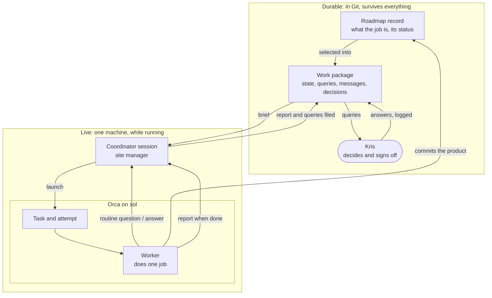

# Orca and Knowledge Islands, plainly

For Kris, who asked: "I don't quite get what's going on ... how we balance all these things up, how and where we're running, what work we're doing, how that works with the roadmaps, how that works with work packages." The detailed design is [orca-fit](orca-fit.md). Nothing here is decided yet.

## One analogy: a building site

Think of each repository as a house being built.

- The **roadmap** is the list of jobs on that house: "fit the boiler", "rewire the kitchen". It says what work exists and whether each job is waiting, under way, ready for inspection or finished.
- The **work package** is the site file for one project spanning several jobs. It says what the project is for, where it stands, the questions waiting for you, the messages that have arrived and the decisions you have made.
- **You** are the client. You approve, decide and sign off. Nobody else can.
- The **coordinator** is the site manager: a chat session that reads the site file, hands jobs out, answers routine questions and brings you the ones only you can answer. It does no building itself.
- The **workers** are the tradespeople: background agents, each doing one job from a written brief.
- Each **machine**, sol or terra, is a separate site cabin.
- **Orca** is the radio and whiteboard in one cabin. It sends tradespeople out, gives each their own workbench if needed, shows who is alive and busy, and carries quick questions back and forth.
- **Git** is the drawings office in town. Anything that must survive, or reach the other cabin, goes there.

The rule that makes it balance: **the site file and the job list are the truth; the radio is only for now.** If the cabin burns down, you lose the radio chatter and nothing else.

## The layered picture

## Worked example: KI-TOOL-RIG-CORE-069

1. **The job.** [KI-TOOL-RIG-CORE-069](/Users/krisbrown/workspaces/knowledge-islands/tools-rig/docs/roadmap/KI-TOOL-RIG-CORE-069-dynamic-type-handler-fallback.md) sits in tools-rig's roadmap as a draft: Rig needs a fallback when macOS refuses to set a default app for some file types.
2. **The project picks it up.** The [Mac Studio setup](/Users/krisbrown/workspaces/knowledge-islands/ki-principal/+/_WORK/ki.prj.mac-studio-setup/work.md) package lists it as a next step. You agreed GO-PLAN, which the coordinator logged in that package's decisions in your words.
3. **The brief.** The coordinator wrote a brief: plan 069 to Ready, no system changes, no sudo.
4. **Orca launches.** On sol the coordinator gave the brief to Orca, which started one Codex worker. The coordinator noted the Orca ids in the package's state.
5. **Routine questions.** The worker asked twice through Orca, "may I leave the unrelated audit warning alone?" and "may I commit in both repositories one after the other?". The coordinator could answer both within your go, so it did, in minutes.
6. **The product.** The worker updated the 069 record in tools-rig and pushed it. That is the real output, and it lives with the job.
7. **The snag.** A third question timed out because nobody was listening when the worker asked. The fix is that the coordinator always keeps one ear on Orca while a worker is out.
8. **The report.** The worker wrote its report and said "done" to Orca. Under this design the coordinator, not the worker, files the report into the site file and copies its questions into the queries list.
9. **Your question.** One question needs you: will you attend a short probe on sol so the right fallback can be chosen? It reaches you as RIG-069-PROBE, with a recommended answer. You answer in speech; the coordinator writes your words into decisions; only then does the job move on.

At no point did Orca hold anything you would miss if sol's Orca database vanished.

## Who owns what

| Thing | Owned by | Lives in | Survives a lost machine |
| --- | --- | --- | --- |
| What work exists, its status | Roadmap record | The repository's roadmap, in Git | Yes |
| Where a project stands, its questions and your decisions | Work package | `+/_WORK/<id>/` in ki-principal, in Git | Yes |
| Approval, decisions, sign-off | You | Your words, logged in the work package | Yes |
| Handing out jobs, routine answers, filing reports | Coordinator session | One chat on one machine | No; the package is its memory |
| Doing one job and committing its product | Worker | One process on one machine | Its pushed commits only |
| Launching workers, workbenches, who is alive, quick questions | Orca | sol's Orca database | No, by design |
| The prompt and its rules for the worker | `ki` | Rendered for each launch | Not needed |
| Moving anything between sol and terra | Git | The remote | Yes |
