# Work state machine

**Owner:** Kris · **Owning repository:** knowledgeislands/ki-principal · **Date:** 2026-10-29

**Work:** `ki.prj.ways-of-working`. Status: draft design under `ki-work-design`, answering WORK-STATE-MACHINE, WORK-FOLDER-PURPOSE, DRAIN-MEANS and TRANSITION-CONDITIONS of 29 October 2026 in [the decisions log](../decisions.md). HOLD-PORTABLE folds in here. Nothing here changes a standard, a skill or the Work Process note; the rollout at the end says where each part would land once decided.



Interactive view, with dark and light themes: [work-state-machine.html](work-state-machine.html).

## Reading the machine

The machine has the seven states of the [Work Process](<../../../../Pillars/Philosophy/Model/Processes/Work Process/Work Process.md>) note and one new one, Bootstrap, where a session reads the package before it acts, as Kris asked on 29 October: "we're also missing some kind of bootstrap state. And you can get to that by re-bootstrapping, and bootstrapping can then transition to with worker or with supervisor".

Drain is not a state. In Kris's words, "drain isn't the state, but it should be what we're doing to target or move to a particular state": it is the work done on the `hold` arc. Every arc has three parts, as Kris set under TRANSITION-CONDITIONS: preconditions that must hold before the arc starts, the work the arc does, and postconditions that must hold when it ends. An arc whose work cannot reach its postconditions does not complete; the one such failure drawn is `drain blocked`.

Only the holder moves, as the note already says: the worker sends, picks up, hands off and receives a reply; Kris receives, replies, holds, releases and finishes; a target answers. A steer mid-run, a heartbeat, a run launched or received, a mark and a `drain` without a hold all happen inside a state and move nothing.

## States

| State | `state` value | Meaning | Who holds the move | Banner | What must be true while in it |
| --- | --- | --- | --- | --- | --- |
| Bootstrap | none: transient, see BOOT-RECORD | A session has been opened on the work, or re-bootstrapped, and is reading the package before acting | The session, as worker | None of its own: the re-bootstrap report carries the glyph of the state it exits to | `state.md` still records the state the work was in; nothing is launched; the only writes are a mark if the work has none and the disposition of each `messages.md` line acted on; the turn budget holds |
| With worker | `with-worker` | A run of this work is in flight, the coordinator is mid-turn, or authorised work waits for worker capacity | Worker | 🤖 With worker | Heartbeat at every change, at least every 5 minutes and always by 10, or the item is stuck; the package is committed after every finished change and synced at least every 15 minutes; a `drain` without hold may be under way |
| Handoff to supervisor | `handoff-to-supervisor` | The worker has sent; Kris has not received | Supervisor | 🤖 → 👤 Handoff to supervisor, with `· blocked` when stuck | Nothing of this work runs; the send commit is on origin; every query is in `queries.md` in full; `blocking: true` only when sent back with a blocking query |
| With supervisor | `with-supervisor` | Kris has received | Supervisor | 👤 With supervisor | `received` is set; nothing runs; the work is never stuck here, only older |
| Handoff to worker | `handoff-to-worker` | A reply, a target's answer or a release waits, and no session has received it | Worker | 👤 → 🤖 Handoff to worker | Every owner answer is read back in `decisions.md`; nothing runs; `state.md` next steps say what to restart |
| Handoff to target | `handoff`, with `target` | The work waits wholly on a named target outside its own runs: other work, a person or a repository's owner | Target | → 🎯 Handoff to `<target>` | The line in the target's `messages.md` is committed and on origin; nothing of this work runs; `state.md` names the target and what is expected back |
| On hold | `on-hold`, with `hold.reason` and `hold.release` | Agreed by Kris and drained: paused, or more expected | Nobody until the release | ⏸️ On hold | The portability postconditions of `hold` hold throughout: deleting the local checkout loses nothing; queries are parked; no heartbeat and no scheduled wake; routed lines wait unread; a paused hold older than 31 days is flagged |
| Finished | `finished` | Closed | Nobody | 🏁 Finished | Every decision homed, `design/` resolved, every finding settled, runs closed; the folder is deleted at the closing mark, Git keeping it |

## Transitions

Each name reuses a word the standards already use where one exists: send, receive, reply, hold, release, finish, pick up and re-bootstrap. Hand off, answer, withdraw, report and drain blocked are new names for arcs the standards describe without naming. Commit subjects marked _proposed_ are new; the rest are today's.

| Transition | From → To | Trigger and owner words | Preconditions | Work on the arc | Postconditions and commit |
| --- | --- | --- | --- | --- | --- |
| open | (entry) → Bootstrap | Kris pastes an opener, `Bootstrap as <id> under ki-coordination.`, from `ki agent prompts` | The machine is "Ready to coordinate" under `ki-bootstrap`; the id resolves to exactly one package home; the opener's level, scope, authority and coordination capability match the package | None | A session in Bootstrap. On a mismatch the session says so in one line and replies conversationally; the work does not move |
| re-bootstrap | With worker, Handoff to supervisor, With supervisor, Handoff to worker or Handoff to target → Bootstrap | `Re-bootstrap as <id> under ki-coordination.`; a compaction, as re-anchoring; a model switch; a fresh session picking the work up; a host move | The previous session's last state is committed and on origin, so the package is the whole state; on another host, the repository level check proves the repositories level | None; re-anchoring moves no mark | A session in Bootstrap; `state.md` unchanged. Not from On hold, which needs `release` first, nor from Finished, where reopening is a new opener from territory work |
| pick up | Bootstrap → With worker | The session, once its reads are done | The Bootstrap reads are complete: the standard and the note read and `method_read` checked; `ki agent status` reconciled; the five files and open findings read; `messages.md` acted on in queue order, IMPORTANT and FIRST-STEP lines first; and there is worker work: runs to recover, authorised next steps, or answers to take from Handoff to worker | Re-bootstrap report, a full owner report ending Done with the rename line; a mark struck if the work has none; stopped runs restarted from their open briefs; answers read back | `state: with-worker` with `since`, `beat`, `mark` and `method_read`; _proposed_ `docs(work): <id> pick up`; sync |
| report | Bootstrap → With supervisor | The session, when nothing is the worker's | The same reads; nothing runs and no authorised unit waits to launch; Kris opened this session and is present | Re-bootstrap report with every open query in full; a mark struck if none | `state: with-supervisor` with `received` set; _proposed_ `docs(work): <id> report to owner`; sync. See BOOT-RECEIVE |
| send | With worker → Handoff to supervisor | The worker | An actual decision or review is due, or all dispatched work has finished, or the worker is stuck (`send · blocked`); every finished run received, its report homed in `reports/`, its queries copied whole into `queries.md` and its decisions logged | Prune the work folder; rewrite `state.md` front matter and next steps; give the Summary with the banner | `state: handoff-to-supervisor`, `blocking` when stuck; `docs(work): <id> send to owner`; fetch, fast-forward pull and push |
| receive | Handoff to supervisor → With supervisor | Kris: `with me`, `ack`, `got it`, `seen` | The send is committed | None | `state: with-supervisor`, `received` set; committed with the worker's next send, `docs(work): <id> receive by owner` |
| reply | With supervisor or Handoff to supervisor → Handoff to worker | Kris answers in speech, by tag, in order or by a bare letter; from Handoff to supervisor the answer is itself the receive | Each answer read back as taken in `decisions.md` in the turn it arrives; an unclear answer asked back in one line | Answered queries leave `## Open` in `queries.md` | `state: handoff-to-worker`; `docs(work): <id> receive by owner`. In a live session the worker usually receives in the same turn, so reply and receive share one commit |
| receive | Handoff to worker → With worker | The worker, in a live session | The reply, answer or release is committed; the worker has read it back | Restart authorised work from next steps; after a release, move parked queries back to `## Open` | `state: with-worker`; _proposed_ `docs(work): <id> receive by worker`. A fresh session takes the same path as re-bootstrap then pick up |
| hand off | With worker → Handoff to target | The worker | The next step waits wholly on a target outside this work's own runs, and none of its runs is in flight; the route is authorised, or Kris has given permission for a transfer of work, proposed at the bottom of Queries | One line in the target's `messages.md`, committed alone and pushed at once; `state.md` names the target and what returns | `state: handoff`, `target: work/<id>`, `person/<handle>` or `repo/<name>`; _proposed_ `docs(work): <id> hand off to <target>` |
| answer | Handoff to target → Handoff to worker | The target: a reply line in this work's `messages.md`, its receipt, or a return of the part not its own | The target's line or receipt commit is on origin | The target's own processing, in its own package | `state: handoff-to-worker`, `target` cleared. What the worker then does is under Where Handoff to target goes |
| withdraw | Handoff to target → With worker | Kris's steer, naming the handoff | The steer is logged in `decisions.md` | The worker replaces its own line not yet acted on, or adds one withdrawing it | `state: with-worker`; _proposed_ `docs(work): <id> withdraw from <target>`. See TARGET-SILENT |
| hold | With supervisor → On hold | Kris: `pause`, with its release, or `done for now`; the worker may propose it in its send. Said while work runs, the word is first a receive | IMPORTANT messages read; every wake this session holds cancelled; for `paused`, the release condition stated in words | **Drain**: launch nothing new; let a run that will finish within about 15 minutes finish; stop any other at a safe point, recording in next steps where it stopped and how to restart it, its brief kept in `briefs/`. **Portability checks** under DRAIN-MEANS, listed below. **Park**: strike the mark; move every open query to `## Parked` with its tag, one line of context and its recommended option; strike decisions; prune the folder | The portability postcondition: if the local checkout were deleted, nothing would be lost. `state: on-hold`, `hold.reason`, `hold.release`, `since`; `docs(work): <id> hold, paused` or `hold, more expected`, pushed fast-forward; the hold report |
| drain blocked | With supervisor → With worker | The worker, when the `hold` arc cannot reach its postconditions | A drain step or portability check fails: an unpushable change, a run that must not be stopped, a diverged pull, an unknown PR state or a runtime-only report | Report in one line what blocks, `NOT DRAINED` | `state: with-worker`, blocked; the next send is `send · blocked`. The terra drain of 29 October ended here |
| release | On hold → Handoff to worker | Kris: `resume`; or the release condition is met; or, for more expected, new work arrives | For a paused hold, Kris's word or the condition holding; nothing else, since the portability postcondition still holds | None: no work starts in the release itself | `state: handoff-to-worker`; _proposed_ `docs(work): <id> release`. The next session receives, through re-bootstrap and pick up, and moves the parked queries back to `## Open` |
| finish | With supervisor or On hold → Finished | Kris: `finish` | Close-out: every decision homed, none homeless or held; `design/` resolved, every note graduated and deleted; every finding settled; no run, report or brief open; the `hold` portability postcondition holds | Route the durable information; point the Project note at the outcome; `ki agent close` archives the runs, its gate strict with `--reconciled` as Kris's waiver | `state: finished`; `docs(work): <id> finish`; the folder deleted at the closing mark in one commit, Git keeping it |

### Portability checks on the hold arc

DRAIN-MEANS and TRANSITION-CONDITIONS set the test, in Kris's words: "there's no longer anything which is specific to a machine that might get lost if I was to delete the repository". The hold arc checks, in every repository the work or its runs touched:

1. Nothing of this work is running, queued or scheduled; each stopped run has its restart recorded and its brief kept.
2. No uncommitted change of this work; everything committed by explicit path, pulled fast-forward and pushed fast-forward, never forced and never with `--no-verify`.
3. Every run worktree removed once its work is on origin; every branch either merged into `main` or pushed to origin, in Kris's words "making sure that any branches are folded in. Or, if not, they need to be pushed to the origin".
4. Stale remote-tracking branches pruned, "a prune of origin ones which are no longer there".
5. No stash and no local-only ref holding this work's content.
6. Every open PR recorded in `state.md` as merged, closed or named for its owner.
7. Every run report homed in `reports/`, or its outcome homed; anything in `~/.local/state/ki/agents/<run>/` needed to resume copied into the package, never a secret.
8. The package reviewed and tidied: mark struck, queries parked, decisions struck, folder pruned.

Another session's uncommitted file is named in the hold report's Left over and left alone; it is that session's to carry. A check that cannot be run, such as PR state under a provider-call ban, is unknown, never passed, and the arc ends in `drain blocked`.

## Where Handoff to target goes

A handoff never goes straight to On hold or Finished: only Kris agrees a hold or a finish, and the target holds no authority over this work. Every outcome lands as a line or commit this work reads, so the move comes back to the worker through `answer`, and the worker then sends to Kris if a hold or finish is now right.

| Outcome | What the target does | What this work's worker does on receive |
| --- | --- | --- |
| Target replies | Adds a reply line to this work's `messages.md` | Takes the reply into next steps and carries on, or raises a query |
| Target takes ownership | Records the line's disposition and removes it in a commit naming it, the receipt under route receipt | Drops the unit from its own next steps; if nothing else remains, sends to Kris proposing a hold, more expected, or a finish |
| Target refuses | Cannot reject a routed unit; returns only the part not its own, once, with the reason | Does what it can with the returned part, or makes it a query; a second return goes to Kris as a query, never round again |
| Target stays silent | Nothing | Stays in Handoff to target, its age shown in the banner, until Kris withdraws it under TARGET-SILENT |

## Host moves on the machine

A host move is neither a state nor an arc of its own; it is a path through the machine, and the machine-local binding is never moved but rebuilt on each host.

- **Planned move**, today's standard and the terra-to-sol practice: `hold` on the old host, its portability checks proving nothing is left there; On hold; `release` on the new host; then re-bootstrap there, the repository level check first, and `pick up`.
- **Unplanned move**, when a host or session is lost: `re-bootstrap` from whatever live state the package records, on the new host. A With worker pick-up is recovery: a run not found counts as stopped and restarts from its open brief. Whatever was not pushed is lost, which is why portability is the hold postcondition.
- **Lighter planned move**: whether a move may skip On hold, re-bootstrapping directly once the portability checks pass, is HOST-MOVE-PATH below.

HOST-SYNC, the two-host regular synchronisation, is a separate design: it keeps repositories level between hosts and moves no work through the machine.

## Work folder layout

WORK-FOLDER-PURPOSE, in Kris's words: "anything else that we create under that structure must be in a folder based on what its purpose is". The root holds the five package files and nothing else; every other kind lives in a named purpose folder:

```text
+/_WORK/<id>/
├── work.md                      definition: description, Goals, Scope
├── state.md                     state fields, Now, Next steps, Held
├── queries.md                   open and parked queries in full
├── messages.md                  inbox, a queue in priority order
├── decisions.md                 Kris's decisions not yet durable elsewhere
├── reports/<run>.report.md      a run report, until its outcome is homed
├── briefs/<run>.md              a brief, until its run's report is received
├── design/<slug>.md             a design note, or design/<subject>/
│   └── <slug>.architecture.json and its .svg and .html renders
├── findings/<tag>.md            an open finding, until settled
└── feedback/<date>-<slug>.md    Kris's Observatory feedback, until homed
```

Against today's `ki-work-package` closed list, only the run report moves, from the root to `reports/`; briefs, design, findings and feedback already sit in purpose folders. The list stays closed: a new purpose folder needs a change to the standard, not a writer's choice. The launcher, `ki agent`, homes reports and so must write into `reports/`, and the rubric's FOLDER family would fail any root file beyond the five.

The folder moves with the machine: `send` and every mark prune it, `hold` prunes it and proves it portable, and the closing mark after `finish` deletes it.

## Rollout once decided

Each part goes to its owner as a `messages.md` line under HANDOFF-AS-MESSAGE, not done here:

- **Work Process note**, in this repository through the Enactment Process: the states table and drawing, the transition names in the Words table, drain as the hold arc's work.
- **`ki-coordination` standard**, in `ki-agentic-harness`: States and moves carries the transition table; Putting work on hold carries the portability checks as the hold postcondition; Picking work up follows the arcs.
- **`ki-work-package` standard**, in `ki-agentic-harness`: the closed list moves reports into `reports/`; a `bootstrap` state value only if BOOT-RECORD takes it.
- **`tools-ki`**: `ki agent` homes reports into `reports/`; `ki work status` learns any new state value.

## Decisions for Kris

### BOOT-RECORD - Whether Bootstrap is recorded in the state file

**Context:** Bootstrap lasts one session turn of reading. Recording it would add a `bootstrap` value to `state.md`, `ki work status` and the Observatory, and a commit at every open; leaving it transient keeps the recorded state as the state the work was in until the session picks up or reports, so the package never says "bootstrap" after a session dies mid-read.

**Query:** Should Bootstrap be a recorded state value, or a transient state that exists only in the session?

**Options:**

a) (recommended, confidence medium - no reader needs it and a crashed bootstrap leaves no stale value) Transient: draw and define it, but record no `state` value; the exit arc's commit is the first record.

b) Recorded: add `state: bootstrap` to the state file, `ki work status` and the Observatory, committed at open.

### BOOT-RECEIVE - Whether Bootstrap exits straight to With supervisor

**Context:** Kris said bootstrapping "can then transition to with worker or with supervisor". Today the standard sets With supervisor only on Kris's receive, and a re-bootstrap report is a send, which would put the work in Handoff to supervisor until Kris says `with me`. Kris opened the session and reads the report live, but may also open a session and walk away.

**Query:** When a bootstrap finds nothing for the worker, does the work go to With supervisor at once, or to Handoff to supervisor until Kris receives?

**Options:**

a) (recommended, confidence medium - follows Kris's words and treats the opener as the receive, since Kris opened the session) The `report` arc goes to With supervisor, `received` set at the opener.

b) The `report` arc goes to Handoff to supervisor, and Kris's next word is the receive, as for any send.

### TARGET-RUN - Whether this work's own run can be a handoff target

**Context:** The Work Process note's states table says Handoff to `<target>` is "sent to other work, run or a person"; the `ki-coordination` standard says work is With worker "while any of their items lies with a run". The machine follows the standard: this work's own runs keep it With worker, and a target is other work, a person or a repository's owner.

**Query:** Should the note's wording drop "run" as a target of a work's own handoff?

**Options:**

a) (recommended, confidence high - the standard is explicit, every banner and heartbeat rule assumes it, and only the note's table differs) Yes: a work's own runs are always With worker; amend the note's table to "other work, a person or a repository's owner".

b) No: let a run be a target, so a work whose only item is a long run shows Handoff to `run/<name>` with no heartbeat.

### TARGET-SILENT - How a handoff to a silent target ends

**Context:** A target that never answers leaves the work in Handoff to target indefinitely. Stewardship already refuses timeout takeovers, and a routed work cannot reject. The worker holds no move while the target does.

**Query:** How does a handoff to a silent target end?

**Options:**

a) (recommended, confidence medium - keeps the holder rule and the no-timeout precedent, while making the wait visible) Only Kris withdraws it, by steer; the banner shows the handoff's age, and territory work flags one older than 7 days at its mark.

b) The worker withdraws it itself after a set time, such as 7 days, and sends to Kris.

### HOST-MOVE-PATH - Whether a planned host move must pass through On hold

**Context:** The standard says a hold "serves a move between hosts", and the terra-to-sol move of 29 October went through a drain. A hold also parks every query and strikes the mark, which a move between Kris's own Macs may not need; the portability checks alone would protect the move.

**Query:** Must a planned host move go through On hold, or may it re-bootstrap directly once the portability checks pass?

**Options:**

a) (recommended, confidence medium - one path, already in the standard and in use, with the portability checks proven on it) Every planned move goes through `hold` and `release`.

b) Allow a direct move from With supervisor or Handoff to supervisor: run the portability checks without parking, then re-bootstrap on the new host.

### REPORTS-NAME - How a report is named inside reports/

**Context:** Reports are named `<run>.report.md` today, and the launcher, the rubric and links in decisions and reports use that name. Inside `reports/` the suffix repeats the folder.

**Query:** Keep `reports/<run>.report.md`, or shorten to `reports/<run>.md`?

**Options:**

a) (recommended, confidence high - a pure move keeps every reader and existing name working, and Git follows a rename without edits) Keep `reports/<run>.report.md`.

b) Shorten to `reports/<run>.md` and change the launcher, rubric and links.

### FOLDER-MIGRATE - How existing root files move into purpose folders

**Context:** This package alone holds 86 root reports, many already tidy candidates; other packages hold fewer. Links in decisions and reports point at the root paths, and a recap reads a deleted report from its last revision.

**Query:** How should existing root reports move once the standard changes?

**Options:**

a) (recommended, confidence medium - tidying first moves the fewest files, and one owner-run move per package keeps links rewritable in the same commit) Each package's steward tidies at its next mark, then moves the survivors into `reports/` with `git mv` in one commit, rewriting links into them.

b) Leave existing root reports where they are under a tolerance window, with only new reports going into `reports/`.

### ARC-NAMES - Adopt the transition names

**Context:** The machine reuses send, receive, reply, hold, release, finish, pick up and re-bootstrap, and adds hand off, answer, withdraw, report and drain blocked, with proposed commit subjects for the new arcs. The note's words are agreed to be proven in use.

**Query:** Adopt the transition names as drawn, for the Words table and the commit subjects?

**Options:**

a) (recommended, confidence medium - they reuse every word the standard already has and name only the arcs it leaves unnamed) Adopt them as drawn, to be proven in use like the other words.

b) Rename some arcs first; name which.
