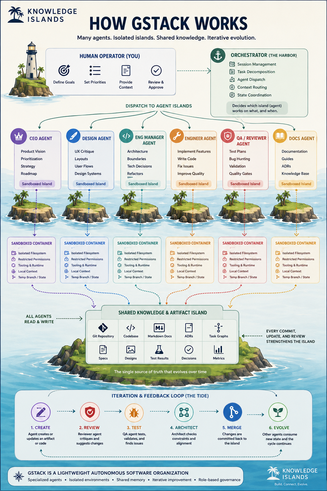
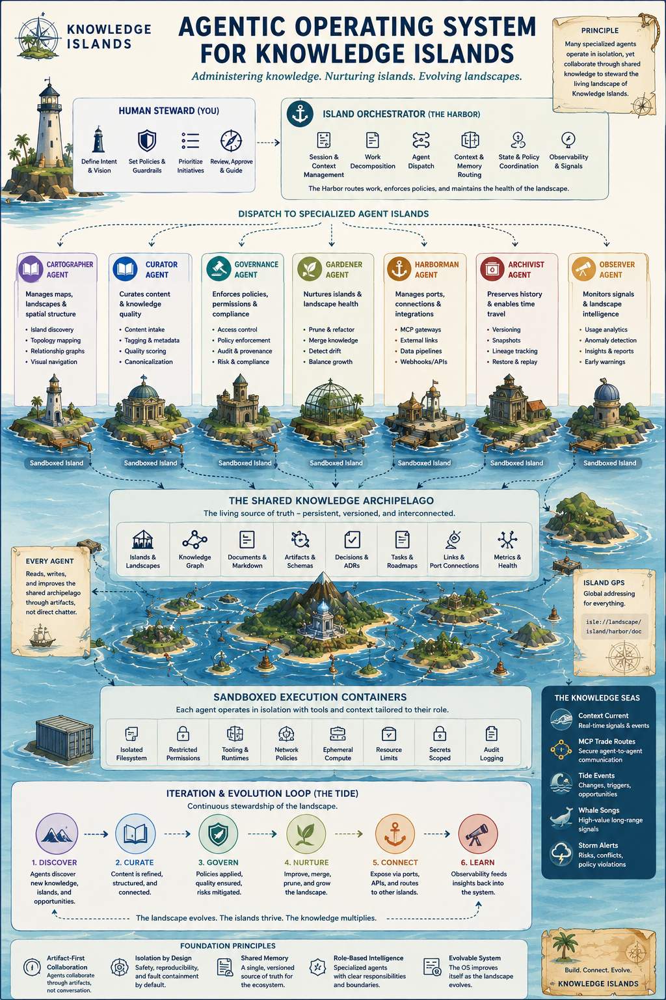

# Influences Along the Way

These are not the inspirations that started Knowledge Islands. Those are the founding approaches in [Prior Art](<../Prior Art/Prior Art.md>) - Zettelkasten, PARA, LLM-native wikis and the Open Knowledge Format - and the real-world lineage told in [History of Knowledge Systems](<../History of Knowledge Systems/History of Knowledge Systems.md>). The projects below were met later, along the journey, while Knowledge Islands was being put to work with agents. Each one informed it: sometimes by being adopted, sometimes by being tried and set aside, and sometimes only by showing an idea clearly.

Each entry follows the capture principle in [Fictional Lineage](<../../../Emerging Concepts/Fictional Lineage.md>): the source, the idea it contributes, what in Knowledge Islands it informed, and what kind of influence it is. Where the influence is not yet written down anywhere, it says "to be recorded" rather than guessing. None of these entries is an adoption decision; the [Technology Radar](<../../../../Engineering Practice/Technology/Technology Radar.md>) and the KI Agentic Harness decisions hold the engineering posture.

---

## gstack

[gstack][gstack] is Garry Tan's open-source (MIT) set of Claude Code slash-command skills that turns one coding agent into a virtual team of specialist roles - a CEO-style product reviewer, an engineering manager, a designer, a code reviewer, a QA lead, a security officer and a release engineer.

**What it informed.** The separation of planning, implementation, review, QA and reflection, with explicit scope control, which the harness `ki-batch` skill records as taken from gstack ([sources][ki-batch-sources]). It also gave the clearest picture of agents as role-holding workers on isolated islands around one shared, evolving source of truth, which became the "How gstack works" explainer below and, from it, the agentic operating system board. gstack itself was declined as an installed skill set, because it would run beside the KI skills as a second, ungoverned skill system; individual ideas such as threat modelling remain candidates for KI skills ([ADR-KI-HARNESS-TOOLCHAIN-002][toolchain-002]).

**Kind.** A current influence on roles and work separation; not adopted as tooling.

---

## Paperclip

[Paperclip][paperclip] is Paperclip Labs' open-source (MIT) orchestration app for teams of AI agents: a server and dashboard with org charts, roles and reporting lines, heartbeats that wake agents for work, budgets and approval gates. Its own framing is that an agent is the employee and Paperclip is the company.

**What it informed.** Knowledge Islands ran Paperclip on `terra` from late September to 14 October 2026, with one company per territory, a CEO agent, a project per repository and a Coordination project. That practice set the position that a coordination plane schedules and tracks agents while repositories remain the authority for knowledge and work, that Paperclip completion is never KI acceptance, and that a CEO cannot review its own work. The lessons are in [Paperclip Operating Lessons](<../../../../Engineering Practice/Operating Model/Paperclip Operating Lessons.md>), and the boundary rules in the harness `ki-agent-coordination-paperclip` skill. Kris stopped the service on 2026-10-14 intending to recreate it fresh with the same approach.

**Kind.** A current architectural influence on coordination, roles and independent review.

---

## Gas City

[Gas City][gascity] is an open-source (MIT) orchestration-builder SDK for multi-agent systems, which extracts the reusable infrastructure of Steve Yegge's [Gas Town][gastown] multi-agent coding orchestrator into a configurable toolkit: runtime providers, work routing, durable work in Beads, health patrol and a declarative city configuration. It is developed by Gas City, Inc., with Yegge, the creator of Gas Town and Beads, as an adviser ([about][gascity-about]).

**What it informed.** The distinction the KI agentic radar keeps between a workflow factory (Gas City: configured coding workflows over durable work state) and a company control plane (Paperclip: organisation, roles, budgets and approvals). Gas City sits on the radar at "assess", with no Knowledge Islands trial yet. Beyond that distinction, to be recorded.

**Kind.** A point of comparison; not adopted.

---

## Hermes Agent

[Hermes Agent][hermes] is Nous Research's open-source (MIT) persistent AI agent: it keeps memory across sessions, creates skills from experience, runs scheduled tasks and reaches people through messaging gateways.

**What it informed.** That Knowledge Islands sits above the agent runtime rather than inside one: Hermes is the intended first conforming environment for persistent, scheduled, steward-style work beside Claude Code, and its self-improving skills sharpened the rule that learned behaviour is proposed, never silently promoted ([SDR-KI-HARNESS-002][sdr-harness-002]). In the engineering estate it is a candidate personal-controller reasoning capability, not the definition of the controller role ([Engineering Estate](<../../../../Engineering Practice/Architecture/Engineering Estate.md>), [Technology Radar](<../../../../Engineering Practice/Technology/Technology Radar.md>)).

**Kind.** A current architectural influence on the agent host and harness portability.

---

## OpenClaw

[OpenClaw][openclaw] is an open-source (MIT) personal AI assistant created by Peter Steinberger, which runs on the user's own machine and works through the chat apps they already use - Discord, Slack, Telegram, WhatsApp and others - through one gateway process. It was first called Clawdbot, then Moltbot; Steinberger joined OpenAI in February 2026 and the project is now stewarded by the OpenClaw Foundation ([The Register][openclaw-register]).

**What it informed.** It is one of the runtimes that showed agent tooling settling into layers, with Knowledge Islands as governance above them; OpenClaw is deferred until a multi-channel gateway is specifically needed ([SDR-KI-HARNESS-002][sdr-harness-002]). Its personal-agent model is the "employee" in Paperclip's framing, which fits the Knowledge Islands view of agents as workers. The harness also uses mcporter, Steinberger's MCP toolkit now under the OpenClaw organisation, as its MCP proxy ([ADR-KI-HARNESS-TOOLCHAIN-002][toolchain-002]). Anything further, to be recorded.

**Kind.** A point of comparison; deferred.

---

## Explainers

Two illustrated boards made while working through these influences. Both predate [GDR-KI-PRINCIPAL-010](../../../../../Admin/Governance/Decisions/GDR-KI-PRINCIPAL-010-the-port.md), so they still say "Harbor" where Knowledge Islands now says the Port.

"How gstack works" draws gstack's roles as agents on sandboxed islands, dispatched by an orchestrator and reading and writing one shared knowledge island, with an iteration loop as the tide.

"Agentic operating system for Knowledge Islands" recasts the same shape in Knowledge Islands roles - Cartographer, Curator, Governance, Gardener, Harbourman, Archivist and Observer - around a shared knowledge archipelago.

---

[gstack]: https://github.com/garrytan/gstack
[paperclip]: https://github.com/paperclipai/paperclip
[gascity]: https://github.com/gastownhall/gascity
[gascity-about]: https://gascity.com/about/
[gastown]: https://pkg.go.dev/github.com/steveyegge/gastown
[hermes]: https://github.com/NousResearch/hermes-agent
[openclaw]: https://github.com/openclaw/openclaw
[openclaw-register]: https://www.theregister.com/2026/02/16/open_ai_grabs_openclaw
[ki-batch-sources]: https://github.com/knowledgeislands/ki-agentic-harness/blob/main/skills/change-management/ki-batch/references/sources.md
[toolchain-002]: https://github.com/knowledgeislands/ki-agentic-harness/blob/main/docs/decisions/ADR-KI-HARNESS-TOOLCHAIN-002-complementary-tooling-current-adoptions.md
[sdr-harness-002]: https://github.com/knowledgeislands/ki-agentic-harness/blob/main/docs/decisions/SDR-KI-HARNESS-002-runtime-portable-contracts-and-executor-positioning.md
