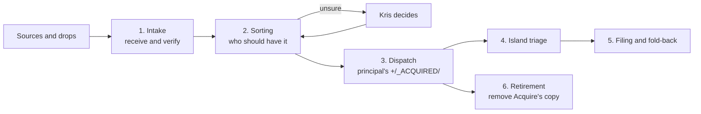

# Acquisition Process

## Overview

The Acquisition Process is the operational picture of how material from AI sessions, meetings and other external sources enters an island faithfully, is harvested into durable knowledge, and eventually leaves its transient source. It applies [ADR-KI-PRINCIPAL-001](../../../../../Admin/Governance/Decisions/ADR-KI-PRINCIPAL-001-provider-neutral-knowledge-acquisition.md) to Acquire's model as simplified on 20 October 2026. Earlier observations below remain historical evidence, not current storage requirements.

Acquisition is not session archiving. A source is visible because it holds transient working state; the destination is reviewed, durable island knowledge. Provider mechanics (MCPs, APIs, local parsers, export importers) sit below this boundary and belong to the repositories that own them.

---

## End-to-end flow

Acquire is **the port**, with one entry per source, in the sense of [GDR-KI-PRINCIPAL-010](../../../../../Admin/Governance/Decisions/GDR-KI-PRINCIPAL-010-the-port.md). It acts as a **sorting office**: material stages in the private `acquire` repository before whole packages reach the receiving principal. "Harbour" is the port's [Arcadian](../../../Realisation/Arcadia/Arcadia.md) register, the historical image of shipping between islands.

- **Sources and drops.** Material is born in a source: an AI session, meeting, message, voice note or photo. Where it cannot be read directly, Kris drops it in a holding place to wait for intake. A drop is not yet acquired.
- **1. Intake.** Acquire receives material faithfully and verifies it. The committed capture is the acquisition record; there is no separate ledger or intake receipt.
- **2. Sorting.** Acquire decides only who should have each item: the territory and receiving principal. It does not decide what matters, where it is filed or whether it changes a decision. Anything unsure goes to Kris.
- **3. Dispatch.** On Kris's instruction, the port delivers whole packages into the receiving principal's `+/_ACQUIRED/` only. Delivery is acceptance. The receiver's commit adding the package and Acquire's commit removing it are the only delivery record.
- **4. Island triage.** The receiving principal decides what each item is worth: file it, turn it into work or park it. Misdelivery is dealt with case by case; there is no return route to Acquire.
- **5. Filing and fold-back.** The receiving principal files what it keeps under its own Enactment Process and folds returning knowledge back into the notes it belongs to.
- **6. Retirement.** Acquire removes its copy after the delivered package's committed tree has been verified against the source package. This does not authorise retiring the provider-side source.

Acquire holds the provider-free territory context that sorting needs. It is also where Kris reasons about material across territories, which is why it belongs to Personal. Routing context describes territories independently of the source provider.

---

## Lifecycle stages

The ADR fixes six stages. Each has an owner for its mechanics; the receiving island owns acceptance of anything it keeps.

| Stage | What happens | Mechanics owner |
| --- | --- | --- |
| Discover | Content-minimised listing of what exists at the source | Provider MCP or adapter |
| Acquire | Faithful read of the original, before interpretation | Provider MCP or adapter |
| Stage | Preserve capture and provenance outside the receiving island | Acquire |
| Harvest | Interpret and promote reviewed knowledge into the island | Receiving island |
| Durable knowledge | Accepted notes in canonical zones | Receiving island, under its Enactment Process |
| Archive or delete source | Retire a staged copy or provider-side source | See [Source retirement](#source-retirement) |

Reusable provider-facing skills and their paired adapter surfaces belong to `ki-agentic-harness`.

---

## Evidence

Current mechanics are defined by Acquire's [capture entry point](https://github.com/krisb/acquire/blob/main/CAPTURE.md), [repository instructions](https://github.com/krisb/acquire/blob/main/AGENTS.md) and [dispatch guide](https://github.com/krisb/acquire/blob/main/docs/guides/operator/dispatch.md). Acquire keeps no ledger or intake receipts. The committed package records acquisition, and the receiver's addition commit with Acquire's removal commit records delivery.

### Historical observations before 20 October 2026

The two observations below explain the earlier staging model. The Granola ledger and migration manifest are historical evidence retained in Acquire's Git history at `aeb1ec4`, not live files to recreate. The former per-island staging location was retired on 10 October; the separate ledger and intake receipts were removed on 20 October.

**Export or API source: Granola, staged in the private `acquire` repository.** Since 2026-10-10 every Granola capture lands in `acquire` (`krisb/acquire`), consolidated from the inbound areas of the former per-island Ports.

- `.acquire/granola/ledger.json` (schema 3) records adapter, provider, hashed account identity, source-schema and identity-checkpoint SHA-256 values, the acquisition interval, `exhaustive`, per-window counts with response hashes, and per meeting the `document_sha256`, `detail_sha256`, `transcript_sha256`, transcript state, versions, folder ids, `acquired_at` and a harvest `disposition`.
- `.acquire/granola/migration/2026-10-10/manifest.json` proves the consolidation: the chosen source projection and hashes are retained exactly, historical memberships are kept, and a migration never fabricates source hashes.
- Each capture is a folder `captures/<territory>/granola/<date>--<slug>--<source_id>/` with `meeting.md`, `routing.json` and `source-variants/`. For example, `captures/humans-not-robots/granola/2026-06-24--hnr-company-fortnightly-update-in-teams--424a17fe-e8cc-4680-87df-a3db8f6eac72/`: its `meeting.md` carries `source_id`, `acquired_at`, `source_account_sha256`, `detail_sha256`, `transcript_state`, `transcript_sha256`, `transcript_observed_at`, folder membership and an explicit `omissions` list; `routing.json` records the primary repository, territories, disposition and original memberships.

**Direct local source: Claude Code sessions, via `mcp-housekeeping-claude` at read level.** `claude_code_sessions_discover`, `claude_code_sessions_list`, `claude_code_sessions_checkpoint` and `claude_code_session_read` are read-only. The checkpoint is content-minimised and writes nothing; per session it returns `id`, `sourceLocator`, `createdAt` (always null), `updatedAt`, `byteSize`, `status`, `archived` and `descendantIds`, under `schema`, `provider`, `repository` and `generatedAt`. The README in the `mcp-housekeeping-claude` repository is the tool catalogue.

---

## Provenance package

The ADR requires every adapter to preserve the fields below. This table records the earlier Granola and Claude Code observations, before the 20 October simplification; ledger references describe historical evidence, not a current requirement.

| Required | Granola (staged capture) | Claude Code (checkpoint and read) |
| --- | --- | --- |
| Original content | Yes: `meeting.md`, plus `source-variants/` snapshots | Via `claude_code_session_read` (a preview, head and tail); not staged |
| Source identity | `source_id`, hashed account identity | Session `id` and `sourceLocator` |
| Timestamps | `acquired_at`, `transcript_observed_at`, `meeting_date`; source `created_at` and `updated_at` declared omitted | `updatedAt` only; `createdAt` is null |
| Assets | `attachments`, `audio` and `recording` declared omitted | Not evidenced |
| Provenance | Ledger, account and schema hashes, `routing.json` | `provider`, `repository`, `generatedAt` |
| Declared omissions | Explicit `omissions` list per capture | Content is omitted by design at checkpoint level; no per-session omissions list |
| Content hash | `document_sha256`, `detail_sha256`, `transcript_sha256` | Absent (`byteSize` only) |
| Repository context | `routing.json` and the territory folder | `repository` field |

Absence is stated, not hidden: the Claude path has no content hash and no creation time, and nothing is staged. Whether those gaps are closed by the harness work is for that work to decide.

---

## Harvest checkpoint

A capture is safe to harvest when the staging record, as observed, holds:

1. Source identity and the account it came from.
2. Timestamps for acquisition and, where the source offers them, observation.
3. A content hash for each retained original.
4. A declared list of omissions.

The historical Granola ledger met this per meeting and kept a harvest `disposition` (for example `staged`). Current capture evidence belongs with the committed package; no separate ledger is required.

---

## Imperfect routing

Initial routing may be wrong and need not be perfect. Before dispatch, a whole package can move within Acquire without rewriting its source evidence. The receiving island decides what it keeps; delivery grants no authority to accept canonical knowledge. After delivery, misrouting is dealt with case by case, without an automatic return route.

---

## Source retirement

Acquire removes its staged copy only after dispatch has verified the receiver's committed package against the source package. The receiver's addition commit and Acquire's removal commit record the delivery. It does not wait for the receiving island's later filing or canonical decisions.

Archiving or deleting a provider-side source session remains **undecided**. Capture, dispatch or harvesting alone does not authorise mutating that source. Any later provider-specific safety decision belongs to the owning repository.

A downloaded drop, such as an attachments ZIP in a holding area, is removed only when every item has been verified at its destination. Originals committed to Git must also be pushed and verified there before the drop is removed, as Acquire's [ChatGPT drop procedure](https://github.com/krisb/acquire/blob/main/docs/guides/operator/chatgpt.md#zip-fallback-for-originals) describes. Partial or held drops stay.

Images stay in Git. Material held outside Git, including video, belongs in an explicitly bound external source store at the mirrored package path. This does not create a source-store binding or authorise moving a held drop: where a destination or verification is missing, retain the original and ask Kris.

---

## Observed gap

The earlier `tools-ki` and Claude Code observations above did not establish two source mechanisms staged through a common record. This amendment changes the staging wording, not those adapters or their evidence. The installed ChatGPT application's opaque local session cache reinforces the distinction between discovery, faithful raw acquisition, interpretation and retirement.
