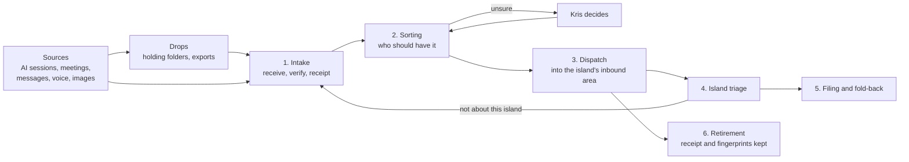

# Acquisition Process

## Overview

The Acquisition Process is the operational picture of how material from AI sessions, meetings and other external sources enters an island faithfully, is harvested into durable knowledge, and eventually leaves its transient source. It describes [[ADR-KI-PRINCIPAL-001-provider-neutral-knowledge-acquisition|ADR-KI-PRINCIPAL-001]] as observed in two local evidence sets, not as a new design. Where the evidence is thin, this note says so.

Acquisition is not session archiving. A source is visible because it holds transient working state; the destination is reviewed, durable island knowledge. Provider mechanics (MCPs, APIs, local parsers, export importers) sit below this boundary and belong to the repositories that own them.

---

## End-to-end flow

Acquire is the capability called ports: acquire is the port, with one port of entry per source. It is the single point where material enters the territories and leaves again for the island that should have it. Material goes into acquire and out of it in a coordinated form, in six steps. "Harbour" is the port's [[Pillars/Philosophy/Realisation/Arcadia/Arcadia|Arcadian]] register, the romantic, historical way of seeing it, because shipping carried things between islands.

- **Sources and drops.** Material is born at a source: an AI session, a meeting, a message, a voice note, a photo. Where it cannot be read directly, Kris drops it in a holding place to wait for intake. A drop is not yet acquired.
- **1. Intake.** Acquire receives the material faithfully, verifies it and writes a receipt. It decides nothing about meaning.
- **2. Sorting.** Acquire decides only who should have each item: the territory and its receiving principal. It does not decide what matters, where it is filed or whether it changes a decision. Anything it is unsure of goes to Kris.
- **3. Dispatch.** The port delivers whole packets into the receiving principal's `+/_ACQUIRED/` only, retires its copy once delivered and read back, and takes back returns marked by the island.
- **4. Island triage.** The receiving principal, which knows its own world far better than acquire, decides what each item is worth: file it, turn it into work, park it or return it.
- **5. Filing and fold-back.** The receiving principal files what it keeps under its own Enactment Process and folds returning knowledge back into the notes it belongs to.
- **6. Retirement.** Acquire retires its copy once the item is dispatched, as [[#Source retirement]] sets out.

Acquire holds the routing knowledge sorting needs, and it is also a place where Kris reasons with his material across all his territories, which is why it belongs to Personal.

---

## Lifecycle stages

The ADR fixes six stages. Each has an owner for its mechanics; the receiving island owns acceptance of anything it keeps.

| Stage | What happens | Mechanics owner |
| --- | --- | --- |
| Discover | Content-minimised listing of what exists at the source | Provider MCP or adapter |
| Acquire | Faithful read of the original, before interpretation | Provider MCP or adapter |
| Stage | Write the capture and its provenance into the receiving working area, with an incremental checkpoint | `tools-ki` (`ki acquire import --adapter <provider>`) |
| Harvest | Review the capture and promote reviewed knowledge into the island | The receiving island |
| Durable knowledge | Accepted notes in `Pillars`, `Resources` or `Calendar` | The receiving island, under its Enactment Process |
| Archive or delete source | Retire the transient source or staged capture | Acquire for captures; open for provider-side sources: see [[#Source retirement]] |

Reusable provider-facing skills and their paired adapter surfaces belong to `ki-agentic-harness`.

---

## Evidence

Two sources ground this note.

**Export or API source: Granola, staged in the private `acquire` repository.** Since 2026-10-10 every Granola capture lands in `acquire` (`krisb/acquire`), consolidated from the former per-island Harbours.

- `.acquire/granola/ledger.json` (schema 3) records adapter, provider, hashed account identity, source-schema and identity-checkpoint SHA-256 values, the acquisition interval, `exhaustive`, per-window counts with response hashes, and per meeting the `document_sha256`, `detail_sha256`, `transcript_sha256`, transcript state, versions, folder ids, `acquired_at` and a harvest `disposition`.
- `.acquire/granola/migration/2026-10-10/manifest.json` proves the consolidation: the chosen source projection and hashes are retained exactly, historical memberships are kept, and a migration never fabricates source hashes.
- Each capture is a folder `captures/<territory>/granola/<date>--<slug>--<source_id>/` with `meeting.md`, `routing.json` and `source-variants/`. For example, `captures/humans-not-robots/granola/2026-06-24--hnr-company-fortnightly-update-in-teams--424a17fe-e8cc-4680-87df-a3db8f6eac72/`: its `meeting.md` carries `source_id`, `acquired_at`, `source_account_sha256`, `detail_sha256`, `transcript_state`, `transcript_sha256`, `transcript_observed_at`, folder membership and an explicit `omissions` list; `routing.json` records the primary repository, territories, disposition and original memberships.

**Direct local source: Claude Code sessions, via `mcp-housekeeping-claude` at read level.** `claude_code_sessions_discover`, `claude_code_sessions_list`, `claude_code_sessions_checkpoint` and `claude_code_session_read` are read-only. The checkpoint is content-minimised and writes nothing; per session it returns `id`, `sourceLocator`, `createdAt` (always null), `updatedAt`, `byteSize`, `status`, `archived` and `descendantIds`, under `schema`, `provider`, `repository` and `generatedAt`. The README in the `mcp-housekeeping-claude` repository is the tool catalogue.

---

## Provenance package

The ADR requires every adapter to preserve the fields below. This table records what each source provides today.

| Required | Granola (staged capture) | Claude Code (checkpoint and read) |
| --- | --- | --- |
| Original content | Yes: `meeting.md`, plus `source-variants/` snapshots | Via `claude_code_session_read` (a preview, head and tail); not staged |
| Source identity | `source_id`, hashed account identity | Session `id` and `sourceLocator` |
| Timestamps | `acquired_at`, `transcript_observed_at`, `meeting_date`; source `created_at` and `updated_at` declared omitted | `updatedAt` only; `createdAt` is null |
| Assets | `attachments`, `audio` and `recording` declared omitted | Not evidenced |
| Provenance | Ledger, account and schema hashes, `routing.json` | `provider`, `repository`, `generatedAt` |
| Declared omissions | Explicit `omissions` list per capture | Content is omitted by design at checkpoint level; no per-session omissions list |
| Content hash | `document_sha256`, `detail_sha256`, `transcript_sha256` | Absent (`byteSize` only) |
| Repository context | `routing.json` and the territory folder | `repository` field |

Absence is stated, not hidden: the Claude path has no content hash and no creation time, and nothing is staged. Whether those gaps are closed by the harness work is for that work to decide.

---

## Harvest checkpoint

A capture is safe to harvest when the staging record, as observed, holds:

1. Source identity and the account it came from.
2. Timestamps for acquisition and, where the source offers them, observation.
3. A content hash for each retained original.
4. A declared list of omissions.

The Granola ledger meets this per meeting and keeps a harvest `disposition` (for example `staged`). This describes what was observed; it does not prescribe a checkpoint for other sources.

---

## Imperfect routing

Initial routing may be wrong and need not be perfect. A capture can move within the staging repository, or to another island, without rewriting acquisition evidence: `routing.json` and the migration manifest retain original memberships, and `source-variants/` keeps immutable snapshots. The receiving island decides what it keeps; a handoff grants no acceptance authority.

---

## Source retirement

Acquire retires its copy of a capture once it is dispatched, keeping the receipt and the fingerprints (the content hashes), so that acquire never becomes a second copy of everything the territories have dealt with. It does not wait for the receiving island to accept the item. A receiver may return anything that is not about it; the return comes back into acquire as a new acquisition, rejected knowledge, and goes through intake and sorting again.

Archiving or deleting a provider-side source session is **undecided**. Successful discovery, staging or harvesting alone does not authorise mutating a source. The threshold needs a later, provider-specific safety decision recorded in the owning repository's roadmap. A downloaded drop (such as an attachments ZIP in a holding area) may be deleted once every file in it is verified in Git and pushed, as step 8 of [`acquire`'s CAPTURE-CHATGPT.md](https://github.com/krisb/acquire/blob/main/CAPTURE-CHATGPT.md) sets out; provider-side sources (ChatGPT chats, Granola meetings) stay under the rule above.

---

## Observed gap

`tools-ki` `src/core/acquire/` ships only the `granola` and `chatgpt` adapters, so Claude Code sessions are evidenced at discovery and checkpoint level only, with no staged capture. This is an observation, not a design choice. A portable specification waits until two source mechanisms are staged through a common record. The installed ChatGPT application keeps an opaque local session cache, which confirms that discovery, faithful raw acquisition, interpretation and retirement stay separate concerns.
