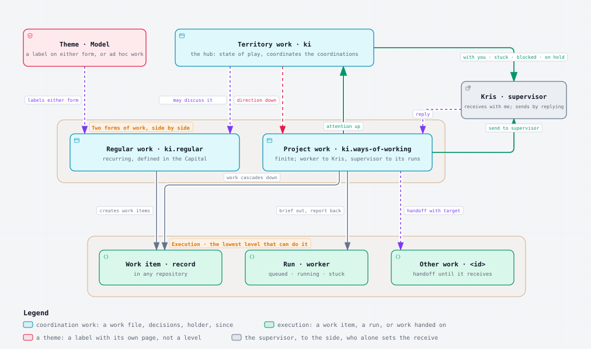

# Work Process

## Overview

The Work Process is how coordinated work moves through a territory: who holds it, how it passes between parties, how new work reaches it, where its state is kept and how it is shown. It is the one canonical description of the model that [GDR-KI-PRINCIPAL-009](../../../../../Admin/Governance/Decisions/GDR-KI-PRINCIPAL-009-the-work-model.md) decides. The harness standards and skills that govern coordination, delegation, the work package, forward work, Activities and recurring work cite this note rather than restate it.

The unit is work, in Kris's words "the unit is work, not a conversation". A piece of work is packaged as a skill is: a short definition saying what it is, what its goals are and what it takes, read first, and detail files, its state, its queries, its incoming messages and its own decisions, read only when needed. A chat session is only the channel through which a party works on it. The work outlives every session and is committed at every send.



Fallback, if the diagram does not render:

- Territory work `ki`: the hub, the state of play coordinating the coordinations
  - shows Kris with you, stuck, blocked and on hold
- Two forms of work, side by side beneath it
  - Regular work `ki.regular`: recurring, defined in the Capital, self-coordinating by default; state of play may discuss it; creates work items
  - Project work `ki.ways-of-working`: finite; worker to Kris, supervisor to its runs; territory work sends direction down and it sends attention up
- Theme `Model`: a label either form, or ad hoc work, can carry; not a level
- Kris, supervisor, to the side: receives with `with me`; Project work sends to supervisor, and Kris replies
- Execution, the lowest level that can do it
  - Work item: a record in any repository, created by either form
  - Run: a worker, queued, running or stuck; brief out, report back
  - Other work `<id>`: in handoff until it receives

---

## Levels and forms of work

Work lies at three levels. Kris named the two forms at the middle one: "regular work and project work. That's the two forms of work that happen, right?"

| Level | Id | What it does | Ends |
| --- | --- | --- | --- |
| Territory work | `ki` | The state of play: coordinates the coordinators, routes new work and stewards the method, executes nothing | Never |
| Regular work | `ki.regular` | The territory's recurring work, defined in the Capital's Activity notes; self-coordinating; creates work items in any repository; holds ad hoc work as `ki.regular.<slug>` | Never; rests On hold, more expected, between occurrences |
| Project work | `ki.<project>` | Coordinates one Project's work items and runs, and briefs runs | Finished when the Project closes |
| Work item | the record's id | One record in any repository, executed by a run or a person | `done` or `cancelled` |

**Regular work is self-coordinating by default.** It needs no coordination thread, in Kris's words "because it is sort of self-coordinating, but there's no reason why the state of play thread can't sort of talk about it". An occurrence is started by its schedule or by whoever needs it; state of play may discuss regular work but does not necessarily dispatch it. A Project's own recurring checks, needed only while it runs, stay with the Project and end with it.

**Coordination is an optional, explicitly opened session role on any valid work package.** The owner selects its scope and authority; a bounded episode names its end condition. Package existence, type, id, backlog size or a repository capability declaration never opens a coordinator automatically. Regular work remains regular during a coordinating episode, and individual captures and other bounded work remain conversational. An explicitly opened coordinator may brief detached runs within the package's existing authority and follows the responsive-coordinator rules. State of play specialises coordination across its explicitly assigned packages. Ending an episode does not itself change a mark, agree a hold, finish work or abandon runs.

**The theme is a label, not a level.** Regular work, Project work or an ad hoc piece of work may carry one. Each theme has a page in `Streams/Themes/` saying why it is a theme, what matters about it, its general direction and the guidance common to the work under it. It holds no work, has no holder and no session, and views group by it. No identifier carries a theme, so relabelling never renames anything.

**The cascade rule.** Work goes down to the lowest level that can do it, and coordination sits above execution:

- territory work coordinates regular work and Project work;
- regular work and Project work each send work items down to any repository; an explicitly opened coordinating session on either form may also brief runs and hand work to other work within its authority;
- only work items, done by runs or people, execute.

Attention comes back up: each level reads the work packages beneath it and rolls up the five views.

---

## Roles

Every handoff has a **worker** and a **supervisor**, and the roles are relative to that handoff:

- for any explicitly opened coordinating session, the coordinating agent is the worker and Kris is the supervisor;
- for a run, the coordinating agent is the supervisor and the run is the worker;
- so a coordinator is worker to Kris and supervisor to its runs at the same time.

A stuck worker comes back to its supervisor: it sends the work back with a blocking query. Kris's own work, while the work lies with Kris, may be to read a report, answer a query or edit a document directly.

The **holder** is the party the work lies with now, derived from the state and the two roles and named `owner`, `agent`, `run/<name>`, `work/<id>`, `person/<handle>` or `repo/<name>`.

There are two moves, and only the holder may make either: to **send** puts the work into handoff to a target, and to **receive** takes it out of handoff and makes it with you. A message mid-run is a steer and moves nothing. Putting work on hold and taking it off are agreed rather than sent.

---

## The seven states

Kris named four kinds of state: "It's either with someone or it's been handed off to someone or we've agreed effectively that it's like on hold ... or we can say it's done, at which point that area is concluded." The seven states take those kinds and the role words.

| Kind | State | When | Whose move |
| --- | --- | --- | --- |
| with someone | With worker | any item with a run, or the coordinator mid-turn | worker |
| with someone | With supervisor | the supervisor has received it | supervisor |
| handed off | Handoff to supervisor | the worker has sent, and the supervisor has not received | supervisor |
| handed off | Handoff to worker | the supervisor has replied, and no session has yet received it | worker |
| handed off | Handoff to `<target>` | sent to other work, a run or a person | target |
| on hold | On hold, paused or more expected | agreed and drained: nothing running, queued or in handoff | nobody until its release |
| done | Finished | closed | nobody |

Only the supervisor's receive and the hold are set; every other state is derived from where the work's items lie.

**On hold.** On hold sits between with someone and Finished: the work is not moving, nobody owes a move, and it is not over. It has two reasons:

- **paused**: the work waits while other work goes on, with a named release condition, such as "after the harness migration" or "when Kris says resume";
- **more expected**: the work is done for now, and new work arriving releases it. Regular work rests here between occurrences, and a Project may rest here between waves.

A hold is agreed only from With supervisor: the supervisor says `pause` or `done for now`, and a worker may propose one in its send. The worker then **drains**, letting a run that will finish within about 15 minutes finish, stopping any other at a safe point with where it stopped recorded, and launching nothing new; a drain that cannot finish leaves the work With worker, blocked. The move into On hold is a mark: every repository the work touched is committed and pushed fast-forward, each open query is parked in the queries file with its tag, one line of context and its recommended option, the state file records `state: on-hold`, the reason, the release and since, decisions are struck and the working area tidied. `resume`, or the release condition being met, or new work arriving for more expected, moves it to Handoff to worker; `finish` moves it to Finished.

**Stuck and the heartbeat.** A heartbeat runs only while work lies with a worker: an update on change, at least every 5 minutes and always by 10. A worker's item that has neither moved nor beaten for 10 minutes is stuck; nobody sets stuck. Work with the supervisor is never stuck, only older, so with you is listed oldest first. On hold has no heartbeat, and a paused hold older than 31 days is flagged.

**The same machine one level down.** A work item's record already carries the states in its `status` and `horizon`, so it needs no new fields:

| Work state | Record |
| --- | --- |
| With worker | `in-progress` with horizon `now`, or `draft` while it is being planned |
| Handoff to supervisor | `awaiting-review` |
| With supervisor | `triage`, or `draft` awaiting approval |
| Handoff to worker | `ready` |
| Handoff to `<target>` | `blocked_by` an open record, or horizon `hold` with reason `waiting-for` |
| On hold, paused | horizon `hold` with reason `parked` |
| Finished | `done` or `cancelled` |

Done for now exists only at the work level: a record is finite, and more work is a new record.

---

## Words

| Term | Meaning |
| --- | --- |
| work | the unit: territory work, regular work, Project work or a work item |
| work item | one record, executed by a run or a person; "task" is fine in speech |
| theme | a label on work, with its own page; holds no work |
| work package | one piece of work above a work item, packaged as a skill is: five files, the definition read first and the rest when needed; not the project-management sense, the lowest deliverable of a breakdown, which here is the work item |
| work folder | `+/_WORK/<id>/`, the place a work package lives |
| work file | `work.md`: the definition, what the work is, its goals and its scope, with the routing description in its front matter |
| state file | `state.md`: where the work lies, its state fields, now, next steps and held work |
| queries | `queries.md`: every open and parked query in full |
| messages | `messages.md`: the work's inbox, one line per message, taken as a queue in priority order |
| logbook | the Git history of a work folder |
| decisions | `decisions.md`: Kris's decisions about this work not yet durable elsewhere |
| route | State of play's placing of a new unit of work in one work's messages |
| refresh | a line telling a work that the method it last read has changed |
| worker, supervisor | the two roles of one handoff |
| holder | the party the work lies with now, derived |
| handoff | in transit to a named target |
| send, receive | the two moves |
| On hold | the agreed state; "hold" means nothing else |
| paused, more expected | the two reasons for On hold |
| release | what ends a hold: a named condition, or new work arriving |
| drain | the activity on the way into On hold, never a state |
| Finished | closed |
| with you, stuck, blocked, moving, on hold | the five views, by holder |
| `with me`, `ack`, `got it`, `seen` | the supervisor's receive |
| `pause`, `done for now` | the supervisor's receive that agrees a hold, with its reason |
| `resume`, `finish` | the supervisor's moves off hold and to Finished |
| working area | `+` inbound and `-` outbound; not canonical, history not durable |
| mark | the point at which decisions are struck and the working area tidied |

The words are agreed to be proven in use, in Kris's words "We probably just need to see how it comes out in use".

---

## Homes

**The work package and its folder.** Each piece of work above a work item is a work package, and it lives in one flat folder in the working area, `+/_WORK/<id>/`, the work folder, named by its dotted id. A work item has no package: its record is its home. Runs keep hyphenated slugs. Kris named it: "work should have a package idea and it should be clear about what its goals are and maybe a description to help things route it, so we've got that kind of progressive reveal capability".

**One real home.** The territory's principal (Capital) is the default package home. Territory and Project work stay Capital-homed; existing deliberately owner-approved regular and ad hoc member-repository homes remain valid, including Acquire intake. A member exception is declared in the real work file's Scope and made discoverable through its parent State of play's existing `covers` and a prose home reference in the parent's Scope, naming repository identity and work id. This reference is discovery, not another package, state or inbox, and grants no cross-repository authority. There is no general Project-home exception or package move in this rule. Exact automated interpretation belongs to the owning readers; an inaccessible or ambiguous home is surfaced through the existing route, never guessed or silently omitted. Forwarding requires separate design.

A work package has exactly five files, all created with it, so that a reader never meets a missing file and another work can queue a message from the start. Run reports, open briefs and design papers sit beside them.

| File | Holds | Read |
| --- | --- | --- |
| `work.md`, the work file | the definition: identity, supervision and a routing `description` in front matter, saying in a few sentences what the work does, what it takes and which neighbouring works it is not for; a body of Goals, linking upward to the Project note's outcome, the Activity note or the Charter, and Scope, naming what is in and what belongs to which other work | first, by routing and by any new session; changed rarely |
| `state.md`, the state file | where the work lies: the state fields the Observatory reads, below, and the method revision the worker last read, in front matter; a body of Now, Next steps and Held work with its release, with territory work's ordered queue | by the worker at pick-up and at each move |
| `queries.md` | every open and parked query in full, with its Context, Query and Options; the owner report's Queries are rendered from it | by the worker at pick-up |
| `messages.md` | the inbox: one dated line per message from other work or State of play | by the worker at each wake |
| `decisions.md` | Kris's decisions about this work not yet durable elsewhere | by the worker at pick-up |

Nothing in the package is a log. History stays in Git and the run reports: there is no moves list, because each move is a commit, and evidence such as commit identifiers and test counts lives in the report and the commit, not in the state file. Splitting definition from state splits the logbook usefully: `git log -- work.md` is the history of what the work is, and `git log -- state.md` the history of its moves. `ki-work-package` owns the exact form of each file, their front matter and their limits.

**The inbox is a queue.** A work's incoming messages are taken in priority order, and the worker may group similar items so that like work is done together. A line added at the top and marked important must be taken first, in that order; that is how State of play changes the way a work works. Other work and State of play write into a package only by adding a line to its `messages.md`, or replacing their own line not yet acted on.

**Canonical and working.** `Streams/` holds only definitions and records: Project notes flat in `Streams/Projects/` with a `theme:` key, theme pages in `Streams/Themes/`, and work items in `Streams/Roadmap/`. Everything that churns, the work package, reports, briefs and design papers, stays in the work folder. Links point upward: the work file names its Project; the Project note does not link down. Briefs sit in `briefs/<run>.md` while their handoff is open. The run state folder, `~/.local/state/ki/agents/<slug>/`, holds only runtime state.

```text
Streams/
├── Streams.md
├── Themes/                                holds no work
│   ├── Themes.md
│   ├── model.md                           theme page: why a theme, what matters, direction, common guidance
│   ├── foundations.md
│   ├── rig.md
│   └── techne.md
├── Projects/                              flat, one note each, theme: key
│   ├── Projects.md
│   ├── ways-of-working.md                 theme: model
│   └── ...
└── Roadmap/                               work item records
+/
├── _WORK/                                 one flat folder per live work package
│   ├── ki/                                territory work, the same five files
│   ├── ki.regular/                        regular work, the same five files
│   ├── ki.ways-of-working/                Project work
│   │   ├── work.md                        definition: description, Goals, Scope
│   │   ├── state.md                       state fields, Now, Next steps, Held
│   │   ├── queries.md                     open and parked queries in full
│   │   ├── messages.md                    inbox, a queue in priority order
│   │   ├── decisions.md
│   │   ├── <run>.report.md                until its outcome is homed
│   │   ├── briefs/<run>.md                while its handoff is open
│   │   └── design/                        design papers
│   └── ...
├── _TRADES/
└── diagrams/
```

**Git is the logbook.** `git log -- +/_WORK/<id>/` is the history. Every session commits each completed unit by explicit path before its turn ends, under [Committing the work folder](https://github.com/knowledgeislands/ki-agentic-harness/blob/main/skills/change-management/ki-coordination/references/standards-coordination.md#committing-the-work-folder), which owns the commit and sync cadence. Move commits carry the move in their subjects: `docs(work): ki.ways-of-working send to owner`, `docs(work): ki.ways-of-working receive by owner`, `docs(work): ki.ways-of-working hold, paused`.

**Shared history is never rewritten.** A rewrite breaks every clone and every revision link and needs a force-push. Instead, the working area is pruned at every mark, a finished work folder is deleted at the mark that closes it with Git keeping it, and a separate working repository is considered only if clone size or `git log` speed measurably hurts.

---

## Routing and stewardship

**State of play routes.** Territory work, State of play, is the single dispatch coordinator. Every new unit of work without a clear owner comes to it: an owner dump, a handoff with no owning work, a cross-work item whose owner is unclear, and every method improvement, whether Kris pastes it there or another work sends it as a line in State of play's messages. A unit that already has an owner goes direct: a work's own follow-ups, an item in a record that names its work, and a reply to a message never pass through the hub.

State of play matches the unit against each work's description and, where two match, their Scope, chooses one work and adds one dated route line to that work's `messages.md`. It keeps no copy of the register, which `ki work status` derives from the work packages. Where nothing matches, it proposes to Kris either a new piece of work or a record captured through `ki-next`.

**A routed work cannot reject.** In Kris's words, "once it's given it, it has to do something with it, it can't reject it, it can then say it wants it to be given to someone else ... we have to be careful about things just [bouncing] in between things". The receiving worker acts on each line at its next wake and does what it can with it: what its existing authority covers goes into its next steps, and what needs Kris's authority, capacity or a change of scope becomes a query. It gives back to State of play only the part it judges is not its own, with a reason. A unit is returned once; if State of play cannot place it elsewhere, it goes to Kris as a query rather than round again. Routing confers no authority to execute: owning a unit means owning what is done with it.

**Held work keeps its hold.** A line routed to work On hold, paused, waits in its messages without waking it, and State of play shows the count. Work On hold, more expected, is released by the new work arriving, under the usual release.

**Packages are tended independently of active coordination.** The acknowledged package steward owns its disposition, incoming messages and tidy work within existing authority; no permanent coordinator or new steward field is required. The parent State of play maintains discovery for its assigned regular, ad hoc and Project packages, including member homes, and checks coverage and home references at opening, an approved move, bootstrap and ordinary tending. It surfaces missing ownership, stale or unreachable homes and unread or blocked messages without taking over execution, releasing holds or moving marks. Handover remains explicit and acknowledged, and findings go to the one real inbox by an authorised existing route.

**State of play stewards the method.** Every work tries to improve continually, and State of play coordinates it: it watches for improvements, and every work sends a proposed improvement to the method as a line in State of play's messages. State of play dispatches each improvement as small regular work or into the Project it most affects; a significant change revives the Ways of working Project, or a more targeted Project under the Model theme. While the method is being defined, Ways of working writes refresh lines straight into the live works' messages; afterwards State of play sends them.

**Refresh is targeted.** Each state file records the method revision its worker last read. After an approved method change lands, the sender adds one dated refresh line only to the works the change affects whose recorded revision predates it, linking the standard at its revision and stating the practical effect in a sentence. A sender may replace its own refresh line not yet acted on, keeping every pending effect, so changes coalesce. The receiver rereads the method at its next safe point, before launching further work, and records the new revision; that record is the confirmation, and no acknowledgement is sent. Held work is not woken; the line waits.

---

## Decisions life cycle

`decisions.md` stays apart from the logbook: a re-bootstrap must read the live decisions whole, and Git history cannot be struck.

- **Logged:** a decision Kris makes about this piece of work, in Kris's words, in the turn it arrives.
- **Not logged:** a relay from other work, which is a receive; an instruction to other work, which is a send; an operational event such as a push, a restart or a drain, which is a move. These are commits.
- **At each mark:** each entry is checked against its durable home and then struck, when a standard, skill, note, record, Decision Record or commit wholly carries it; reduced to a one-line pointer (tag, Kris's date, link), when it still governs live work whose home is elsewhere; or kept. A struck entry leaves no stub, and entries carry no running numbers.

---

## Banner

A report shows its state in rich text. The heading's glyphs come first and the last glyph is whose move it is: 🤖 an agent, 👤 Kris, 🎯 a named target, ⏸️ nobody until the release, 🏁 nobody. A settled state shows its holder's glyph alone: `🤖 With worker`, `👤 With supervisor`, `⏸️ On hold`, `🏁 Finished`. An arrow appears only in a handoff state, pointing to whose move it is: `🤖 → 👤 Handoff to supervisor`, `👤 → 🤖 Handoff to worker`, `→ 🎯 Handoff to <target>`. The heading gives the state in role words; a line of counts follows; then the list `- [state] what · holder · since`. The counts and lists say "with you", because they are views by holder. The report's form line takes the same prefix, as in **🤖 → 👤 Handoff to supervisor · Summary at 23:52 BST · last mark 22:34 BST**.

Every banner closes with one plain Markdown thread line, after a blank line following the list: `🧵 Coordination thread · <label> (<id>)` for Project work or `🧵 State of play thread · <label> (<id>)` for territory work. Use the exact work label and id from `work.md`; a run report uses the work it reports to. The thread line closes every state, including handoff, On hold and Finished, and replaces all copyable send and resume lines. No banner, handoff or hold report emits a send or resume prompt or a paste instruction.

An example of work with its worker:

> ### 🤖 With worker · since 23:41 BST
>
> 🤖 2 running · 👤 1 with you · ⛔ 1 blocked
>
> - [running] work-model · run/work-model · since 23:20
> - [with you] WORK-HOME · owner · since 22:58
> - [blocked] thread commit · repo/ki-principal · since 22:40
>
> 🧵 Coordination thread · KI > Model > Ways of working (ki.ways-of-working)

And on hold:

> ### ⏸️ On hold · paused until the harness migration lands · since 00:10 BST
>
> ⏸️ drained · 🅿️ 9 queries parked
>
> - [parked] 9 queries in `queries.md`
> - [release] after the harness migration lands, or `resume`
>
> 🧵 Coordination thread · KI > Model > Ways of working (ki.ways-of-working)

An On hold banner lists nothing waiting: no "with you", running or per-repository status item. Its items are only `[parked]` and `[release]`; what each repository did stays in the hold report's Done. The standing authority to push everything stacked on `main`, including other sessions' commits, follows [Pushing beneath other sessions](https://github.com/knowledgeislands/ki-agentic-harness/blob/main/skills/change-management/ki-coordination/references/standards-coordination.md#pushing-beneath-other-sessions).

The other headings follow the same form: `👤 With supervisor`, `🤖 → 👤 Handoff to supervisor`, `👤 → 🤖 Handoff to worker`, `→ 🎯 Handoff to <target>`, where the target is other work, a run or a person, `⏸️ On hold · more expected` and `🏁 Finished`. A stuck worker's send reads `🤖 → 👤 Handoff to supervisor · blocked`. The closing thread line identifies the work; its work package governs picking it up and lifting a hold. The hold report keeps its name and its Done, Parked and Left over sections.

**Answers.** An owner report carries no copyable reply block. Each query keeps its Context, its one-sentence Query and its lettered Options, the recommended option first with its confidence. Kris answers in speech; the worker reads each answer back as taken in the decisions log and asks one line where an answer is unclear.

---

## Observatory fields

The Observatory reads work state only through the `ki` command surface: `ki work status --format json`, schema `ki/work-status/v1`, one entry per work package in each selected territory. It reads the state fields from `state.md`, and from `work.md` in a folder not yet migrated to the package, so its output is the same for both. Paths are repository-relative.

| Field | Meaning |
| --- | --- |
| `identity` | the registered repository holding the work package |
| `id` | the dotted work id, such as `ki.ways-of-working` |
| `level` | `territory`, `regular` or `project` |
| `title` | the display title |
| `theme` | the theme label, or null |
| `worker`, `supervisor` | the two parties, such as `agent` and `owner` |
| `state` | `with-worker`, `handoff-to-supervisor`, `with-supervisor`, `handoff-to-worker`, `handoff`, `on-hold` or `finished` |
| `hold` | while on hold, `reason` (`paused` or `more-expected`) and `release`, the condition in words; else null |
| `holder` | the party it lies with now |
| `role` | the holder's role, `worker` or `supervisor`, or null for another target |
| `target` | the named target while in handoff, else null |
| `blocking` | true when a worker has sent back with a blocking query |
| `since` | UTC time of the last move |
| `received` | UTC time of the supervisor's receive, or null |
| `beat` | UTC time of the last heartbeat while with a worker, or null |
| `path` | the repository-relative path of the file holding the state fields, `state.md`, or `work.md` before migration |
| `items` | each item below it: `id`, `kind`, `holder`, `role`, `state`, `target`, `blocking`, `since` |

The five views are derived by stated rules: **with you** is every work or item whose holder is `owner`, oldest `since` first; **stuck** is a worker-held item whose later of `since` and `beat` is more than 10 minutes old; **blocked** is `blocking` true or the roadmap's own blocked signal; **on hold** is `state` `on-hold`, a paused hold flagged after 31 days; **moving** is the rest. Work items are read through the Observatory's existing roadmap read and need no new field.
